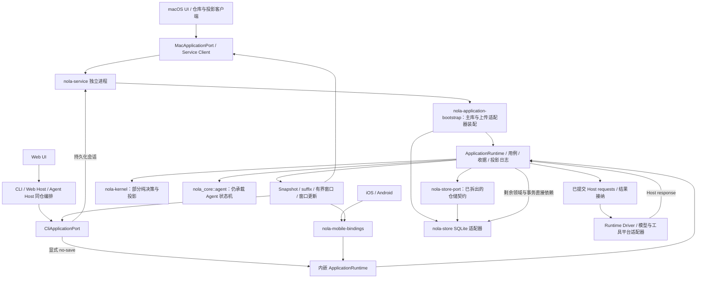

> **单版本开发约束：Nola 仅有一个未发布的内部开发版本。只保留当前架构、接口、协议和数据格式；删除旧版本兼容层、旧字段别名、双读/双写、兼容回退及历史数据迁移/转换代码，不为旧接口保留实现。文中历史兼容或数据转换计划不再执行，历史记录不构成保留旧实现的要求。不匹配的协议或存储格式明确拒绝；不得自动删除、重建或改写用户数据。当前版本的会话恢复、事务回滚和外部服务协议适配不属于旧版本兼容。**

# V2 当前架构核对：2026-09-08

基线：`ARCHITECTURE_V2.md`、`V2_REFACTOR_HANDOFF_2026-09-08.md`、
`V2_CHUNKED_TRANSCRIPT_PUBLICATION.md` 与当前未提交工作区。
本次先核对运行入口、依赖和事务，再确定实施顺序；不是全平台验收完成报告。
已有工作区修改保留，不重建用户数据库。

## 本次架构复核入口（2026-09-09）

按当前源码复核，整体仍是迁移中的架构，不能按 crate 名称判定 V2 已完成：

1. `nola-service-client` 的生产依赖仅有 Protocol、序列化与传输库；
   `nola-application-bootstrap` 负责装配 Application 与 SQLite Store。
2. `ApplicationRuntime<R>` 使用聚合仓储接口，但实际提交仍调用
   `AgentCore::restore/try_new/submit_at`；`nola-runtime-driver` 已改为通过
   `nola_legacy_agent_adapter` 接触旧 Core，运行态所有权仍未迁移。
   Kernel 目前包含投影、admission、正文绑定、工具批次、权限规则和压缩规划/重试算法，
   模型完成主分支、Turn 输入/完成/取消选择及条目 token 估算也已接入 Kernel；
   完整状态所有权、命令处理及事件/Effect 装配仍在旧 Core。
3. CLI 的会话包装已走 Application Port，但同一包仍承担交互客户端、Web transport、
   Host 执行与恢复协调。权限无输入恢复和当前 Run 启动规划已接通，持续 Supervisor 尚未完成。
4. Android `NolaDatabase` 仍包含计划任务与执行结果领域表，
   `ScheduledActionRepository` 仍调用对应 DAO 写入；此处需要迁移所有权，不能只改类名。

实施顺序：在已闭环的权限恢复及当前 Run 启动规划上，继续补齐 Run/Attempt 与 Supervisor
生命周期、旧 Core 决策和 CLI/Host、Android 领域所有权。每段都保持同一 Application 事务提交
checkpoint、事件、Effect 与 receipt，并删除被替代的算法或写入路径。
§20 的五端投影一致性、真实取消/重启、四种权限 scope、真实模型和 10M UI/性能门槛
仍需分别验收。后文历史测试不是本次重新执行结果；本次新增入口以新的整合记录为准。

## 最新进度：独立 DelegatedInvocation 与 typed 投影归属（2026-09-09）

外部 invocation 现有独立 UUID、领域状态/CAS 及同事务持久账本，不再缺少正式归属。
Application 准入校验与 Host UUID 回传、冷恢复、Store retained delivery、Kernel typed
projection owner及 Mac/FFI 解码已接通。ModelAttempt与外部Invocation不能相互冒用。
旧Core恢复配置中的动态session仅从规范账本取得证明，冻结配置未改。
Store schema18、Service协议15采用硬切换；未转换用户数据库。

实现与真实测试范围见[独立Invocation账本](V2_DELEGATED_INVOCATION_LEDGER_2026-09-09.md)。
permission control投递证据、持续Supervisor/lease、未知副作用恢复、完整Core与
CLI/Android所有权和§20验收仍未完成。下文历史“尚缺invocation账本”以本节为准。

## 最新架构复核：delegated 执行提交与恢复边界（2026-09-09）

主路径仍是 Client → Application → 领域决策/旧 Core 适配 → Store 同事务提交 →
Runtime 派发已提交 Effect → Host 执行 → Application 接受响应。Service Client 已独立于
Store，Application 与 runtime-driver 已脱离旧 Core 的直接生产依赖，但仍通过明确的
legacy adapter 使用旧状态；因此 crate 拆分不等于状态所有权迁移完成。

本次接入 delegated 每事件提交 ACK、首次 Accepted 的持久化准入与 worker 生命周期回收。
冷恢复只有旧 cursor 而没有原 worker 时，记录 WorkerUnavailable，保留原请求/Effect，
不重发原输入。Codex/OpenCode 的已有 session 恢复失败不再退回新建 session。权限 RPC
保留原 requestID/callID，Core 保存 conversation grant，Host 仅批准本次 provider 请求。
新持久化状态采用 Store schema17、Service 协议14；未转换用户数据库。

这仍不是正式 DelegatedInvocation 账本：不透明外部调用不能写成可观察模型 Attempt。
后续需补独立 invocation 身份、生命周期、投影 owner 和权限控制投递证据；然后继续持续
Supervisor/lease、Kernel 完整状态所有权、CLI/Android 领域写入迁移及 §20 全平台验收。
delegated 实际进程专项7/7通过，完整范围及剩余边界见
[Delegated 提交边界](V2_DELEGATED_COMMIT_BOUNDARY_2026-09-09.md)。

## 最新进度：正式模型 Attempt 账本与采样准入（2026-09-09）

直接 ModelStream/Compact 的初始 Prepared Attempt 现与 Begin 同事务创建；实际每次
采样在 HTTP 前提交 Running，retry/fallback/纠正/冷重采样创建独立后继 Attempt。
Domain/Kernel 决定生命周期，Application 原子提交账本、Part、checkpoint/outbox 与
receipt。结果及投影绑定真实 Attempt，旧 request 别名和无身份 reset wire 已删除。
Store schema16、Service协议13采用硬切换；未转换或删除用户数据库。

真实测试额外定位并修复后继 Turn 占位消息缺失、Supervisor 整请求覆盖账本身份两处
生产缺口。Application281、Kernel81、Core Host70、CLI Host93、Runtime Driver3、
LLM实际HTTP11、Host→App retry3/fallback1、Service两次重启1项通过。
完整范围与日志见 [模型 Attempt 账本](V2_MODEL_ATTEMPT_LEDGER_2026-09-09.md)。

这不是完整 V2 完成：delegated invocation/内部隐藏采样、持续 Supervisor/lease、
完整 Core 与 CLI/Android 所有权、配置/Device 重绑定及 §20 五端、真实模型和性能门槛
仍待完成。后文历史“尚无Attempt账本”的描述以本节为准。

## 上一阶段：Host 响应提交握手与重试隔离（2026-09-09）

Host emit 现在返回接受结果，拒绝立即阻止后续物理执行，Runtime 保留 Application 原始
错误；LLM checked 回调将提交拒绝与 provider 重试分类分开。模型 retry/fallback/协议
纠正先持久化流重置，成功后才清缓冲、换 Part ID 并重新请求。普通 Application execute
也强制提交该边界，不能用热状态确认重试准入。

Application279、Runtime Driver3、Host93、真实HTTP checked3及完整Host→进程内App2
全部通过，全目标编译通过。见 [Host 提交边界](V2_HOST_ACCEPTANCE_BOUNDARY_2026-09-09.md)。
这只是完整 Attempt 的前置条件：当前 RunAttemptId 仍映射 request ID，无独立账本或
activeAttemptID；下一步需区分逻辑调用、物理采样和 Effect 重投递，建立规范准入事务。

## 上一阶段：通用启动恢复决策迁入 Application/Kernel（2026-09-09）

Store 的历史 Turn 终态 SQL 推断和权限专例已删除。新恢复 Port 在同一写事务/receipt
savepoint 内读取当前事实、调用 Application/Kernel 规划并应用 Run 与 trace 变更；即使
scoped 恢复也核对 live lease。合法后继 Model/Tool 等 pending Effect 不被旧 Turn 终态覆盖。
Application 验证 checkpoint、配置和完整请求关系；Kernel 决定保留、结算或拒绝。
拒绝不修改规范状态，保留不自动重执行工具；终态 hot overlay 在事务提交后才移除。

最终 Application279、Kernel77、Store5、CLI3/HTTP2和真实 Service IPC1项通过，全目标
编译通过。详细边界、原子回滚、非 SQLite 注入和真实进程证据见
[当前 Run 恢复迁移](V2_RUN_RECOVERY_KERNEL_CUTOVER_2026-09-09.md)。
完整 Attempt/activeAttemptID、持续 Supervisor/lease/未知副作用恢复及 §20 仍未完成。

## 上一阶段：后继 Turn 的权限恢复（2026-09-09）

上一阶段定位的 Store Run / Core Turn 身份差异已接入实际恢复路径：resume SSE 顶层
`canonical_run_id` 绑定原规范 Run，trace/Core Turn 保留原身份；Mac 不再要求两者相等。
中间 Turn 完成不会结束恢复。匹配原 Run/submission 的最终会话投影必须先提交本地
Application，随后立即结束消费，避免提交后网络错误留下无法再次恢复的卡片。

回归同时发现并修复持久化遗漏：普通 Application execute 的权限运输中断必须立即落
checkpoint；启动维护需验证当前等待及其实际 Core Turn，不能用旧 Turn completed 事件
终结后继权限等待，也不能用 Core Turn ID 查询 Store Run。详细契约与证据入口见
[权限运输与调用](V2_PERMISSION_TRANSPORT_AND_CALL.md)，最终测试结果见交接末尾。

该阶段只覆盖权限恢复；随后通用启动规划已由上节迁出 Store。持续 Supervisor、完整
lease/Attempt 以及纯 Kernel 状态所有权仍需继续收敛。

## 上一阶段：模型完成与 Turn 决策（2026-09-09）

当前代码已将 `ModelCompleted` 主分支及重试计数、Turn 输入准入/排队、完成后当前轮与
下一轮输入的选择、取消目标选择迁入 Kernel。`AgentTurnStatus`、`ToolCallStatus` 唯一
定义归 Domain，Core 重导出原路径。`AgentItem::estimated_tokens` 只映射借用 facts，
Kernel 通过序列化计数器计算 JSON 字符数，不再先分配完整 JSON 字符串。

已有最终日志记录 Kernel 74、Application 270、Core Host 70 项通过。本次复核确认实际
调用已接线；详细范围见 [模型与 Turn 迁移](V2_MODEL_TURN_KERNEL_CUTOVER_2026-09-09.md)。
这些是 Rust 测试，不能代替真实模型、平台 UI 或整套 V2 验收。

本次发现需要优先验证的身份边界：真实 Application receipt 用例中，排队的下一轮会产生
不同 Core Turn ID，但仍属于原 Store Run；Mac 恢复流当前比较 `trace.turnID == expectedRunID`。
这两个 ID 不能假定恒等。该缺口已由上节的实际 Application→Host→恢复投影链修复与
回归覆盖，首次 Turn 恢复的旧结果不能单独作为后继 Turn 的验收证据。

完整 Core 状态/事件/Effect 类型、重复工具批次恢复、provider metadata 和工具曝光仍未
迁完；Application/runtime-driver 的旧 Core 生产依赖、CLI/Android 所有权及持续 Supervisor
仍是主要架构缺口。

## 上一阶段：上下文预算、用量和模型响应策略（2026-09-09）

ContextWindowConfig 的归一化/预算/provider 窗口更新，当前上下文与累计用量的数字会计，
摘要有效性检查及模型最终综合/文本暂缓/Goal 呈现策略已迁入 Kernel，Core 原算法副本删除。
Domain 持有相应事实和用量投影，Core 公开路径/JSON 保留。详见
[上下文策略 Kernel 迁移](V2_CONTEXT_POLICY_KERNEL_CUTOVER_2026-09-09.md)。
后续模型完成与 AgentItem 估算进度以上节为准；完整状态机、provider metadata、工具曝光
和 Effect 装配仍待迁移。

## 上一阶段：压缩规划与生命周期决策迁入 Kernel（2026-09-09）

实际 `request_compaction` 链路现调用 Kernel 的请求准入、目标预算、完整轮次选段、摘要预算
及空 archive 后续动作；ContextWindow 的触发、同 archive 重试、失败/无进展阻断也由 Kernel
决定。Core 只传条目种类、call ID、token 估算等事实并应用结果，不再保留这些算法副本。
Domain 持有压缩原因、重试记录与决策 DTO；checkpoint JSON 及既有公开导入路径保留。

该阶段之后的配置归一化、数字 usage 会计和摘要校验已由上节覆盖；AgentItem 估算、指纹、
压缩提示、完整 turn/model 转换和事件/Effect 装配仍在旧 Core。
详细边界与回归见 [压缩 Kernel 迁移](V2_COMPACTION_KERNEL_CUTOVER_2026-09-09.md)。

## 上一阶段：用户恢复入口与冻结执行身份（2026-09-09）

普通 CLI `--resume` 已在输入框前接入无输入恢复；Web/mobile 新增严格的四身份字段恢复
端点，Mac 接入独立恢复请求。预期 Run 使用规范执行身份，不能使用 trace run ID，
也不能从窗口是否有 running 活动推断 queued Run 是否存在。
Mac 通过既有 Service `active_run` 查询核对执行身份；该查询不加载完整会话。

热 Host 保留原执行配置，冷 Host 在 Provider 探测前核对随实际 Run 持久化的
HostInvocationBinding；配置、凭据或 Device 广告/resolver 不匹配时拒绝，保持原 ask。
服务启动维护保护 checkpoint/outbox 身份一致的权限等待，包含 Host Accepted 后退出。
恢复终态现发布原 Run 的规范会话投影，供客户端沿 Application 提交原消息完成状态。

Rust 最终验证已通过：CLI 入口/绑定 3、真实成功 handler 1、严格契约 1，Core Host 69
及上下文身份 2、Application 全量 268，workspace all-targets check。
Mac 新增恢复交互与迟到回应的原生测试最终 15/15 通过，具体范围和日志见交接文档。
这些 HTTP 测试使用 provider stub 和临时进程内 Application，不是真实模型或 Service IPC 验收。

仍待完成：任意原 Web 自选配置的冷启动解析、Device 重新绑定、持续 supervisor
wake-up/backoff、完整 lease 生命周期、纯 Kernel 与客户端所有权，以及 §20 全量验收。
只读 replay 仍不能重新建立 challenge；不能把上述专项通过等同于完整 V2 完成。

## 上一阶段：权限等待的持久化与 Host 重派（2026-09-09）

Custom 输入、typed transport 中断、原调用保留、后台同 task/Core ask 的 pending/resolved 交互复用已接通。Host 无输入恢复可重复 pump并绑定当前 resolver；新输入不会隐式取消 pending 权限。Core 重派发布新的规范呈现事件，保留原 call/参数；CLI 返回实际运行状态，Goal/后台不将 nonterminal 误判为完成。

真实 HTTP + 完整 Host + 进程内 Application 的恢复入口回归已通过，覆盖重复中断、冷 open、fresh canonical trace 与原工具只完成一次。具体测试范围与最终整合结果见交接文档和 [权限生命周期](V2_PERMISSION_TRANSPORT_AND_CALL.md)。schema 当前 15，默认拒绝不兼容用户库。

该阶段尚未接入的 CLI/Web/Mac 无输入恢复入口已由上节覆盖；持续 supervisor wake-up/backoff、完整重连/lease 生命周期，及纯 Kernel、客户端所有权和 §20 全量验收仍待完成。只读 trace replay 不等于重新建立权限 challenge，专项回归不等于五端真实模型验收。

## 当前架构总览（代码复核，2026-09-08）

本节作为阅读入口；下方“最新增量”保留阶段历史，旧阶段中的待迁移描述以本节及较新记录为准。
当前处于 **Application 仓储边界已接通、Agent 决策仍在逐步迁入 Kernel** 的状态。
不能把 crate 拆分完成等同于职责迁移完成。

```text
macOS / CLI / Web                   iOS / Android
  Service Client / transport         移动 FFI / 内嵌服务
                  \                 /
              Application Command / Projection
                            |
              ApplicationRuntime<R>
                 /                 \
      ApplicationRepositories     旧 AgentCore
                 |                 |       \
            Store Port             |     nola-kernel
                 |                 |     已迁移的纯决策
        SQLite Store adapter       |
                 |          checkpoint / events / effects
          canonical 数据库         |
                 \_________________/
                  receipt 事务提交
                            |
                 已提交 Effect → 执行适配器
                            |
                  Host Result → Application

bootstrap 负责选择具体 Store、打开主库并装配 Runtime。
此图表示业务调用和提交顺序；Runtime/Host 的完整独立分层仍未完成。
```

| 边界 | 当前代码事实 | 距离目标的缺口 |
| --- | --- | --- |
| Domain / Protocol | 领域事实与跨端命令、投影已有独立 crate | 旧 Core 仍持有部分运行态及协议类型，不能宣称统一类型迁移结束 |
| Kernel | 已接投影、admission、正文绑定、工具批次、权限规则、压缩、上下文会计、模型完成和 Turn 决策 | 完整运行态及事件/Effect 装配仍在旧 Core；权限风险分类仍由旧 Core 提供 |
| Application | Runtime、完整命令分发及收据用聚合仓库；业务 helper 使用对应 Port | 生产依赖已改为 Domain/Kernel/Port、Host Protocol 与 `nola_legacy_agent_adapter`；运行态仍是旧 Core |
| Store / bootstrap | SQLite 实现 Port；bootstrap 选择具体类型，事务沿原连接提交 | 必须继续保持 checkpoint、事件、Effect 与 receipt 的同一事务，不可为迁移另开写入路径 |
| Service / Client SDK | Service 持有 Runtime；Service Client 仅依赖协议及序列化/传输库 | 完整五端故障时序一致性尚未验收 |
| Runtime / Host | 有独立 runtime-driver 和多种 Host 适配器 | runtime-driver 仅通过 legacy adapter 使用旧 Core；CLI 同包包含客户端、服务装配和 Host 职责 |
| Android | 内嵌服务链路已存在 | Room 的计划任务、执行结果等领域表及写入 Repository 仍存在，所有权尚未收敛 |
| 历史与呈现 | 有界窗口、正文引用、按需详情及恢复专项已接线 | 五端真实交互、10M 多会话切换帧时间/RSS 和截图门槛未完成 |

本次直接核对的代码入口：

- `core/nola-application/src/runtime.rs`、`repositories.rs`、`application_command.rs` 与 `lib.rs`：泛型仓库与实际 `AgentCore::submit_at` 调用。
- `core/nola-application-bootstrap/src/lib.rs`：具体 Runtime alias 与数据库装配；`core/nola-service/src/lib.rs`：共享 Runtime 与服务所有权。
- `core/nola-kernel/src/lib.rs` 与 `core/src/agent/runtime/`：已经迁入和仍留在旧 Core 的算法边界。
- 各 crate 的 `Cargo.toml`，以及 `cargo metadata --offline --no-deps`：确认 Application 的旧 Core 仅经 legacy adapter 进入生产图，具体 Store 仅为 dev-dependency。
- `android/.../data/local/db/NolaDatabase.kt` 与 `ScheduledActionRepository.kt`：Room 表及实际 DAO 写入，并非仅凭文件名推断。

### 后续重构顺序及验收依据

1. Custom 原调用恢复与客户端输入已接通；继续统一远程权限 transport 的超时、取消、跨客户端终态与冷恢复。超时不能冒充用户拒绝，live challenge 与规范投影需要明确身份及版本关联。保留现有 receipt 回滚和后继请求回归。
2. 沿真实调用迁移旧 Core 的决策：可信 capability 风险事实、权限生命周期，再到 turn/model/context/compaction。每次删除原算法副本，保留显式输入和可重放状态，不用空壳转发声称完成。
3. 收敛 CLI 的 Client/Host/装配角色及 Android 剩余领域存储，保持单一 Application 写入入口；不能以同一二进制运行作为越过协议的理由。
4. 按 §20 补齐四种权限 scope、OS/policy 分离、真实取消和跨进程长任务恢复，再完成五端投影、真实模型及性能/UI 验收。

交接记录中的最近测试基线是 Application 263/263 与 workspace all-targets check 通过。
本次架构梳理只复核代码、依赖并校正文档，没有重新运行这些测试；不将历史结果表述成本次运行。


## 最新增量：权限规则评估与作用域匹配迁入 Kernel

2026-09-08。六个权限事实 DTO 已归 Domain；Core RuleSet 保留薄适配，实际 tool_driver
规则评估现调用 Kernel。规则顺序、origin 过滤、匹配解释及路径/bash/wildcard 匹配没有旧 Core
算法副本。风险分类器仍在旧 Core，以显式事实传入 Kernel，未宣称整个权限系统纯化。

另修复 shell scope 两个真实边界：双引号内展开不能继承脚本前缀授权；普通字符前反斜杠
必须保留，不能把另一个脚本误认作已授权脚本。迁移契约、shell 反例及真实 once/conversation
收据与冷恢复验证见 [权限 Kernel 审计](V2_PERMISSION_KERNEL_CUTOVER_2026-09-08.md)。
最终 Application 263/263（0 失败/忽略）和 workspace all-targets 编译通过，所有句柄终态。

下一优先生产缺口已实证：Custom response 当前结束原调用，可能转模型或留下无 outbox 的
AwaitingTools，不满足 §20.2 原调用挂起与恢复。下一步处理该完整状态转换；不要用不授权/
不执行测试冒充这一验收。可信 catalog 风险契约、durable scope 执行层冷恢复、旧 Core 剩余
状态机、客户端业务所有权及全部性能/UI 验收仍待完成。工作区修改保留，完整目标未完成。

## 最新增量：工具批次 Kernel、显式时间与权限 origin

2026-09-08。本轮沿实际 Application→AgentCore→tool_driver 链路，将工具批次的选择算法
完整移至 `nola_kernel::plan_tool_batch`。Domain 仅传生命周期与 capability 事实，旧 scheduler
只做类型映射；没有新增第二份算法或按用户文本路由。

Application 的创建/提交/Host response 观察时间现显式传给 Core，Effect 创建和恢复不再在
reducer 内部读取系统时钟；standalone Core 的采时 facade 仍存在，不能据此宣称整个旧 Core 已纯化。
另修复同批权限重评隐式丢失 origin：scheduled/replay 的其他等待调用不能继承交互式
Conversation/Turn 授权，直接批准当前调用与 interactive 合法批量放行均保留。

验证：Kernel 4、Core batch adapter 2、权限 Core/contracts 19、真实 Application batch receipt 3
通过；最终 Application 全量 260/260、workspace all-targets 编译通过。
详细时间输入、持久化 Effect 身份、冷恢复和剩余权限分类边界见
[工具批次迁移审计](V2_TOOL_BATCH_KERNEL_CUTOVER_2026-09-08.md)。

下一步继续权限的纯规则/authority 决策契约及其真实调用；不能扩散旧工具名称分类器，
也不能把 scope 的路径/shell 语义顺手改掉。旧 Core 的 model/turn/compaction、客户端业务所有权
及 ARCHITECTURE_V2 §20 验收仍未完成。保留工作区所有修改，完整目标保持进行中。

## 最新增量：Runtime 解除具体 Store 生产依赖

2026-09-08。本节覆盖此前“Runtime 仍持有具体 NolaStore”的旧阶段描述。

Application 的实际 Runtime、完整命令 dispatcher、receipt、projection feed/journal 和上传分发
已统一为 `ApplicationRuntime<R: ApplicationRepositories>`。`nola_store` 仅保留在
Application dev-dependencies；普通依赖树中没有 Store/SQLite。具体类型由 bootstrap 选择，
Service、移动 FFI 与 CLI 都已接该装配 alias，writer 排他和原事务连接没有拆分。

本轮同时完成远程会话、恢复快照、SOP、branch、idle checkpoint、队列、trace、settings
及 Runtime 所需 metadata 方法的 Port 接入。独立恢复候选查询也纳入一致快照。
详见 [Runtime 仓库切换审计](V2_RUNTIME_REPOSITORY_CUTOVER_2026-09-08.md)，
含真实调用范围、专项验证与全量回归结果。修复 checkpoint-only 超大呈现读取后，
最终 Application 全量 256/256（0 失败/忽略）与 workspace all-targets check 通过。
旧 Core、客户端业务存储/所有权及 §20 完整
验收仍待完成，完整 V2 目标保持未完成。

## 最新增量：任务、计划、Model/MCP、自动化与历史编辑

2026-09-08。本节覆盖较早端口清单；完整 V2 仍未完成。未清理、提交或重建用户数据。

### 实际生产迁移

- RuntimeTaskRepository 与 WorkspaceOwnershipRepository：4 DTO、28 方法；任务命令/进度及五个 checkpoint/lease helper 泛型。公平 claim、重试和租约规则沿用既有事务实现。
- ConversationPlanRepository 与 WorkStepTransactionRepository：3 DTO；计划和步骤所有实际 helper 泛型，步骤推进与计划关联保持一个原子存储调用。
- ModelRepository 与 McpRepository：3 DTO；模型参数/替换、MCP 编辑和目录真实 helper 泛型，同步和 receipt 仍共享原连接。
- AutomationRepository：2 DTO、12 方法；定义/Run dispatcher 泛型。非 SQLite 验证 lease 身份传递、存储拒绝、retry 状态投影和未知状态拒绝。
- TranscriptEditRepository：编辑/删除 helper 泛型；复用已有 projection DTO。SQLite 提交 edit/delete 时新增同事务活跃 Run 与替换消息已知 Run 归属复查，避免仅依赖 Application 提前检查。失败不改变 revision、消息或 operation，合法操作仍可提交/冷重启幂等重放。

### 验证终态

| 范围 | 结果 |
| --- | --- |
| 最终 Application lib | 95/95，`/tmp/nola-business-port-app-final.log` |
| 最终 workspace all-targets check | exit 0，`/tmp/nola-business-port-workspace-final.log` |
| 任务/租约 | App task 4 + Store scheduling 8 + workspace 1；详见 `V2_RUNTIME_TASK_PORT_CUTOVER_2026-09-08.md` |
| 计划/步骤 | 新非 SQLite 2；生命周期/审批/步骤/receipt 8，`/tmp/nola-plan-step-port-final.log` |
| Model/MCP | 新非 SQLite 3；编辑、持久化及同步/事务原子性 16，通过子任务验证 |
| 自动化 | 新非 SQLite 2；真实 receipt 回滚/冷重放 1，Store 定义/Run/删除 3；`/tmp/nola-automation-edit-final.log`、`/tmp/nola-automation-port-receipt.log`、`/tmp/nola-automation-store-final.log` |
| 历史编辑 | 新非 SQLite 1（包含于 lib 95）；新 Store admission 1，App Run scope/输入验证 2；`/tmp/nola-transcript-edit-port.log`、`/tmp/nola-automation-edit-integration.log` |

自动化 receipt 故障测试证明 definition、sync outbox 与 receipt 同时回滚；重试成功、冷重放不重复 outbox。
所有本轮测试句柄已终态。中途跨 agent 文件暂态编译失败已由最终整合覆盖；未将 filter 下 0-test 结果计入专项通过数。

### 下一步具体边界

代码核对仍存在的具体 `NolaStore` helper：`remote_turn.rs`、`remote_projection.rs`、
`resume_snapshot.rs`、`sop_runtime.rs`，以及 `lib.rs` 的 full session projection、remote mirror、
canonical branch 与 idle submission。`application_command.rs` 仍有权限读模型、consistent-read 窗口、
设置 CAS、trace/task 查询、lease release 等直接调用；Runtime 字段仍为 `NolaStore`。

应先把这些真实调用纳入仓库能力，并保留窗口查询的一致快照和 receipt 单一 UoW，
再设计/接入 Runtime 所需的聚合仓库，移除具体 Store 生产依赖。不要以泛型参数或 trait 目录存在
代替这一整条调用链的切换。之后仍须继续纯 Kernel、客户端所有权及 ARCHITECTURE_V2 §20 全部验收。

## 最新增量：Run 创建、历史读取、Skill 与权限仓库端口

2026-09-08。本节覆盖下方旧阶段中相应端口“待开始”的描述。保留现有工作区修改，未提交、清理或重建用户数据库。

当前真实依赖可概括为：客户端经 Service/FFI 到 ApplicationRuntime；Runtime 仍持有具体
`NolaStore`，但普通/internal/maintenance Run 创建、Run Effect、历史读取/上下文/revert、
Skill 编辑/选择/可见性以及权限请求/规则投影的实际 Application helper 已改用 StorePort。
SQLite adapter 复用原连接，受外层 receipt Unit of Work 管理。主库打开由 bootstrap 装配。
这完成了部分业务用例的依赖倒置，并未消除 Application 对 Store 和旧 Core 的生产依赖。

| 本轮切面 | 实际变化 | 验证 |
| --- | --- | --- |
| Run 创建 | 5 DTO 与 RunCreationRepository；普通、内部、maintenance 创建真实入口泛型 | 非 SQLite 3、turn transaction 15、Store adapter 1、ledger 15、append sync 5 通过 |
| 历史与上下文 | canonical/history 与 projection 读 DTO 迁入 Port；full/page/window、restore、durable context、revert 真实入口泛型 | 非 SQLite 2、branch 3、bounded revert receipt 1、Application lib 85 通过 |
| Skill | 不可变正文版本、编辑目录、选择、内置可见性通过 SkillRepository | 非 SQLite 2、编辑 receipt 16、catalog 1、Store version 2 通过 |
| 权限 | 5 durable DTO 与 PermissionRepository；请求命令及 grant/rule helper 泛型，Core 保持规则评估责任 | 非 SQLite 2、请求/receipt 4、ledger 2 通过 |

权限新增真实 SQLite receipt 最终 UPDATE 故障测试：resolution 与 receipt 同时回滚，
请求保持 pending；同请求成功重试后，冷重启 replay outcome 相同。非 SQLite fixture
验证 typed input、干预指令去空白、错误传播、无效持久化状态拒绝和真实 Core 的有序规则评估。
这些专项不能替代 §20 的所有 scope、真实工具与 OS 权限验收。
本轮最终 `cargo check --workspace --all-targets --quiet` 通过（exit 0），日志
`/tmp/nola-port-integration-check.log`。所有本轮测试句柄已终态。
日志：`/tmp/nola-permission-repository-final.log`、`/tmp/nola-history-port-tests.log`、
`/tmp/nola-history-port-app-lib.log`；Run 创建详见 `V2_RUN_EFFECT_PORT_CUTOVER_2026-09-08.md`。

下一步按所有权收敛：先补齐 Runtime 尚直接调用的仓库能力和事务聚合接口，再移除其具体
Store 依赖；继续旧 Core 到纯 Kernel、CLI Host/客户端边界和 Android 业务存储迁移。
跨 Message 引用、五端权限/长任务/真实模型、10M 会话切换帧时间/RSS/延迟与 UI 截图仍需完成。
不可用目录中存在 Port 或局部测试通过来判定完整 V2 完成。

## 最新增量：实际历史详情交互与 RunEffect 端口

2026-09-08。本节覆盖前文“尚未接五端历史详情入口”及“Run/Checkpoint/Effect端口待开始”的旧阶段描述。
工作区全部保留，未提交、清理或重建用户数据库，完整V2目标仍未完成。

### 真实用户入口

macOS消息行详情sheet、iOS ChatBubble sheet、Android MessageBubble dialog、Web历史详情按钮
以及CLI `session part <conversation> <message> <part> <revision>`均已接通。
详情是独立只读状态，不替换canonical stream节点，不恢复工具/权限/Run；
owner/revision固定，失败可重试，迟到响应被丢弃，32768-byte之外的字段仍明确Deferred。
完整范围与验证见[历史详情交互](V2_HISTORICAL_DETAIL_INTERACTION.md)。

实际HTTP/CLI回归发现并修复了CLI通用startup recovery污染历史查询的问题：
显式Sessions/SessionShow/SessionPart跳过cleanup及orphan Run恢复预检；
SessionPart成功/失败读取均不增加receipt，窗口与原JSON不变，冷重启后查询相同。
Web还修复“先分页→打开旧行详情→分页返回”的竞态，应用新窗口前关闭旧详情。

**仍未完成的UI门槛**：浏览器完整点击与截图、原生视觉截图、移动真实UI点击到native库全链路，
以及超大原字段range下载交互。Browser技能初始化后可用浏览器列表为空，
没有以HTTP或Node状态测试冒充浏览器验收，也没有把原生单元测试计作完整UI验收。

### 主架构生产迁移

Run/Checkpoint/Effect的9个DTO已从具体Store迁入StorePort，9个实际Application helper改为
`RunEffectRepository`参数，Runtime两处checkpoint revision探测也走Port。
恢复投递在同一快照取得effect、canonical owner和checkpoint；transition仍使用原连接/savepoint，
不提前提交外层receipt UoW。非SQLite fixture调用真实Core与Application验证实际依赖倒置。
细节与当前Core session/canonical conversation独立身份域见
[RunEffect迁移审计](V2_RUN_EFFECT_PORT_CUTOVER_2026-09-08.md)。

### 验证终态

| 范围 | 本轮证据 |
| --- | --- |
| 最终Application整合 | lib83 + 非SQLite2 + turn transaction14全部通过；`/tmp/nola-run-effect-application-final.log` |
| Store/receipt边界 | Store adapter1、增强最终receipt失败回滚1、receipt unit3通过；见RunEffect审计 |
| 真实Service长流 | 2048 delta、RSS、terminal Core淘汰、replica接收端重启1/1通过；见RunEffect审计 |
| 全workspace编译 | all-targets check通过（子任务32980，exit0） |
| macOS | 新详情4 + 原投影10 = 14/14；`/tmp/nola-history-detail-mac-native.log` |
| iOS | 新详情2 + 原投影9 = 11/11；`/tmp/nola-history-detail-ios-final.log` |
| Android | 新详情3 + 原投影5 = 8/8；`/tmp/nola-history-detail-android.log` |
| CLI/Web真实进程 | HTTP与CLI同结果、owner/rev拒绝、无receipt/原文变化、重启1/1；`/tmp/nola-history-detail-web-cli-final.log` |
| CLI参数 / Web状态 | parser1/1；Node历史decoder、详情及实际分页函数竞态通过 |

三端上述原生/JVM测试均0失败0跳过。iOS首轮缺Combine导致编译失败已修，最终结果覆盖旧失败。
root和子任务已启动的构建/测试全部终态，不重复等待旧句柄。

下一步继续Run创建（BeginTurn、内部/maintenance Run）DTO/端口与真实调用迁移，
把Runtime收敛到同一UoW的聚合仓库。Application仍持有具体Store，旧Core纯决策、Android业务存储、
跨Message引用、五端权限/长任务/真实模型与§20性能UI门槛均未宣布完成。

## 最新增量：语义预算、引用身份与主库装配

本节覆盖较早阶段关于“预算不足整窗失败”“Source/Citation只能省略”及“Application仍打开主库”的记录。
保留全部工作区修改，整体V2目标继续有效，未提交或重建用户数据库。

- 窗口全部Part仍保留，语义32KiB池耗尽后明确NotLoaded，source/schema/binding均无伪造值。
  同owner/revision的独立fresh query可补读，完整窗口含metadata与占位合计受2MiB编码上限约束。
  五端已识别新状态及canonical_text描述预览；**尚未接五端点击加载UI**。
  详见[窗口预算契约](V2_HISTORICAL_WINDOW_BUDGET.md)。
- Store只按已证实的生产形状支持AgentPart artifact→canonical attachment对应，
  ArtifactReference嵌套有界验证；Opaque/Unsupported JSON可保留独立规范文本预览。
  预览计入输出预算，不参与工具执行或身份授权。
- 模型上下文两阶段建立同目标Message内的source/citation/tool映射，支持两种历史schema及两代本地branch删源重启。
  缺失、歧义、URI不符或Deferred关联明确降级；附件/任务贡献描述性数据。
  **跨Message引用尚未支持**，需要与依赖组裁剪契约一起完成。
- 修复额外发现的context item ID碰撞：所有条目与说明使用完整owner及role的独立散列身份，
  不再用裸Part ID或`p:call`后缀；重复ID/缺失ownership显式拒绝。
  真实旧tool `tool`与新Part `tool:call`复现证明按Message裁剪不会留下孤立ToolCall。
  详见[上下文引用与身份](../参考研究/V2_HISTORICAL_CONTEXT_REFERENCES.md)。
- 主库mkdir/open及显式recreate策略迁入独立`nola_application_bootstrap`，
  Service、移动FFI和CLI临时会话真实入口已切换；Application生产仅接受已装配Store，
  Service的直接生产Store依赖已删除。Application的具体Store参数/字段与旧Core依赖仍在，
  **不是全面依赖倒置完成**。详见[装配切换审计](V2_APPLICATION_BOOTSTRAP_CUTOVER_2026-09-08.md)。

本阶段验证终态：

| 范围 | 证据 |
| --- | --- |
| Store完整suite | 248/248（153unit+95integration）；`/tmp/nola-store-preview-final.log` |
| Application最终context身份、分支、回退 | 83+3+1通过；`/tmp/nola-context-identity-final.log` |
| 实际窗口预算/escaped metadata | 2项通过；详见窗口预算文档 |
| 真实Service历史/export/window | 4/4；64Part初窗、独立query、错owner/revision拒绝、冷重启无receipt；`/tmp/nola-history-budget-service.log` |
| 真实Service进程/单Part补读 | 6+1通过，包括显式开发重建入口；`/tmp/nola-history-bootstrap-service-final.log` |
| CLI两个服务入口旧schema保护 | 1/1，检查精确schema错误，排除socket失败假阳性；`/tmp/nola-bootstrap-cli-schema.log` |
| Bootstrap及workspace | bootstrap4/4；workspace all-targets check通过，`/tmp/nola-history-bootstrap-workspace-final.log` |
| macOS / iOS / Android历史decoder | 10/10、9/9、5/5；均0失败0跳过；`/tmp/nola-history-budget-{mac-native,ios,android}.log` |
| Web / CLI新共享fixture | Node通过、CLI1/1；详见窗口预算文档 |

原生decoder验证针对本轮NotLoaded/canonical_text契约；后续context item身份修复由最终Rust
83+3+1专项验证，不能将原生decoder测试当作真实模型上下文端到端证据。
所有root构建/测试句柄均已终态。下一阶段需接按需读取的实际用户交互，继续Run/Checkpoint/Effect
事务端口与DTO迁移，并最终完成Kernel、Android业务存储及ARCHITECTURE_V2 §20完整验收。

## 最新核对：历史窗口、模型上下文与回退已共同接线

2026-09-08，本节覆盖下文较早阶段的“公开消费者尚未切换”记录；整体 V2 仍未完成。

实际链路为：规范 Message/Part → Store 同快照 owner/revision/来源验证 →
`HistoricalPartProjectionRepository` → Application 共同历史 adapter →
窗口 `MessagePartView::Historical` 或有界 AgentItem 上下文。
新轮次恢复与 idle revert 均消费这条链；两个旧入口的完整 AgentPart/MessagePartView JSON 解码已删除。
活跃 Core Part 保持活跃投影语义，历史节点不会恢复权限等待或工具执行。

- Store 区分原 JSON 不存在与窗口未携带 JSON；大字段提供 Deferred 原文定位，验证失败提供 Unsupported。
  每 Part Application 预算最多 8192 bytes，选择范围共享 32768 bytes；字段编码及定位元数据计入预算。
  最小控制元数据仍装不下时明确返回错误，尚未实现自动缩小语义窗口或统一 omission counts。
- Domain 当前为固定 schema 字段目录和 Complete/Deferred 状态，尚不是完整逐 kind 的最终语义类型。
  非空 artifacts、retained IDs 等未完成验证的结构仍 Unsupported，不推测其含义。
- 上下文只恢复完整的历史工具 call/result 对；确定性 call ID 限定于目标 Part，
  不完整字段生成显式说明。最终 AgentItems、ownership 和说明合计限制为 32768 bytes，
  超预算按完整 Message 组舍弃，不拆开工具对。这不是精确模型 token 上限。
- idle revert 用元数据定位真实 boundary，并将有界上下文选择锚定到该边界；
  receipt 故障仍原子回滚。待隐藏 Message IDs 与 mutations 仍是 O(N) 元数据。
- macOS、iOS、Android、Web 和 CLI Web adapter 已接 Historical 解码/呈现；
  文本与思考可展示完整值，其余目前主要显示静态类型/状态。CLI 旧 SavedSession 终端回放没有迁移。
  Deferred locator 已保留，但没有新增公开 token-range 协议或完整交互控件。

### 本阶段验证终态

| 验证 | 结果 |
| --- | --- |
| Store 全套及新增历史 allocator | 245 项 + 1 项通过；10MB JSON 最大分配 32768 B，峰值 67960 B |
| Application lib、branch、revert、实际历史 window | 77 + 3 + 1 + 2 项通过 |
| 真实 Service transcript/export/window 与冷重启 | 3 项通过，历史查询不写收据 |
| Kernel projection / FFI Historical / CLI Historical / Web Node | 22 / 1 / 1 项及 Node 专项通过 |
| macOS 原生 MacCanonicalSessionProjectionTests | 9 项通过，0 失败、0 跳过 |
| iOS 模拟器 IOSConversationProjectionContractTests | 8 项通过，0 失败、0 跳过 |
| Android ConversationProjectionV1DecoderTests | 4 项通过，0 失败、0 跳过 |

root 最终日志：`/tmp/nola-historical-app-final.log`、`/tmp/nola-historical-window-final.log`、
`/tmp/nola-historical-service-final.log`、`/tmp/nola-historical-mac-native-final.log`、
`/tmp/nola-historical-ios.log`、`/tmp/nola-historical-android-final.log`。
本阶段已启动的 root 验证均已终态。没有提交、清理工作区或重建用户数据库。

### 后续实施顺序与未关闭的架构缺口

1. 补齐历史 source/citation/artifact/task 的语义与跨 Part 引用映射、opaque JSON 的可见原文呈现、
   canonical attachment 与 AgentPart artifact 的类型对应，以及语义预算不足时的可用分页契约。
   当前不能声称工具与引用的完整语义迁移或五端交互验收完成。
2. 收敛 Application 主库装配与事务端口：`runtime.rs` 仍持有具体 NolaStore，但打开逻辑已迁独立 bootstrap，
   Cargo 已移除 Application 对具体 Store 和旧 Core 的直接生产依赖，但 legacy adapter
   和旧状态仍在；已有 Port 不等于 Application 全面解耦。
3. 继续将旧 Core 的 Agent 状态机、权限、上下文与长任务决策迁入纯 Kernel，
   拆分 CLI/Web 的客户端与 Host 装配，并迁出 Android Room 的业务 schedule/result。
4. 完成 ARCHITECTURE_V2.md §20 的五端事件一致性、权限恢复、真实取消、
   多窗口性能、截图与真实模型端到端验收。专项测试不能替代这些门槛。

结构化 JSON 引用的可见发布门禁继续关闭；本阶段使用已准备不可变原文验证读取。

## 1. 结论

当前是 **Application 收敛已有实质进展，但 V2 依赖与运行所有权尚未完全收敛** 的状态。
不能继续沿用“CLI 每次 `NolaStore::open` 都直连 SQLite”或“Service 只有同步 RPC、没有投影”的旧判断。
也不能把新 Kernel crate、上传存储测试或单个页面正常显示当作整个重构完成。

本轮已接通原文发布、读取、导出、分支和复制，Mac 单条千万字符恢复与召回原生用例已通过。
**整体 V2 仍未完成**：已封存上传的额度释放已修复并通过原生多长会话恢复；
移动写命令已统一收据入口并完成原生专项验证；生产依赖图、完整 Kernel 及全平台性能/真实模型验收仍需推进。

## 2. 当前运行关系



这是职责图，不代表各节点已拥有独立 crate 或所有客户端使用了全部投影 API。
移动内嵌库拥有 Application 是目标允许的装配方式；问题在于命令和收据语义是否一致，
而不是必须把移动端也改成独立 Service 进程。

## 3. 按代码确认的边界

| 层 | 当前证据 | 尚未满足的目标 |
|---|---|---|
| Domain / Kernel | `nola-kernel/Cargo.toml` 只依赖 Domain；已有投影、消息/Part 准入、会话元数据和复制决策 | Agent turn、权限、压缩、记忆等完整决策仍在旧 Core，不能宣布纯 Kernel 迁移完成 |
| SDK | `nola-service-client` 仅依赖 Protocol 与通用库；已有依赖测试 | CLI 及平台包装仍有 Application DTO、手工 JSON 与领域包装，不等于所有客户端已只依赖 SDK |
| Application | 多个用例已使用 Store Port；`runtime.rs` 仍由泛型仓储持有运行时状态，主库由独立 bootstrap 打开 | 主库装配已迁 bootstrap；事务协调、剩余领域端口和 legacy adapter 仍需拆分 |
| Service | 独立进程、数据库所有权、收据入口、投影查询与流交付基础设施已存在 | 进程锁不能替代类型边界，也不能证明所有嵌入式写入口拥有相同幂等语义 |
| Runtime | `runtime_supervisor.rs` 管理热 Core；`nola-runtime-driver` 生产依赖无 Store | Supervisor仅消费Application给定的durable revision；CLI仍含任务监督与工具编排 |
| Store | 历史读取/追加、profile、删除、数据源、文档、记忆、context、上传等已分模块/端口 | 部分事务与领域实现仍集中在根模块；规范 Part 已支持 owner-bound 原文引用与有界读路径 |
| macOS | `MacCanonicalConversationRepository` 使用窗口、更新游标与 deferred range；有投影客户端 | 恢复已接逐条 staging 与最终原子提交；上传额度安全释放已验证；待完善跨客户端重启恢复与完整结构化大字段 |
| iOS / Android | FFI 写命令统一 submit，execute 限 typed query；共享 Runtime、pending envelope 与重放已有原生实证 | Android Room 仍保存 schedule/result 等业务状态；五端投影、权限和完整运行恢复尚未验收 |
| CLI / Web | CLI `store::NolaStore` 仅保存 `PathBuf`，`application()` 返回服务端口；生产持久化端口使用 SDK | 包装名称和业务 API 债务仍在；Application、Service、Core 的装配依赖尚未拆完 |

### CLI 同名 Store 的区别

`cli/src/store/mod.rs::NolaStore` 与 `core/nola-store::NolaStore` 不是同一类型。
前者 `open()` 只准备目录并保存路径，不创建 SQLite 连接；生产持久化调用转交 Service。
`CliApplicationPort::persistent` 的测试分支直接创建 ApplicationRuntime，不能把它当作生产直写证据，
也不能把 CLI 单元测试当作真实 IPC 验收。

本次核对发现 CLI 直接引用 SQLite 的位置为 `#[cfg(test)]` 故障注入与 fixtures；
最初剩余生产 `nola_store` 引用是 Web 分支创建所需的 `CreateConversationInput` 类型。
本轮已将分支硬切为 Protocol 的 revision + boundary 意图；`nola_store`、`nola_store_port`、
`rusqlite` 均仅留在 CLI dev-dependencies。
新增 Cargo metadata 门禁及 Linux/macOS CI 检查，禁止这些包重新成为 CLI/Host 的直接生产依赖。

这个门禁只封住**直接依赖**。CLI 仍通过 Application/Service 装配间接包含 SQLite，
Web 分支已使用 Protocol 意图，但仍不能把直接依赖门禁宣称为完整客户端依赖图验收。

### 收据与事务的实际进度

`command_receipt.rs::execute_received_command` 已在主库外层 Unit of Work 中执行：
收据准入、revision 检查、业务修改、投影发布及终态收据；失败回滚也协调热运行状态。
不能再笼统说这条入口的业务修改与终态收据必然分为两次 SQLite 提交。

但边界必须分开看：

- Service 已明确将窗口、原文 range/search、上下文用量等查询排除在 durable admission 外。
- FFI `submit` 使用收据入口，`execute` 已限 typed query；移动通用写入改用 submit，未决请求持久保存原始 envelope 后精确重放。
- 上传 staging 与主库是不同存储事务；主库有 Unit of Work 不等于跨库上传副作用原子化。
- 大正文发布与 archive 最终提交已接入正式命令；消息、引用、revision、同步事实、投影事件、
  收据在主库同一提交边界。原文准备可早于可见消息提交，已准备对象不自动删除。

## 4. 大正文主链路当前状态

```text
Mac 备份 -> directory CAS + begin archive
         -> profile/message staging + owner-scoped UTF-8 upload/seal
         -> 主库准备原文对象（尚无可见消息）
         -> final commit（消息、引用、revision、同步、投影、receipt 同事务）
         -> window/deferred/range/search/context/export/branch
```

原文对象位于 canonical 主库，上传仍是独立 staging store。最终提交失败保留旧历史；
目录 CAS、活动 Run、owner 和清单摘要在提交时重新验证。同步 final 等待所有 stage/target/seal ACK，
接收方最终一帧原子替换，排除会话发布 tombstone；同 ID 会话 revision 单调增加。

Mac 原生已证明单条千万字符可恢复为一个 Message/Part，并进行有界尾部召回。
多长会话测试曾因200个上传触发既有128项staging上限而失败，现已修复：
下一次Begin通过独立只读主库连接确认原文准备已提交，验证原始chunk字节和归属后退役重复上传正文。
active额度释放，但保留sealed身份；原始upload range可从主库回读。未提交或回滚的准备不能触发退役。
最后一条上传可留待下次Begin退役，无后台GC；原生200条/20M字符恢复现已通过。
Mac writer 目前每次恢复创建新 restore ID，尚无跨客户端进程退出的恢复作业日志。
带大 `content_json` 的结构化字段仍走有界内联清单，超限会在最终提交前拒绝，完整支持待办。

Export 已按一条消息元数据页 + 32KiB 字段范围读取，保留 text 与 JSON 原字段，
Mac 直接流式写备份文件；Branch 已按 source revision + boundary 意图在 Store 复制原文，
保留 lineage，不再通过客户端完整 transcript 或旧 Core checkpoint 创建分支。

## 5. 实施顺序与完成证据

1. **规范正文的读取与发布一起设计。** 明确已提交 Part 到不可变正文的归属关系，
   统一窗口/deferred/range/search 的解析；同时覆盖 context、export、branch 与同步读取。
   原文对象必须在消息发布前准备完成；未引用对象不自动回收。
2. **实现 Application 发布事务。** 事务内重新检查活动 Run、revision、历史数量和身份，
   一起提交消息/引用、投影失效事件、同步事实和 command receipt。
   故障注入覆盖每个提交点、相同身份重试、内容改变及跨会话绑定。
3. **完成复制依赖。** 有界正文块得到远端确认后才发布引用；跨数据库恢复后验证原文字节，
   不能把全文放进同步 metadata，也不能出现悬空 Part。
4. **接通 Mac 恢复。** 稳定 import/message/Part 身份、UTF-8 分块、续传、封存、发布，
   加上多会话 staging 与原子可见性。保留原生单消息千万字符用例，量测客户端和 Service RSS、
   帧大小、切换延迟与实际 UI；不能用存储层测试替换原生入口。
5. **完成剩余架构硬切换。** 统一移动写命令 admission，继续拆出主库端口与装配入口，
   把完整 Agent 决策迁入 Kernel，再消除 CLI/Host 领域包装及 Application 实现依赖。
   长任务虽然已有 Claim/Heartbeat/Report/Finish 命令，但仍有字符串状态、输出路径等契约，
   需要逐项对照 V2 的 attempt/lease/artifact 要求验收，不能据命令名称判定已完成。

第 1–4 项是一条产品主链路，发布 API 不能先于读取与复制支持开放。
依赖门禁是防回退措施，不替代这条主链路。

## 6. 验证范围

本次编译和测试结果在下方记录。交接中的 Mac 16/17、上传/recall 性能数字属于此前证据，
本次不将其改写为新执行结果，也不据此声称 Mac 大消息、真实 LLM 或全平台通过。

- `cargo check -p nola_cli --bins --quiet`：通过，检查 CLI 与 Agent Host 生产目标。
- `cargo test -p nola_cli --test dependency_boundary --quiet`：1/1 通过。
- `cargo test -p nola_service --test database_service_ownership_e2e --test projection_query_process_e2e --quiet`：7/7 通过。
  使用临时数据库与真实 Service 子进程，覆盖重复服务所有权拒绝、连接资源限制、
  新鲜查询及不生成收据等语义；不覆盖所有客户端写命令与任意外部进程直连。

### 本轮新增证据（2026-09-08）

- Service 正式发布：10M 字符/15MB UTF-8，上传/封存/发布期间重启；最大请求45,304B、响应99,317B，
  原文 range/export 逐字节一致、收据与 import 重放通过。
- 真实 Worker+D1：原文与分支复制；archive 507 facts/9 轮数据库重启，stage 保留旧历史，
  最终单帧原子替换、排除会话 tombstone、完整15MB原文及 no-echo 验证通过。
- Service archive：3 次进程重启、多会话最终提交、fresh query 不增收据、stable/changed replay 回归通过。
- Store archive 3项；Application staging 2项，receipt 故障注入覆盖 sync 与 projection 最终失败回滚；
  10M 正文成功结果<2KiB，2个 bounded invalidation +3个列表事件，cold replay不重复。
- Service 既有 process/projection query/export 回归12/12通过。
- Mac build-for-testing 通过。导出/上传原生6/6通过；恢复/召回本轮5/6通过，
  唯一失败为上述多长会话 staging 额度。结果目录 `nola-mac-history-acceptance-o9hu2fqa`。

当前未提交协议版本12、Store schema13；不自动迁移或重建用户数据库。
上述证据不代表真实模型、UI帧时间/RSS或五端完整架构门禁通过。

### Mac 真实窗口性能与数据库拒绝行为补充

- `MacLargeConversationPerformanceTests` 原生2/2通过（fixture直接走规范导入，
  不能代替上述200项archive恢复测试）。两条10M字符会话、12次切换：p95约0.240s，
  其中settling p95约0.232s，layout p95约4.70ms，冷切完成约0.214s；
  UI warmup后切换RSS增量0，常驻窗口50消息/501,350文字节。
  千万字符2000消息用例首帧约0.732s、window读约0.068s、UI RSS增量约24.5MB。
  这些是测试阶段计时，不是屏幕实际逐帧采样。截图已查看。
  artifact目录 `nola-mac-history-acceptance-xxo9jo_s` 保留xcresult、JSON与PNG。
- CLI/Agent Host hidden service默认不再重建不兼容schema；Store在schema验证通过后才设置WAL，
  拒绝时连数据库header也不改写。真实两个binary分别对foreign与旧Nola schema测试通过，
  数据库字节和原始行完整保持。显式Service reset选项仍是独立operator动作。

### 原生恢复闭环复验

`python3 scripts/run_mac_history_acceptance.py --timeout 240
--only-testing NolaMacTests/MacCompactionRecallEndToEndTests
--only-testing NolaMacTests/MacTranscriptBodyUploaderTests
--only-testing NolaMacTests/MacCanonicalExportTests`：13/13通过，0失败、0跳过。
结果目录 `nola-mac-history-acceptance-zr4_webr`。保留原始单条千万字符消息及多长会话规模，
覆盖失败时保留旧历史、取消不提交、完整原文、sealed重放、流式JSON导出与原JSON保留。
正式canonical备份恢复在后台线程执行，分块及final前响应取消。
当前尚未实现备份整个JSON的流式解码，也未把activity/automation/settings等全部备份领域纳入同一archive事务。

Store lib90/90、Application lib70/70通过。后续Supervisor去除Store依赖改动，
runtime定向9/9与turn_transaction_e2e14/14通过。新的完整lib测试计数会随专项测试增加，
此处保留实际执行时的计数，不以代码数量代替测试结果。

### Part字段保真及移动提交后续进展

- ExportPart/StoredPart/ConversationPart、CLI重建及Mac writer已保留原content_digest和Part独立时间，
  原生真实export stream→decode备份→archive restore测试通过；Mac Export类5/5，
  artifact目录 `nola-mac-history-acceptance-7tijpup9`。Service export2/2、Store90/90、App72/72、CLI check通过。
- Android generic execute已转submit，持久精确envelope/clientID；单未决请求禁止后续不同命令越序，
  重启重试复用原身份，4项JVM回归及production Kotlin/Java编译通过。真实JNI/device验证仍在推进。
- FFI通用submit、typed query-only execute、共享Runtime/跨进程owner，以及iOS pending journal
  已在工作区施工；iOS模拟器测试和Service完整回归仍待最终结果，不宣称已全部通过。
- 结构化大JSON的后续契约见 `V2_STRUCTURED_BODY_CUTOVER.md`，目前未启用通用字段引用写入。

### Replica用例端口切分

同步records/input/result已移入StorePort，SQLite实现通过ReplicaSyncRepository适配原连接。
Application replica_sync转换及五个同步命令用例只依赖该port，不引用nola_store实现。
非SQLite拒绝仓储回归2/2证明错误页在持久化前拒绝、apply失败不单独确认cursor；
Store archive_restore_sync5/5保持原子替换与依赖排序。Application顶层Runtime/receipt仍未完成Store解耦。

### 收据与投影日志Port进度

protocol_journal records移到StorePort，新增CommandReceiptRepository/ProjectionJournalRepository，
SQLite适配器维持原连接、cursor CAS和外层command事务。Application收据查询与projection diff追加
已是generic port用例；事务协调进一步使用CommandTransactionRepository，准入冲突通过ReceiptAdmissionError显式分类。Runtime仍持有具体Store，剩余业务访问及装配尚未解耦。
本轮投影8/8、command_receipt3/3、Storejournal2/2、archive receipt failure-injection2/2通过，
其中非SQLite journal测试验证事件顺序、owner与追加失败传播。

### 移动真实验证与字段表切换补充

- FFI 24/24通过，包含真实子进程收据恢复及跨进程 writer 拒绝；iOS 模拟器 receipt 用例实际链接 NolaCore，1通过/0失败/0跳过。随后补入缺少 NolaCore 时 XCTFail，补编译结果由后续记录确认。
- Android nola_avd API35真实 JNI instrumentation 1/1通过；Rust arm64、NDK JNI、APK实际构建。使用独立cache数据库，覆盖写入、冷重启、丢失ACK后原envelope重放、原receipt一致和无pending再重启。日志 `/tmp/nola-android-native-recovery.log`。
- Service process 6/6通过，accepted恢复fixture改为真实 `put_product_setting` 写命令，并确认重放未执行该写入。全套另发现Unix socket flush deadline选项的Darwin关闭peer边界，正在独立修复；不可据此宣称全Service green。
- 唯一正文引用表切为 `message_part_body_references(part_id,field,reference_json)`，复合主键。既有发布、archive、复制写入显式绑定content_text，文本搜索及fixtures过滤该字段，避免双字段引用重复行。resolver/export支持逐字段解析正在回归；外部JSON引用发布仍关闭。

### 完整会话复制的Part时间保真修复

字段表切换后CLI replica回归暴露旧HTTP fixture缺少必填Part时间。补齐并新增原值断言后，
进一步定位Store `replace_conversation_projection` 将Part两个时间都写成conversation.updated_at_ms。
已改为保留原Part.created_at_ms/updated_at_ms；HTTP往返同时断言正文、digest和独立时间。
`cargo test -p nola_cli --bin nola replica_sync::tests --quiet` 最终8通过、0失败、2 ignored；
两个真实Worker专项本命令未运行，不将此前Worker证据视为本次复跑。

### 字段读取阶段最终验证

`cargo test -p nola_store --quiet`：98 unit + 90 integration，总188通过；
Service transcript_export_process_e2e 2/2通过。新structured_field_export_e2e 3项
涵盖同一个tool_result Part两个10MB字段、冷重启后20MB逐chunk字节一致、单Part有界metadata、
Unicode边界、NULL/empty/literal-null、owner/field/完成状态/可见性/双来源冲突。
这些引用由隔离fixture插入；生产JSON发布仍关闭，window/context/branch语义消费者仍待接入。
字段复制只读审计及后续12类验收见 `V2_STRUCTURED_BODY_REPLICA_AUDIT.md`：
优先共享字段admission、接收seal JSON验证，再统一upload owner、branch身份与双字段ACK。
不得仅移除text guard开放JSON；远端seal当前绕过prepare验证，必须同时补接收事务内验证。

### 共享字段准入与JSON不可见对象复制

Kernel新增纯`validate_body_bindings`，以借用Part声明检查完整owner、完成状态、目标字段inline/ref排他、
(part_id,field)去重及对象ID不可复用。无正文拷贝或IO；支持同Part两字段，保持另一字段独立。
Store本地append、remote append、archive validate及prepared publication调用同一adapter；
adapter仍先要求text field并限制text kind/no JSON，结构化可见消息发布尚未开放。
Kernel39/39、App archive receipt2/2及CLI bins check通过。

immutable replica的chunk/seal/enqueue/require_complete已支持ContentJson准备对象，接收seal新建、
既有对象和same-operation重放均在页事务内调用bounded JSON验证；非法尾部不推进cursor。
canonical对象已存在时首chunk先校验完整descriptor与原chunk字节，防止错误field/字节污染staging。
专项11/11通过，覆盖约10MB跨库重启逐字节一致、JSON非法尾部回滚、field/重放/配额边界。
这不是JSON消息发布完成；UploadOwner字段化、双字段append/archive绑定、branch身份和语义投影仍待完成。

本阶段整合最终验证：Kernel39/39；Store完整194/194（104 unit＋90 integration，
日志 `/tmp/nola-body-binding-store-tests.log`，0失败0跳过）；Application archive receipt2/2；
Service archive_restore_process_e2e1/1与replica_sync_process_e2e5/5；CLI bins check通过。
这些正式Service用例维持既有文本发布/归档行为；JSON复制新增11项在Store双库层验证，
本轮未跑真实Worker JSON专项、未开放JSON消息、未做新UI性能验收。

结构化语义审计见 `V2_STRUCTURED_BODY_CUTOVER.md` §10：当前MessagePartView分支校验嵌入part_id
会拒绝原文保持的branch，AgentPart路径却沿用旧owner；durable context还存在不同格式恢复差异。
后续需单一owner-bound semantic projection、受限token span提取与可信branch来源证明，
同时替换window和context消费，不能只修改显示ID或把工具JSON降级成普通text。

### 语义原文字段准备实现

Domain `part_semantics.rs`新增validated CanonicalPartOwner / SemanticSourceKey / SemanticTokenLocator。
inline source指纹覆盖原UTF8字节，immutable source与完整owner/field精确绑定；
locator是JSON原token半开字节范围（含引号与转义），不是授权，也不代表可信执行参数。
SemanticValue明确Complete与Deferred，不能以null/截断值冒充缺失或完整参数。
反序列化校验nested owner、field、source和range；Domain 13unit+6integration通过。

Store `semantic_json_projection`提取固定最多64个顶层字段，已知名支持Unicode escape，
重复known key明确歧义；大value/array只返回span，输出受总预算约束。
先原validator全流语法验证，重开再提取，双SHA256一致防止source变化。
4项差分/错误源/预算测试、1项10M allocator通过，最大单次分配32768B、峰值<=36744B。

`part_semantic_source::inspect_part_json_tokens`将提取接到规范owner、visibility与expected revision，
两遍读取共享一个SQLite snapshot，读取只通过bounded original field range。
返回source key和tokens；duplicate字段禁止生成可消费locator；prepared未绑定对象不暴露，
NULL与非法空JSON不同。3项adapter测试通过。此seam未接公开Protocol或正式window/context，
仍需typed schema转换、持久投影cache、分支来源证明和所有消费者切换。

整合 `cargo test -p nola_store --quiet` 最终202/202（111unit+91integration），
日志 `/tmp/nola-semantic-source-store-tests.log`。SDK当前授权环境全套16unit+1dependency gate通过；
此前4项socket bind失败属于子任务sandbox限制，已用实际通过结果闭环。
Service SDK flush修复后process6/6、recall13/13已取得exit0。
iOS增加缺NolaCore时XCTFail版本由root补跑，当前handle92920，日志
`/tmp/nola-mobile-receipt-ios-root-final.log`，只测试IOSApplicationReceiptRecoveryTests。

语义准备变更后的CLI/AgentHost生产bins check已通过。iOS最终版补跑仍使用root session92920，尚未收到终态，不能按日志等待误判失败重启。

iOS最终补验已收exit0：`/tmp/nola-ios-receipt-root-final-20260908.xcresult`
经xcresulttool实际解析1passed/0failed/0skipped，iPhone17e iOS26.5 arm64。
当前包含缺NolaCore则XCTFail分支，验证真实pending原envelope恢复及已提交写入不重复。
日志 `/tmp/nola-mobile-receipt-ios-root-final.log`；root session92920已终态，不要再轮询/重启。

真实Worker元数据回归由root接手：子任务原编辑/测试命令在审批等待中被中断，确认未启动/未落盘，
root已实际修改cli两个ignored fixtures：7条原文Part非空digest+独立时间，chunk与archive同样，
通过正式ExportCommand对接收端metadata逐条核对。已启动
`python3 scripts/test_worker_replica_e2e.py --with-cli`，root实际live session62501，
日志 `/tmp/nola-worker-part-metadata.log`，尚待终态，不要再次启动。
本测试仍是文本复制，不能视为JSON消息发布验收；branch digest保真另有待核查点。

### 真实Worker与分支Part metadata保真

root实际Worker测试session62501已exit0。`/tmp/nola-worker-part-metadata.log`
确认7条会话Part、chunk及archive非空digest/独立时间经正式ExportCommand保持；
同时通过15MB/500chunk正文、branch504facts、archive507facts/9轮、原子可见性及noecho。
这是已完成的text链路证据，不是JSON消息开放。

代码核查发现 `conversation_branch::copy_parts` 的immutable复制及大inline外置两分支
初始化content_digest=None而未加载；已改为每Part有界读取原digest，纳入累计manifest预算，
原chunk读取SQL也在取字符串前施加32KiB长度约束。两代分支保留digest/Part独立时间
新增测试通过，conversation_branch共4/4。CLI真实Worker分支阶段增加接收端同样metadata断言。
第二次真实Worker运行root session51493，日志`/tmp/nola-worker-branch-metadata.log`，
此条记录时尚在运行，不要因无缓冲输出重启。

Worker分支metadata复验session51493已exit0：真实接收端export确认chunk-branch也保持非空digest与101/202原Part时间。
日志 `/tmp/nola-worker-branch-metadata.log`；两次Worker均已终态，不再等待或重启。

分支metadata回归最终5/5，包括两代引用复制与超限digest失败不发布目标。
Store新增 `inspect_part_semantic_draft`，与原token读取共享owner/revision/visibility固定快照，
从DB kind选择draft预期类型；识别器使用两种实际schema，不把Recognized当owner证明或可执行授权。
owned source adapter当前4/4通过，正式window/context尚未接入。
审阅发现draft第二阶段的字段解码预算仍可能被前置正文耗尽而影响后置控制字段，
已交body_readers修复并补键顺序回归；不要把当前schema draft视为最终完成。

### 两种历史JSON schema的有界识别

Store新增semantic_part_draft识别AgentPart与MessagePartView，按实际kind选固定字段规则；
识别结果为Recognized或稳定Unsupported原因，typed嵌套字段另外标记pending_nested_validation。
不做巨大JSON整体反序列化，不把识别成功当内嵌owner已获证明或历史工具可执行。
owned source adapter现有inspect_part_semantic_draft固定规范kind/owner/revision/visibility，4/4通过。

审阅发现并修复控制字段预算受正文顺序影响：extractor新增固定scalar decode mask，
草稿阶段只解码控制/需范围验证的数值字段，正文始终保留原token span/Deferred。
不增加原输出上限；两种schema的text/reasoning/tool都加入正文前后顺序回归。
公开window/context仍未切换；接下来须typed nested验证、可信逐Part branch来源绑定、
统一窗口与context消费，再开放JSON可见发布。

本阶段最终整合：Store210/210（118unit+92integration），日志
`/tmp/nola-semantic-draft-store-final.log`，root session74701已exit0；CLI bins check通过。
草稿专项4/4、两类allocator各1/1；10M draft最大单次32768B，
AgentPart峰值35347B、MessagePartView34406B。所有root/reader测试已终态。

### 身份判断、嵌套结构与逐Part分支来源

Domain SemanticIdentityAssessment + Kernel assess_semantic_identity已落并接owned draft：
匹配规范Part/Message/Run才Canonical；不匹配DerivationRequired；缺少规范Run为CanonicalTurnUnavailable，
不能由JSON填补。身份判断不授权历史工具重放。Kernel40/40，owned source adapter5/5通过。

Store semantic_nested_draft已支持origin/permission/affected_resources固定结构，
Validated/Deferred/Unsupported明确区分；大数组超过16项或原字节预算时resources为空，
不能将前缀当完整结果。4项专项、semantic lib18项与新增allocator通过，10M/20万resource
最大单次分配32768B、峰值<=40659B。root新增part_nested_source将嵌套token从已识别父Part
规范snapshot中读取，绑定原字段locator与父identity assessment；拒绝错schema、过期revision或删除的owner，
适配专项1/1通过。这不是完整typed Part projection，artifacts/evidence等仍待验证。

Store正在整合逐Part来源表message_part_derivations，branch事务从实际source/target元数据和
两原字段SHA256产生来源记录（独立fingerprint，不伪装inline storage identity）。
目标FK级联，immediate/root不依赖源存活；记录禁止原位UPDATE，读取/继承验证目标当前元数据与原字节。
known branch缺失Part proof时root_source=None，再分支继续None；raw branch可用但不能冒充身份证明。
完整archive/replica provenance保存尚未接入，未用记录豁免当前JSON身份检查/开放JSON writer。
当前root全Store整合运行中，日志`/tmp/nola-semantic-identity-store-tests.log`。

本阶段最终整合Store222/222（129unit+93integration），日志
`/tmp/nola-semantic-identity-store-tests.log`，root48689已exit0；
Application branch_transaction_e2e3/3（root54454 exit0）及CLI bins check通过。
逐Part来源实现说明见 `V2_PART_DERIVATION_IMPLEMENTATION.md`。当前所有本阶段测试已终态。
仍需把来源记录以明确可信契约接入archive/replica，完成其余typed nested字段及正式window/context共用投影。
不得把identity assessment Canonical或NestedStatus Validated当作工具执行授权。

### Part来源复制接线施工

PartDerivation/Source/Fingerprint已移Domain，Store原名reexport；
StorePort新增StoredPartDerivation与receiver-owned provenance(LocalBranch/Replica/Archive)，
wire纯claim不允许携带provenance字段。Domain14unit+6integration通过，包含外部伪造local provenance字段拒绝。

复制按每Part<=16KiB独立事实推进；append/proof可同页按序，最终branch lineage增加必填
derivation_count，发出前要求全部proof exact ACK，接收核对target prefix覆盖、派生ID、原字段与source operation。
root已接dispatcher、same-operation重新校验、outbox barrier及bounded proof ACK保留。
新replay设计使用typed canonical SHA摘要收据，不依赖target当前存活/未修改；
exact删除后重放no-op不复活proof，changed同operation拒绝。当前由body_replication完成测试，尚未声明全套通过。

归档/导出接线只读方案见 `V2_PART_DERIVATION_ARCHIVE_EXPORT_PLAN.md`；
独立单Part导出query与独立archive provenance entry避免把512份16KiB记录塞进现metadata frame。
archive origin必须接收端强制标记，外部root owner+SHA不构成历史身份授权；尚未实现此接线。

### 本次继续前的架构复核与实施顺序

重新核对目标 §§3–6、20、单写者门禁以及实际 Cargo/入口代码。当前核心缺口排序为：

1. 收尾现有规范 Part 数据链：逐 Part 来源复制已实现，正在完整 Store、Application 和真实 Worker 回归；独立来源导出 query 与 archive entry 尚未接通。
2. 完成共享 typed semantic projection，再同时切换 window/context 等消费端，满足 owner、来源、原文与有界资源约束后才开放 JSON 引用发布。现有 parser/draft 不代表产品路径已切换。
3. 收敛 Application/Runtime 装配与事务端口：`runtime.rs` 仍直接持有/打开具体 NolaStore，Supervisor 仍持有旧 AgentCore；Kernel 目前仅承接部分纯决策。
4. 拆开 CLI/Web 客户端与 Service/Host 装配角色。CLI NolaStore 是 PathBuf 包装，生产持久化走 Service，但 Cargo 仍有 Application/Service/Core 依赖；直接 SQLite 依赖门禁不等于完整隔离。
5. 迁移 Android Room 中 schedule/result 的业务所有权，再按 §20 完成五端投影一致性、权限、长任务恢复和真实模型/UI 性能验收。

移动 FFI 的 execute 已拒绝 mutation，写入须走 durable submit；这一已完成事实已同步修正目标文档末尾的旧审计描述。
继续保留整个工作区，不重建用户数据库，不以新增 crate 或局部测试替代架构验收。

### Part 来源复制整合验收与当前架构复核

本次重新核对目标 §§3–6、20、单写者门禁与真实入口依赖，实施顺序已补入
`V2_CURRENT_ARCHITECTURE_2026-09-08.md`。目标文档末尾旧审计中“FFI 写命令绕过收据”与
“Web branch 使用 Store Port DTO”已按现实现修正；其余未满足边界继续保留。

逐 Part 来源复制已完成：每份 claim<=16KiB，接收端强制 Replica provenance；本地后代
不将 Replica/Archive 升级。lineage 等待所有 proof ACK，并核对规范目标与覆盖数。
不可变 typed canonical SHA 收据允许目标编辑/删除后的 exact replay，changed operation 拒绝；
首次旧事实晚于 durable tombstone 时只保存收据、不复活内容，无 tombstone 的缺失目标仍拒绝。
依赖读取采用 SQL 重复检测与逐行遍历，没有随整个 branch 增长的 Rust HashSet。

root 实际验证：Store227/227（134 unit+93 integration），
`/tmp/nola-part-derivation-store-final.log`；Application branch3/3，
`/tmp/nola-part-derivation-application.log`；Service replica process5/5，
`/tmp/nola-part-derivation-service.log`；CLI bins check通过。以上均已 exit0。
真实 Worker首次新增proof回归已 exit0，`/tmp/nola-worker-part-derivation.log`：
15MB/500chunks、branch505facts、archive507facts、冷重启、精确原文和无echo通过。
进一步增强CLI真实Worker fixture，直接验证接收端原Part来源、root、字段fingerprint及Replica provenance；
增强版当前root session85255，日志`/tmp/nola-worker-part-derivation-final.log`，待终态。
归档来源与独立导出query尚未接通，JSON可见消息发布仍关闭，整体V2仍未完成。

增强版真实 Worker 回归 root85255 已 exit0：`/tmp/nola-worker-part-derivation-final.log`
明确包含 `branch_derivation=true replica_provenance=true`，接收端来源 owner/root/原字段指纹
与强制 Replica 标记断言通过；15MB、branch505facts 与 archive507facts 仍通过。
本阶段所有 root 测试已终态，不再等待或重复启动。下一步按归档/导出方案继续。

### 来源导出与归档恢复接线（本轮实施）

- receiver-owned StoredPartDerivation/Provenance 已统一移Domain，StorePort reexport；Protocol维持仅协议/Domain依赖。
- ExportPart必填has_derivation；独立fresh query `read_conversation_part_derivation` 输入完整owner与expected_conversation_revision，同snapshot验证revision/visibility/当前字段SHA，返回null或<=24KiB的record。
- archive manifest/internal entry新增 `part_derivation {record}`，外部只接受claim；所属Message之后独立stage、独立sequence/digest；staging target唯一；final重新检查实际Part元数据/原文字段，在既有UoW插入强制Archive来源。
- Mac实际分页backup writer按flag独立query并写纯claim；restore每Message后stage对应记录。缺失已声明record直接失败，旧backup无该字段仍可读取。
- root追到Web GET conversation/export?format=json，原格式仅输出Web展示messages。现附加canonical对象，保存原始Part字段与纯claim，不污染共享业务ConversationPart DTO；load_canonical_archive使用有界Service分页/range/query并最终复查revision。
- Web export目前仍在客户端整体重建并作为JSON字符串响应，Mac restore也仍全文件解码；本轮没有将这些路径宣称为整体内存有界。JSON导出里的canonical与展示messages为不同表示，后者不得用于恢复来源授权。

已验证：root真实Service export2/2+archive2/2，日志`/tmp/nola-derivation-export-archive-service.log`。
包含10MB导出、query无收据、owner/revision/篡改拒绝、本地branch源删除后export→新库restore→两次冷重启stage/final原收据重放，恢复origin为Archive且claim相同。
CLI production bins check与10M两代Web branch canonical导出1/1通过；日志
`/tmp/nola-derivation-archive-cli-check.log`、`/tmp/nola-derivation-web-export.log`。
Mac build-for-testing exit0（`/tmp/nola-derivation-mac-build.log`），全MacCanonicalExportTests原生运行root15107；
Store完整整合root94830（`/tmp/nola-derivation-archive-store-final.log`）待终态；另在补Application receipt外层失败注入。

本轮补验终态：Store root94830 exit0，232/232（29个suite，无失败/忽略）；
Mac root15107 exit0，MacCanonicalExportTests 7/7、0失败/0跳过，真实本机arm64。
日志`/tmp/nola-derivation-mac-native.log`，artifact目录
`/var/folders/td/ly97ddt91k7gpfkvkqw0dzr80000gn/T/nola-mac-history-acceptance-d3r02hix`。
后续record与archive wrapper预算对齐及新增故障注入的最后增量测试另记，不重复启动已终态任务。

来源归档最终跨进程/跨端证据：root Worker9443已exit0，
`/tmp/nola-derivation-archive-worker-final.log`包含15MB/500chunks、branch505facts、
archive508facts/9轮，`archive_atomic=true archive_derivation=true archive_provenance=true`。
接收端每个staging轮次都断言来源不可见，final才与目标原文同现；正式独立export query
验证Archive origin和完整claim，原文range仍逐字节相同且无echo。

Application新增`archive_derivation_receipt_e2e`1/1通过：proof INSERT、archive final outbox、
projection journal、receipt committed UPDATE四处故障均回滚旧目录、原文、原proof和事件/既有收据；
冷重启后成功final仅一个Archive proof，原envelope replay返回相同protocol receipt。
用户可读格式说明见`../../软件架构设计/模块/04-存储与索引/CANONICAL_BACKUP_FORMAT.md`。

此阶段接通了来源归档/导出，不等于完整typed semantic projection或JSON可见引用发布。
后续继续验证其余嵌套字段，完成window/context共同消费与本地可信branch身份重绑定；
全Application解耦、Android业务存储迁移与五端/真实模型/UI门禁仍在完整V2范围内。

归档最后增量验证已终态：Store archive13/13、Application cargo check通过；
新增独立record<=16KiB、entry<=128KiB预算校验，避免把wrapper开销错误计入record预算。
最大escaped metadata fixture仅验证DTO编码预算，不声称任意历史target或root具有可信身份。
当前root与三个子任务均无待处理测试；本阶段未提交或清理工作区。

### 本地分支身份绑定与后续消费者切换审计

Kernel新增纯`assess_semantic_identity_with_derivation`，Domain新增
`VerifiedLocalDerivation`。当前owner直接匹配仍Canonical；否则仅接受Store重验过的
LocalBranch记录，并核对当前target owner/run、root owner及AgentPart root.run_id。
只匹配immediate、不匹配root不能通过；root未知、Replica/Archive均不升级。
这是历史描述身份绑定，不授权工具、权限或Run恢复，也尚未映射跨Part call/result/citation引用。

Store owned draft现在在同一读snapshot取得原JSON draft与实际target两原字段指纹/来源记录，
另外明确比较draft SHA与proof.target JSON SHA，防止未来拆读引入TOCTOU。
两种历史schema、两代本地branch、源删除、原JSON不变、外部origin不升级已通过；
目标原字段改变会拒绝。Kernel41/41、初版Store identity6/6。

嵌套source adapter已按实际AgentPart schema接Source.evidence、Citation.location/range，
与工具origin/permission/resource按不同parent kind校验；citation range/location locator专项
2/2通过，涵盖Unicode原escape保真、过期revision与错parent拒绝。
底层nested扩展与真实Core serde oracle由body_readers整合中；不得把尚未验证的类型当已完成。

实际消费者审计见`V2_SEMANTIC_CONSUMER_CUTOVER_PLAN.md`：除window/new turn，
idle revert无checkpoint分支也调用旧durable decoder并full load，需要共同切换。
公开window/context仍未使用新typed语义投影，JSON可见发布仍关闭。
root全Store56734（`/tmp/nola-semantic-local-binding-store-final.log`）与CLIcheck47429
（`/tmp/nola-semantic-local-binding-cli.log`）此条记录时待终态。

本轮root整合终态：Store238/238（145unit+93integration），
`/tmp/nola-semantic-local-binding-store-final.log`；Kernel41/41，
`/tmp/nola-semantic-binding-kernel-final.log`；CLI bins check通过，
`/tmp/nola-semantic-local-binding-cli.log`。全部exit0。
随后补入源会话原字段后改但target不变仍匹配历史proof的断言，
Store identity6/6最后复验exit0（`/tmp/nola-semantic-binding-source-final.log`）。

Core真实serde oracle `semantic_nested_wire_oracle`1/1通过，使用29条共享案例；
SourceEvidence/SourceLocation/CitationRange实际decoder确认namespace personal name:null
可接受、name:String拒绝，未知扩展按真实schema处理。新增Store共享案例与allocator最后结果另记。

下一阶段必须开始共同typed历史投影的实际消费接线（window、new turn、idle revert及五端），
不以继续累积准备seam替代迁移。尚未支持的nested要明确Unsupported/Deferred并保留原文，
不可猜义、伪造参数或恢复历史工具执行。

最后增量终态：Core真实oracle1/1 + Store同29案例定向1/1；nested allocator2/2。
新增5种10MB输入（evidence/location/range/namespace/supersedes）最大单次分配均32768B，
峰值分别36915/40656/40656/36920/36915B。所有root与子任务测试均已终态。

### Delegated Invocation 与权限投递账本（2026-09-09）

外部 agent 调用已从 ModelAttempt 身份中拆开。Domain/Kernel/Application/Store 现在维护独立
`DelegatedInvocation` 账本，投影 owner 明确区分 ModelAttempt 与 DelegatedInvocation；取消意图
只进入 `Cancelling`，收到实际 cancel ACK 才进入 `Cancelled`。Store schema 18、Service protocol
15 阶段的接线和验证见
[独立 Invocation 账本](V2_DELEGATED_INVOCATION_LEDGER_2026-09-09.md)。

后续[权限控制审计](V2_DELEGATED_PERMISSION_CONTROL_AUDIT_2026-09-09.md)发现原控制路径把入队
误称为送达，且没有绑定 invocation/session/generation/occurrence/call。该缺口现已按
[权限投递账本](V2_DELEGATED_PERMISSION_DELIVERY_2026-09-09.md)接通：每个 occurrence 有独立
canonical ledger，授权 intent、worker Claim 和协议 write/flush 分别是 `Prepared`、`Claimed`、
`TransportWritten`。Claim 必须先经 Application 提交 ACK，worker 才能交付决定；Claim 后中断
恢复为 `OutcomeUnknown`，禁止自动重发。

真实双 occurrence 测试还发现权限控制曾被 Core 当作取消请求，使父 invocation 误入
`Cancelling` 并丢弃后续事件。现在只有 typed Cancel/CancelTask 启动取消；权限控制保留 target
关联但使用 Recoverable 语义。UI 权限 ID 使用 occurrence，原 backend RPC 单独保存，因此同一
session 重用 RPC/call 不会复用旧授权。

当前 Store schema 19、Application Service protocol 16。已通过 Domain/Kernel 迁移5项、Store
完整267项、Application SQLite交付专项、恢复端口7项、Host protocol12项、Core Host71项、CLI
delegated11项，以及真实OpenCode/Codex进程的Claim拒绝前零写入和Written拒绝后回收。最终
Application `--all-targets` 全量和 workspace `--all-targets` 编译均退出0。全工作区首次编译还
发现 mobile bindings 测试仓库漏传新 mutation 集合，补齐端口字段后复验通过。

外部backend当前没有幂等delivery token或可查询ACK，不能声称exactly-once。持续Supervisor/
lease、一般副作用的OutcomeUnknown处置、完整Core/CLI/Android所有权、Device配置及§20五端、
真实模型、长任务、10M UI性能验收仍未完成。完整V2继续进行。

### 下一切面施工基线：通用 Effect Delivery Attempt

已新增 Domain/Kernel 的 `EffectDeliveryAttempt` 纯状态机，以及 StorePort/Store 的 schema20
账本、run-scoped有界候选、部分唯一活跃索引、原子claim/CAS mutation和恢复记录字段。
Attempt UUID/序号与worker generation/owner/token分离；过期且未开始的lease关闭旧Attempt后才可
创建新Attempt，旧token永久失效。执行开始后按replay safety得到Retry、Resume或OutcomeUnknown。
Domain14/14、Kernel99/99与workspace all-targets编译通过。

此处仍是下一轮接线基线：Runtime Driver尚未改用claim，Host envelope尚未携带独立delivery lease，
Application也尚未提交execution-start fence。因此不能声称普通Effect已经防止双执行，schema20
当前新增表也不是产品级Supervisor完成证据。下一步必须从显式Application claim命令、Host开始执行
ACK与双Runtime竞争/进程崩溃真实回归继续。

### 通用 Effect Delivery 已接入生产派发边界（2026-09-09）

上节“尚未接线”的施工基线已被本节取代。Application 现在提供显式 committed-effect claim，
初始 pending 与 Interrupted Retry/Resume successor 均通过 schema20 的 CAS 账本原子领取。
Runtime Driver 每个实例使用独立 generation/owner，生产执行入口只消费 claim 结果；两个 Driver
不能同时取得同一个逻辑 Effect。

Host envelope 已携带独立 delivery lease。CLI Host 在外部执行前提交 `ExecutionStarted` 并等待
Application 持久化 ACK；所有后续响应必须回传完全一致且未过期的 Attempt/generation/owner/token/
expiry。合法但尚未执行的拒绝使用 `ExecutionRejected`，直接结算为
`RejectedBeforeExecution`。终态 settlement 按具体 Host payload 显式映射，未知终态拒绝提交。
Application Service protocol 当前为17；Store schema仍为20。

冷恢复基于 Attempt 与 checkpoint 的共同事实：过期未启动领取进入Retry；已启动的Idempotent进入
Retry；Recoverable只有在规范非零cursor存在且身份一致时进入Resume；非重放安全副作用进入
OutcomeUnknown。Retry/Resume创建新Attempt和新token，OutcomeUnknown不自动领取。详细契约、回归
证据和限制见[通用 Effect Delivery](V2_EFFECT_DELIVERY_LEASE_2026-09-09.md)。

typed transport/worker interruption 同样在Host响应事务内关闭当前Attempt。Retry可以复用当前已提交
request；Resume必须等显式`ResumeHostEffect`提交fresh request ID才进入候选，防止当前Driver在pump
尾部提前占住一个随后被去重丢弃的successor。最终Kernel102、Store275、Runtime Driver5、
Application301全部0失败/0忽略；workspace all-targets check退出0。

通用续租现已接通：Application Service 18提供typed heartbeat写命令；Runtime用scoped Host worker
和主线程timer在完全静默时CAS续租；CLI连接Application port与活跃Effect cancellation registry。
短TTL SQLite、拒绝/terminal竞态、真实Service IPC、真实HTTP延迟首字节和真实子进程取消已通过。
取消与准入错误现按Effect隔离，同批健康Effect继续续租和结算；模型、普通工具、runtime tool及
delegated session使用统一的Effect级cancellation registry。delegated/permission真实长静默故障测试
仍待补充；运行仍依赖调用方触发pump，尚无常驻wake/backoff/lifecycle。
外部系统缺少幂等delivery token或查询ACK时，账本不能证明
exactly-once；OutcomeUnknown也尚未接人工证据处置。RuntimeTask的独立lease/upsert、完整Core所有权、
CLI/Android领域写入、配置/Device与§20五端、真实模型、长任务和10M UI/性能门槛仍未完成。

### Runtime Effect Supervisor 第一切片已接入（2026-09-09）

Store schema现为21，Application Service protocol现为19。Store/Application/Protocol/Service Client
已经形成显式conversation scope的跨Run工作计划和可取消长等待；提交通知与租约deadline驱动重查，
空闲时不轮询。独立`nola-runtime-supervisor`拥有scope注册、dirty更新、单worker、每会话退避、取消、
drain和shutdown，且不依赖Store实现。

CLI持久模式已装配该Supervisor，warm Host生命周期更新scope，后台按conversation+Run核对后复用
CommittedRuntimeDriver和Application port。Store279、Application306、Protocol32、Service76、
Service Client25、Supervisor9及CLI专项均通过，workspace all-targets编译通过。详细边界见
[Runtime Effect Supervisor 第一切片](V2_RUNTIME_EFFECT_SUPERVISOR_2026-09-09.md)。

这里的“常驻”限于当前CLI进程与已注册Host；五端统一Supervisor和durable Host配置冷启动解析尚未
完成。OutcomeUnknown、RuntimeTask transition-specific命令及§20完整验收仍是后续主线。

### OutcomeUnknown 的 confirmed-not-applied 恢复入口（2026-09-09）

当前Application Service protocol为20，Store schema在本切片后为22。人工恢复命令携带完整历史
Attempt/worker/lease身份、revision、处置时间和证据；Kernel只把
`OutcomeUnknown + RequiresRecoveryDecision`转换为带typed `ConfirmedNotApplied`证据的
`Interrupted(Retry)`。Store用单Attempt CAS，在同事务核对pending outbox并写Run审计事件；Application
命令收据也属于同一UoW。命令不ACK outbox、不推进Core，后续正常claim只建立一个fresh successor。

`applied`、`failed`和`abandon`仍不可表达；必须先增加Core显式outcome-resolution submission/event，
不能伪造Host成功或失败。RuntimeTask的泛化full-row upsert已从StorePort移除，ReportProgress改为只写
允许字段的过期感知CAS；task attempt identity/revision及其余transition-specific命令正在继续迁移。

### Runtime Supervisor worker outcome 安全收紧（2026-09-09）

Supervisor worker 已改为 typed `Drained` / `RetryableUnavailable` outcome，执行错误继续由独立 `Err`
表达。只有明确 drained 才清除 conversation 退避；CLI 的 Busy、未注册 Host 和 Run 身份过期都会进入
有界 per-conversation 退避。专项测试证明同一 durable head 不会造成忙查询，退避中的会话不阻塞其他
会话，且到期后会重新进入 scope；CLI 分类回归覆盖 Busy、Unregistered、StaleRun 和 Drained。
Runtime Supervisor 10/10、CLI Supervisor 4/4 通过。

CLI/Web常驻进程现有最小cold Host factory。worker对Unregistered/StaleRun只使用该conversation在当前
进程登记的Config，或启动时显式session对应的Config；它先从Application读取active Run/checkpoint并将
当前credential、route、生成参数和执行策略与冻结Host binding精确匹配，然后复用既有cold acquire/resume
路径。缺少配置或binding不匹配返回typed `BlockedConfiguration`，服务暂不可用返回
`RetryableUnavailable`，两者都不会在验证前claim或执行。checkpoint只保存credential摘要，无法让无凭据
的新进程还原secret；多conversation也不会错误共享单一启动Config。真实跨进程Service冷恢复综合验收、
非Unix transport和五端生命周期仍未完成，不能据此宣称已满足 `ARCHITECTURE_V2.md` §20.3。

### RuntimeTask 当前 attempt 所有权（2026-09-10）

当前Store schema为23、Application Service protocol为24。RuntimeTask Claim/ClaimFair已返回持久化
Attempt身份；RenewLease和ReportProgress都要求完整attempt revision、worker generation、lease token与
当前expiry，并由Store在单事务滚动revision。CLI各执行路径共享同一lease state，跨进程启动只传递最新
ACK后的Attempt；终态清理按attempt ID执行remove-if-same。

PermissionWait/Resume、Retry/Recover和Complete仍沿用旧task-token状态迁移，通用AppendEvent也仍允许
客户端提供kind/status。因此RuntimeTask迁移尚未完成。下一步先让permission suspension关闭旧attempt并
真正释放worker，resolved permission通过fair queue创建fresh successor；然后依次收口恢复、终态和输出。

### 产品主线优先级调整（2026-09-10）

工作区当前Store schema为24、Application Service protocol为25。版本提升来自尚未切入生产调用的
RuntimeTask permission suspension复合事务骨架；上一节的23/24描述是Claim/Renew/Progress切片完成时的
历史状态。

后续施工不再连续专精RuntimeTask单一状态机。优先并行推进五条用户可见主线：压缩摘要到规范原文的
可定位引用与provider超窗后的无重复恢复；tool contract/catalog/unknown-tool恢复和SOP选择、续跑、验证；
带repo/path/symbol/revision或digest provenance的code memory；经验与长期记忆的自动沉淀、去重、纠错、
预算化召回和选择；iOS、macOS、Android与Web长会话UI的增量渲染、滚动、动画与性能。

本轮先移除了Android聊天时间线空闲时每90ms永久唤醒的滚动循环，改为仅在可见内容发生变化后运行
有界的尾部布局跟随窗口；`testDebugUnitTest`通过。iOS、macOS和Web已有各自的有界/按需流式呈现机制，
仍需用长会话、持续Markdown、工具卡和降低动态效果场景做统一性能验收，不能只凭代码审计宣布流畅。

CLI 的 SOP 目录现按稳定 `sop_id` 选择满足最低兼容版本的最高版本，而不依赖目录迭代顺序。
该选择同时用于活跃运行上下文的更新提示、Work 详情和终态运行的 `/work rerun`；已有运行仍使用
Store 中固定的原始定义，只有显式 rerun 才创建使用最新可用定义的新运行。乱序、多版本和其他 SOP
混排的回归夹具覆盖了该契约，避免目录扩展后误续跑旧版本。

### Memory 召回与自动沉淀第一轮收紧（2026-09-10）

Application `MemoryCommand::Recall` 不再把 SQLite 匹配行直接交给客户端；它先做最多50条的有界候选读取，
再统一经过 Core 的 namespace、置信度、过期、supersession、条数和 token 预算选择。用户用 `supersedes`
提交纠正后，旧事实不会再作为当前事实返回；低置信度与超预算记录同样不会进入召回结果。

旧 Host 未提供 `maximum_input_tokens` 时，Core 现在使用2048 token的保守估算预算，不再把“未传上限”解释为
无限预算。`ValidatedAutomatic` 也必须是 `AgentInference`、置信度至少0.65，并携带唯一非空来源项；会话抽取
必须绑定匹配的session来源，合并记录必须精确引用其supersedes集合。Core lib 280、selection contract 8、
Application memory port 5、replacement receipt 7、maintenance input 2均通过。code graph结果的
repo/path/symbol/revision或digest强制provenance仍未接入生产返回链路，是下一轮记忆准确性重点。

### Code memory 结果 provenance 第一轮（2026-09-10）

Codebase Memory 的只读 MCP 结果在进入模型前现附带 `_nola_code_intelligence_provenance`。Core 合约要求
每条可验证代码事实绑定 repository root、相对 path、symbol，以及当前 repository revision 或文件 SHA-256
证据。Host 独立读取当前 Git revision（dirty 工作区另带状态摘要）和工作区内文件 digest，并限制为64条事实、
每文件8MiB，外部路径不会被读取。

只有 provider revision 与当前 revision 一致，或 provider digest/源码证据与当前文件一致时才标 `current`。
无结构化 path+symbol 证据、无法核对的 graph 摘要标 `requires_verification`；路径消失、digest 漂移、provider
源码片段与当前文件冲突标 `stale`。这些状态和原因属于实际 model-visible result envelope，调用端不能把未核验
graph 快照当当前代码事实。Core code-intelligence专项5/5、CLI provenance专项3/3通过，CLI bin编译通过。

### 五端三态权限模式统一（2026-09-10）

CLI、Web、iOS、macOS 与 Android 现统一使用 canonical `safe`、`recommended`、
`allow_all`，旧设置缺失时默认 `recommended`。Safe 不提供宽泛 baseline；Recommended
通过 `product_default */* allow` 允许普通可逆工作，并由 Core 的具体风险分类器把破坏性或
不可逆调用降为 Ask；AllowAll 只通过 live Turn rule 自动批准当前交互调用，scheduled、delegated、
replayed 与 maintenance origin 不继承。OS permission、文件/URI scope 和后置 Host/Core Deny
始终独立且优先，客户端不按提示词、语言或工具名称自行判断风险。

Web 设置持久化该字段并严格拒绝非 canonical wire value；每 Turn 使用 typed Config，避免并发请求
共享进程环境。Android DataStore、iOS 会话、macOS 会话与受管 Server 均持久化选择；Android/iOS
本地 Core 直接生成同一顺序的 PermissionRuleSet，Android/iOS 远端与 macOS stdin 请求显式携带
profile。CLI hydration 同时冻结 profile、auto-approve 与 network policy 到 Host binding。Rust
三态、非法值和后台隔离专项，Android 21 项 JVM 及 instrumentation 编译、iOS PermissionMode 3 项与
七语种资源检查均通过；Android connected tests 与本轮 macOS XCTest 尚未形成运行证据。

### 单条超大上下文恢复与 iOS Effect admission（2026-09-10）

普通压缩找不到可归档前缀、Provider 又明确返回 context overflow 时，Core 可以把一个超大原子
source item 投影为有来源 ID 的有界首尾模型视图。规范 transcript 原文保持不变；checkpoint 保存
source IDs、fingerprint 和原 token 数。ToolCall/ToolResult 以 call_id 为事务边界共同投影，引用和
Artifact 继续保留。运行时只在新工作集 token 严格下降且不超过 prompt limit 时重试。

iOS 的直接 Core Host 已接入 Application effect claim，不再用没有 delivery lease 的 outbox 读取结果
直接回执。每个支持的 effect 先持久化 execution_started，模型与压缩请求在物理采样前再持久化
model_attempt_started；后续 response 回传 attempt、delegated invocation 和 delivery identity。
模型 retry/fallback 使用 fresh attempt ID，防止旧采样输出写入当前 attempt。四分钟 claim 位于 Core
五分钟上限内；前台 Coordinator 每两分钟通过 Application heartbeat 更新 canonical lease，后续
response 使用最新 delivery identity。进程终止后的权限等待挂起/恢复仍是后续生命周期门禁。

Android 的直接 Core Host 也已切到同一 admission 契约：Canonical runtime 在 begin、每次 Host response
及 active submission 后，以进程内稳定的 worker generation/owner 领取四分钟 claim；Coordinator 先校验
支持的 effect，再提交 `execution_started`，model/compact 在调用 provider 前提交
`model_attempt_started`。response 回传 attempt、delegated invocation 与 delivery identity；模型重试使用
fresh attempt 和新的 Part ID，并让后续 delta/final 继续绑定该 attempt。Android 全量 JVM 测试与
instrumentation Kotlin 编译通过。Coordinator 现与 iOS 一样每两分钟续租，Canonical runtime 用命令互斥
保证 heartbeat 与流式 response 不并发进入同一 Application handle，续租后 response 使用最新 delivery。
Android 本地 permission-wait 已支持进程冷恢复：会话重载从 canonical active run 和 config digest 恢复，
等待旧 lease 到期后由新 generation/owner 领取 successor delivery，并且只允许恢复 `request_permission`。
恢复入口进一步要求 delivery 的 generation、owner、attempt、token、expiry 和 request session 全部匹配本次
claim；非权限 Effect 或旧 worker 信封 fail closed。iOS 对应的进程冷恢复仍未完成。

### 自动记忆来源权威性（2026-09-10）

自动沉淀的内容去重现在由共享 Store 事务保护来源权威性。相同 namespace、scope、kind、content 的
`agent_inference` 仍复用既有 canonical ID，但不能覆盖 `explicit_user` 的 provenance、confidence、source、
summary 或更新时间；它只能合并 last-used 信息。显式用户候选仍可更新或纠正事实。Store 7 项和
Application 真实 `ValidatedAutomatic` Commit 6 项端到端测试通过。

### 记忆纠错链的字面召回（2026-09-10）

Application 的 literal recall 不再只把文本命中的旧记录交给 Core。SQLite adapter 从最多 50 条初始命中
出发，有界补齐同 namespace/scope 的 supersession 后继链，总候选不超过 200，再由 Core 统一执行
confidence、expiry、supersession、条数和 token 预算裁决。因此纠错事实即使使用完全不同的措辞，旧事实
也不会因关键词命中而复活。跨 kind 后继可参与冲突抑制，但 typed recall 只返回请求的 kind。Application
memory port 8 项端到端测试通过。

### 压缩摘要到规范原文的 iOS 消费（2026-09-10）

Compaction Part 的 source item IDs 和 `source_fingerprint` 已通过 Domain/Application conversation projection
进入 iOS。摘要卡展示覆盖数量、摘要与 SHA-256 前缀，点击后按 canonical message ID 或 Part ID 定位当前
已加载窗口中最早的源消息，并遵守 Reduce Motion。Core projection 与 iOS focused XCTest 各 1 项通过，
七语种字符串资源校验通过。目标位于更早分页时仍需实现 load-before-scroll。

后续已完成 load-before-scroll：iOS 初始窗口和后续历史页均来自 Application
`load_conversation_projection_window_v1`，按 `before_ordinal` / `has_more` 有界向前读取；只以 canonical
Message/Part ID 命中，去重合并后再滚动。缺失或停滞游标、历史终点和读取失败均有显式终止结果。

### Provider 超限错误身份与 Code Memory 脏快照（2026-09-10）

CLI Host 对 Provider HTTP 错误优先解析结构化 JSON 的 `error.code` / `error.type`，并只在错误 envelope
内读取 message。即使人类可读错误已本地化，`context_length_exceeded`、`prompt_too_long` 等规范身份仍会
进入 Core `RecoverContextLimit`；请求回显中同名普通字段不会误触发恢复。无结构化 envelope 的旧 Provider
继续使用兼容文本分类。

Code Memory 的当前仓库 revision 不再只哈希 `git status` 路径集合。脏工作区身份同时流式哈希 porcelain
记录和变更、未跟踪文件的实际内容；同一路径连续修改会产生不同身份。`git status` 失败时返回未知 revision，
让 Core 要求当前源码验证，而不是把无法观测的工作区误报为 clean。

### Web 压缩来源分页与 projection 预算（2026-09-10）

Web 消息路由现在直接复用生成气泡窗口的同一个 Application `ConversationProjectionWindowV1`，不再在每次
48 条历史请求旁边额外物化完整 conversation projection。浏览器为每个已加载页累积 canonical Message/Part
索引；点击压缩来源时若当前页未命中，会继续读取更早窗口并重新检查 source item IDs，直到命中、历史结束、
读取失败或 before 游标不再前进。10M Web 会话测试同时约束消息和 projection 均为有界窗口。

### macOS 长历史尾部投影（2026-09-10）

macOS 时间线已把每个流式 delta 对完整消息数组的多次 filter/suffix/byte-budget 重算，改为从尾部一次
有界扫描。默认 10,000 条可见历史只检查 21 条即可产生 20 条窗口，同时保留活动空 assistant、原顺序、
160KB byte budget 和加载更早历史语义。macOS arm64 focused XCTest 2/2 通过。
