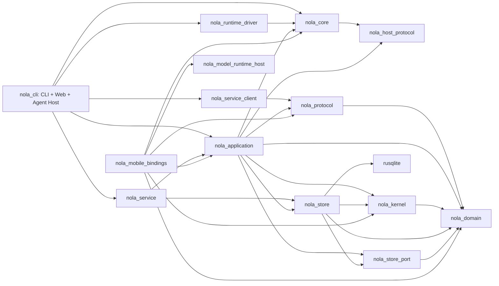

> **发布兼容约束：重新发布的 Nola 1.0.0 是首个受支持基线，Nola 自有协议、ABI 与数据库格式/epoch 从 1 开始；此前开发格式不保留兼容或转换代码。从本次发布起，后续版本须维护已发布接口与数据兼容，破坏性变更必须有明确版本协商、升级说明及回归测试；数据库迁移必须可验证、可回滚并保护原始数据。未知或不支持的格式明确拒绝，不得自动删除、重建或静默改写用户数据。外部服务标准协议沿用其自身版本。**

# V2 依赖硬切换审计：2026-09-08

本报告按当前未提交工作区读取 Cargo metadata、生产入口及调用实现，不按类名推定数据库访问，也不把 dev-dependencies 当成生产依赖。审计只新增本文；没有修改产品代码、用户数据库或现有工作区修改。root 在收到审计发现后单独修复了自动 Service 启动的危险重建默认值。

结论：**持久化 CLI / Web / Host 路径已经转交 Service，但完整 V2 依赖门禁仍未通过。** 当前生产直接依赖 `nola_store` 的工作区包为 `nola_application` 和 `nola_service`；生产直接依赖 `rusqlite` 的工作区包只有 `nola_store`。CLI 仍直接依赖 Application / Service 实现，Application 仍打开具体主库并持有旧 `AgentCore`。Android 另有实际写业务数据的 Room 数据库，不能与 canonical 会话库混为一谈，也不能一概称作已迁移。

## 1. 验收基线与核对方法

基线为 [ARCHITECTURE_V2.md §3.1](ARCHITECTURE_V2.md#31-单写者)、§4.3、§5、文末“架构验收门禁”：

- 业务持久化由 Application Service 独占；客户端 / Host 不创建 canonical SQLite 连接。
- Application 依赖 Store Port / Host Port，不依赖具体 SQLite 适配器。
- Client SDK 不依赖 Application 实现。
- Kernel 不依赖 Host Protocol / IO。
- 装配角色可以打包在一起，但不能合并协议、事务所有权及失败语义。

执行的元数据审计命令：

```sh
cargo metadata --offline --no-deps --format-version 1
cargo test -p nola_cli -p nola_service_client --test dependency_boundary --quiet
```

metadata 核对 `dependencies[].kind != "dev"`，同时保留 target / build 依赖分类；包名用 Cargo 的 package name，不用源码别名。两项既有 dependency-boundary 测试均通过，各 1 项。这证明现有直接依赖门禁通过，**不证明传递依赖或整个 V2 完成**。

本报告里的“未发现直接 SQL”来自限定目录的源码搜索与实际入口阅读，不是全平台运行时证明。移动 FFI 写命令入口另有代理正在修改；本文不把正在进行的收据修复算作已验收。

## 2. 当前生产依赖图

箭头表示“左侧 crate 正常生产依赖右侧 crate”，不是运行调用顺序。省略 serde、chrono、libc 等通用库和全部 dev-dependencies。



关键结论：

| 包 | 正常生产依赖事实 | 不能据此误判的内容 |
|---|---|---|
| `nola_store` | `rusqlite`、Domain、Store Port、Kernel | 它是实际 SQLite 适配器；没有依赖 Application |
| `nola_application` | **具体 `nola_store`、旧 `nola_core`**，同时依赖 Ports / Kernel | 引入 Ports 不等于删除具体 Store 依赖 |
| `nola_service` | Application + Store | 在 Service 装配层注入 SQLite 适配器是允许角色 |
| `nola_cli` | Application、Service、SDK、Core、Runtime Driver | 没有直接生产 Store / SQLite，但可经实现依赖创建 Runtime |
| `nola_mobile_bindings` | Application、Core、Domain、Kernel、Protocol、Model Runtime Host | `nola_store` 只在 dev-dependencies；移动内嵌装配仍间接含 SQLite |
| `nola_runtime_driver` | Core + serde_json | Application / Store 只在 dev-dependencies，不是生产直接写库者 |
| `nola_service_client` | Protocol + 通用库 | 当前 SDK 没有 Application / Store 实现依赖 |
| `nola_kernel` | Domain | 当前模块未发现数据库、HTTP、网络或进程调用；完整 Agent 状态机仍未迁入 |

精确来源：[Application manifest](../../../core/nola-application/Cargo.toml#L6)、[Service manifest](../../../core/nola-service/Cargo.toml#L10)、[CLI manifest](../../../cli/Cargo.toml#L22)、[Mobile manifest](../../../core/nola-mobile-bindings/Cargo.toml#L11)、[Driver manifest](../../../core/nola-runtime-driver/Cargo.toml#L6)、[Store manifest](../../../core/nola-store/Cargo.toml#L6)、[SDK manifest](../../../core/nola-service-client/Cargo.toml#L6)。

以下都是 **dev-only**，不能作为生产直写证据：Application → rusqlite；Mobile → Store；Runtime Driver → Store；Service → rusqlite；CLI → Store / rusqlite / Store Port。此前当前架构文档里“CLI 的 Web 分支仍生产依赖 Store Port DTO”已经过时：当前 CLI 的 Store Port 也只保留在测试依赖中，生产仍有的是 Application DTO / command 耦合。

## 3. 谁实际打开数据库

| 入口 | 已读到的调用链 | 当前判断 |
|---|---|---|
| CLI / Web 持久化访问 | CLI `store::NolaStore::open` 仅 mkdir + 保存 PathBuf；`application()` → `CliApplicationPort::persistent` → SDK `for_database` | 不是 SQLite 直写；数百个同名 `NolaStore::open_default` 调用不能逐个算成创建 SQLite |
| CLI `--no-save` | `Session::open_ephemeral` → `CliApplicationPort::ephemeral` → `ApplicationRuntime::open(":memory:")` | 确实在客户端进程创建内存 canonical SQLite / outbox。保留了事务语义，但不是 SDK-only 依赖硬切换 |
| CLI / Agent Host 隐藏 Service 模式 | `--nola-application-service` → `nola_service::serve_with_options_and_parent` | 同一个 binary 内包含独立 Service 启动角色；应与普通 Host 执行角色区分 |
| 独立 Service | 先取得 database ownership lock，再创建 Mutex<ApplicationRuntime> 并注入 LazyContentUploadStore | 当前持久化单写者装配路径，有真实进程所有权测试；主库仍由 Application 内部打开 |
| macOS | `MacApplicationPort` → `MacApplicationServiceClient` → Unix socket / Supervisor | 本次在 NolaMac 生产 Swift 中未发现 canonical sqlite3 open 或 `nola_core_application_open`；Swift 自有 transport / DTO，不等于整个 Client 已只链接 Protocol |
| iOS | `IOSApplicationRuntime.init` → `nola_core_application_open` → Rust `ApplicationRuntime::open` | Swift 不直接写 SQL；Rust 嵌入式 Application 拥有 canonical 连接 |
| Android canonical | `AndroidApplicationRuntime` → JNI nativeApplicationOpen → 相同 Rust FFI open | canonical 文件是 `noBackupFilesDir/nola-product.db`；Kotlin 不直接创建此 SQLite 连接 |
| Android Room | Hilt `Room.databaseBuilder(...,"nola.db")` | 独立 Android 数据库，实体为 schedule、execution results、notifications、agent trace；不是 canonical messages 表 |

证据：[CLI wrapper](../../../cli/src/store/mod.rs#L120)、[生产 / 测试 / ephemeral 分支](../../../cli/src/application_port.rs#L42)、[ephemeral Session](../../../cli/src/session.rs#L179)、[隐藏服务入口](../../../cli/src/application_service_entry.rs#L8)、[Service ownership lock](../../../core/nola-service/src/lib.rs#L42)、[Service 装配](../../../core/nola-service/src/lib.rs#L158)、[Mac Port](../../../NolaMac/Services/MacApplicationPort.swift#L1853)、[iOS open](../../../Nola/Services/IOSApplicationRuntime.swift#L754)、[Android canonical path](../../../android/app/src/main/java/com/nola/data/local/AndroidApplicationRuntime.kt#L45)、[JNI open](../../../android/app/src/main/cpp/nola_core_jni.cpp#L67)、[FFI open](../../../core/nola-mobile-bindings/src/lib.rs#L127)。

移动端 `nola_core_application_open` 每次创建一个 Runtime 与 Mutex；daemon 的 database ownership lock 位于 Service 装配，不位于这个构造函数。上层 Swift shared / Android Hilt singleton 减少正常路径的重复实例，但不构成“同一路径永远只能创建一个 canonical writer”的类型或进程锁证明。移动收据入口修复与多 handle / 多进程所有权应分别验收；不能把这点描述成 Swift / Kotlin 已直接写 canonical SQL。

Android Room 的 [数据库实体](../../../android/app/src/main/java/com/nola/data/local/db/NolaDatabase.kt#L14) 不含 Conversation / Message。但 [ScheduledActionRepository](../../../android/app/src/main/java/com/nola/data/repository/ScheduledActionRepository.kt#L25) 仍直接调用 DAO upsert / delete / setEnabled / recordResult，属于具体业务写入，不能一概认定只是展示缓存。通知和 trace 是否可保留为明确的客户端投影缓存，需要按其权威来源及重建能力逐项确定；本次不凭数据库名称判定。

### 本次发现并由 root 修复的自动重建默认值

审计最初看到隐藏 CLI Service 固定传入 `recreate_incompatible_store=true`，经 Service policy 映射进入 `ApplicationRuntime::open_with_upload_repository`，旧 schema 会触发 `remove_persistence_family` 后重建。

当前已核对 root 将隐藏 Service 调用改为 **false**。独立 `nola-service` 默认也是 false；显式 `--recreate-incompatible-store` 仍由用户主动选择。root 新增 [service_schema_preservation.rs](../../../cli/tests/service_schema_preservation.rs#L8)，分别检查 CLI / Agent Host binary 遇到旧 schema 后拒绝启动并保留数据库原字节。本审计未执行该子进程测试，不能将源码修复自动当成它已通过；其执行结果由 root 记录。

## 4. Application → Store / 旧 Core 的具体耦合入口

这些是生产调用，不是只有 Cargo 名称上的关系。

| 入口 | 具体行为 | 需要拆出的边界 |
|---|---|---|
| [runtime.rs:22](../../../core/nola-application/src/runtime.rs#L22) | `ApplicationRuntime` 直接持有 `NolaStore`；open 创建目录、选择 SQLite / upload adapter，并可处理数据库删除重建策略 | 独立装配工厂；Application 接收 ports，不能负责文件族生命周期 |
| [application_command.rs:507](../../../core/nola-application/src/application_command.rs#L507) | 总 dispatcher 参数是 `&mut NolaStore`；即使部分分支调用 trait 用例，顶层仍锁定实现 | 由共享 command unit 暴露的聚合端口集合 |
| [command_receipt.rs:144](../../../core/nola-application/src/command_receipt.rs#L144) | 收据、revision、业务 savepoint、投影及热状态提交直接协调 Store UoW；还导入 StoreError / receipt 存储类型 | Receipt / revision / transaction ports；必须保持原连接及原子提交，不能拆成多个独立连接 |
| [lib.rs:602](../../../core/nola-application/src/lib.rs#L602) | begin turn 读取 active Run / checkpoint，恢复旧 `AgentCore`，调用 `core.submit`，提交 checkpoint / canonical projection / outbox | Run / checkpoint / effect outbox ports + 新 Kernel 状态转换 |
| [lib.rs:1226](../../../core/nola-application/src/lib.rs#L1226)、[lib.rs:1879](../../../core/nola-application/src/lib.rs#L1879) | 活动输入与 Host response 使用 `Option<AgentCore>` 热缓存，必要时反序列化旧 Core checkpoint 并继续归并 | Kernel state / transition DTO 与明确 Attempt / Effect 协议 |
| [runtime_supervisor.rs:79](../../../core/nola-application/src/runtime_supervisor.rs#L79) | 本轮已改：`take_current` 仅接收 Application 在事务中读取的 checkpoint revision，不再依赖 Store | 热状态本身仍是旧 AgentCore，完整Kernel迁移仍待完成 |
| [replica_sync.rs:5](../../../core/nola-application/src/replica_sync.rs#L5) | 已改为Protocol与StorePort records转换，五个同步命令经generic ReplicaSyncRepository用例 | 根Runtime/receipt还有具体Store耦合；Host仍只操作Protocol |
| [projection_journal.rs:17](../../../core/nola-application/src/projection_journal.rs#L17) | 依赖 Store `AppendProjectionEventInput` / `ProjectionScopeKey` 等具体类型 | Projection journal / summary observation ports，保持同 UoW |

已完成的端口切分必须保留：例如 [conversation_recall.rs](../../../core/nola-application/src/conversation_recall.rs#L19) 以 `TranscriptReadRepository` 泛型执行；[uploaded_transcript_publication.rs](../../../core/nola-application/src/uploaded_transcript_publication.rs#L10) 以 `TranscriptPublicationRepository` + `ContentUploadRepository` 执行。Archive、profile、memory、context 等也有独立 Store Port。下一步应移除顶层实现耦合，不能把已经拆开的用例重新塞回万能 Store 门面。

新 Kernel 目前导出 projection reducer / diff、message / Part admission、conversation metadata / transition：[kernel lib](../../../core/nola-kernel/src/lib.rs#L8)。实际 Agent turn、旧 checkpoint、Host envelope、permission 等类型仍由 Core 提供并在 Application 实际执行。将旧 `AgentCore` 改名或 re-export 成 Kernel 不会完成迁移；Kernel 不能因此新增 Core → Host Protocol 实现的传递依赖。

Store → Kernel 当前调用的是 commit-time message / Part admission 以及 conversation replica 决策，并未发现 Store 调用 Tool / HTTP / UI。是否最终将共享持久化准入约束落 Domain，需要按纯策略 / 持久化不变量划分，不能仅凭 Store 依赖 Kernel 就声称出现 IO 反向调用。

## 5. 现有门禁覆盖与缺口

- [CLI dependency_boundary](../../../cli/tests/dependency_boundary.rs#L7) 读取 Cargo metadata，检查 CLI 包的非 dev 直接依赖。它能覆盖改名依赖及 target / build 依赖；配合 `cargo check -p nola_cli --bins`，生产源码不能偷偷使用仅存在 dev-dependencies 的 SQLite 包。
- [SDK dependency_boundary](../../../core/nola-service-client/tests/dependency_boundary.rs#L8) 本轮已改为Cargo metadata遍历SDK可达的工作区生产依赖，限制SDK只直接依赖Protocol、传递只允许Domain，检查build/target/rename后的真实package名并禁止SQLite。此门禁通过；未分析第三方crate内部任意IO行为。
- [rust-build.yml](../../../.github/workflows/rust-build.yml#L24) 在 Linux / macOS 执行 Service / SDK 测试、CLI / Agent Host 生产编译和 CLI 直接依赖门禁。
- 上述门禁没有禁止 CLI → Application / Service 的传递实现依赖，也没有禁止 CLI 通过 `ApplicationRuntime::open` 创建内存 Store；没有覆盖移动多 handle writer、Android Room 业务所有权或每个 Host 角色的依赖子图。
- Agent Host 和 CLI 是同一 Cargo package 的两个 binary，依赖测试不能把它们当成两个已经独立隔离的 crate。

## 6. 可执行的拆分顺序

### A. 先固定装配所有权，保持收据事务不动

1. 把 `open*`、SQLite adapter 构造、路径创建 / 明确重建策略移到 Service / embedded-Service 装配 crate。Application Runtime 构造只接收端口及策略配置。
2. 对同一 canonical 路径增加明确的 embedded-Service ownership 机制；新增双 FFI handle / 重启 / 已有 daemon writer 的互斥测试。保留移动框架打包能力，但让 UI adapter 与 writer 装配职责可区分。
3. 将 CLI no-save 改为明确的短生命周期 Service 会话或隔离的 embedded-Service owner；仍使用 command / receipt / outbox 协议，不能退回客户端私有消息数组。

完成证据：普通 CLI / Host / Swift / Kotlin 入口不能调用公开的 SQLite runtime factory；独立和 embedded Service 都能证明每库唯一 owner；Service 不可用时没有新的 canonical 写入 fallback。

### B. 拆顶层 Store 端口，先拆事务再拆领域

1. 将 command receipt、typed revision、command UoW / savepoint、projection journal 所需类型放入 Store Port / Domain。
2. 同一 UoW 提供 Run / checkpoint / effect outbox / replica / projection 等 repository 视图；所有 SQLite 实现共享原连接与外层事务。禁止每个 port 自己打开连接。
3. 依次改 `command_receipt.rs`、`runtime_supervisor::take_current`、`replica_sync.rs`、顶层 dispatcher，再迁移剩余 `lib.rs` 以 `NolaStore` 为形参的用例。
4. 删除 Application manifest 的 `nola_store` 正常依赖，并用非 SQLite fake port 做失败 / rollback / replay 测试。

验证命令与关键回归：

```sh
cargo test -p nola_application
cargo test -p nola_store
cargo test -p nola_service --test uploaded_transcript_publication_process_e2e
cargo test -p nola_store archive_restore_sync --lib
```

这些命令是下一步验收清单，不是本次全部重新运行的测试。必须同时保持 receipt + canonical write + outbox + projection 的联合原子性、提交前 active Run 检查、大正文引用完整性和 archive 全目录 CAS。

### C. 把客户端包与 Service 实现包真正分开

1. 将 CLI `ApplicationCommand` / Application DTO 依赖逐个迁到 Protocol。删去客户端 `execute` 对 `Into<ApplicationCommand>` 的约束；SDK 只提交 typed Protocol command。
2. 从 CLI / Agent Host 包移出隐藏 Service 实现入口，使用明确打包的 Service executable / 装配包。SDK 的启动与协议版本恢复仍要保持同构建版本约束。
3. 将 Agent Host 拆成独立 package，依赖 Protocol / Host contracts / capability adapters；不因为与 CLI 共用源码而继承 Application / Service 实现。
4. 删除 CLI `store` 领域包装，让业务路由直接使用 typed SDK。**仅重命名包装类不算完成，也不得为通过字符串门禁而保留同样的绕行工厂。**

完成证据：metadata 正常依赖闭包中，客户端 / Host 不再到达 Application 或 Store；生产双 binary 编译仍通过；真实 CLI / Web / Mac 同会话与 Service 停止 / 恢复测试通过。

### D. 最后迁移旧 AgentCore 行为，禁止仅改名

1. 先将 Run / Attempt / Effect / submission / checkpoint 等跨层语义移到 Domain / Protocol；Kernel 输入输出不依赖 Host implementation。
2. 迁移 begin-turn / active submission / Host response / permission / compaction / memory 决策，Application 保留加载和事务提交，Supervisor 只保留生命周期调度。
3. 对同一 transcript / submission / effect-result fixture 比较新 Kernel 决策、稳定 ID、事件顺序和 checkpoint 恢复；覆盖多语言自然追问、未知工具恢复及真实模型会话。
4. 删除 Application / Runtime Driver / 客户端正常依赖中的旧 Core；再删死代码，而不是保留双决策器或语言关键词路由旁路。

### E. 将 Android 独立业务库纳入产品所有权清单

把 ScheduledAction / ExecutionResult 的增删、启停、结果接纳迁到相应 Application command。通知和 trace 若保留本地，只能以明确可重建的投影缓存角色存在；需要离线 / 重建 / 多端一致性证据。不要把 Room 文件直接覆盖成 canonical 数据库，也不要创建迁移期间双写。

## 7. 当前审计结论的边界

当前可以确认 SDK 直接依赖门禁与 CLI 直接 Store / SQLite 门禁通过，也能确认默认持久化 CLI 路径通过 Service。不能确认 Application 已脱离 SQLite 实现、CLI / Host 生产依赖闭包已隔离、移动多 writer 已禁止、Android 所有业务状态已收敛或完整 Agent Kernel 已迁移。

本文记录的是依赖与所有权切换待办，不改变当前已经通过的大正文 Service / Worker / archive 数据一致性证据，也不把那些数据链路测试当作完整依赖验收的替代品。

### root后续执行证据

- 两个实际CLI/AgentHost binary分别对foreign及旧Nola schema启动拒绝，
  4种组合的原数据库字节/行保持不变，`service_schema_preservation`通过。
- RuntimeSupervisor已删除`nola_store`导入和Store参数，Application负责同事务读revision。
  runtime定向9项及`turn_transaction_e2e`14项通过，包含无库策略测试、热缓存恢复及事务行为。
  这只消除了Supervisor的持久化选择，Application顶层具体Store依赖仍在。

SDK新Cargo metadata依赖图门禁1/1通过，替换原manifest子串搜索，
其范围是SDK可达的工作区生产依赖，不宣称整个CLI/Host依赖已完成拆分。
