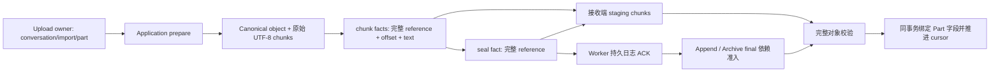

> **发布兼容约束：重新发布的 Nola 1.0.0 是首个受支持基线，Nola 自有协议、ABI 与数据库格式/epoch 从 1 开始；此前开发格式不保留兼容或转换代码。从本次发布起，后续版本须维护已发布接口与数据兼容，破坏性变更必须有明确版本协商、升级说明及回归测试；数据库迁移必须可验证、可回滚并保护原始数据。未知或不支持的格式明确拒绝，不得自动删除、重建或静默改写用户数据。外部服务标准协议沿用其自身版本。**

# V2 字段级正文复制审计

审计日期：2026-09-08。以工作区源码为准，结合 `V2_STRUCTURED_BODY_CUTOVER.md`；仅新增本文，没有启用 JSON binding 或修改生产复制实现。reader/resolver 正在独立推进，本文行号是审计快照，不能把后续 reader 改动视为复制已经完成。

## 后续实施记录（同日）

审计后已完成不可见 JSON 对象复制：`canonical_text_replica::{require_complete,enqueue,apply}` 不再拒绝 ContentJson；所有 seal 新对象、既有对象和同 operation replay 在接收页事务内调用 shared geometry + bounded JSON validator。直接 JSON seal 无 owned transaction 明确拒绝。append/archive/UploadOwner/branch 未由本子任务开放。

`cargo test -p nola_store --lib canonical_text_replica --quiet`：11/11 通过（5 个原有 text 用例、6 个新 `canonical_body_replica_tests.rs` 用例）；新用例覆盖约 10 MB 原始 JSON 跨库/双端分页重启、末尾非法整页回滚与 cursor 保留、字段串用和 changed replay、同长且 canonical/staging 相等的坏 JSON 在既有对象/replay 拒绝、混合字段全局 staging 配额，以及目标已有 prepare 对象但无 staging 时首个错误 field/bytes 立即拒绝且不污染 staging。chunk 接收先有界读取已有 canonical descriptor/对应 chunk 并比较，再写 staging，不等 seal 才发现冲突。未执行 JSON Worker HTTP 或外部 JSON publication；下文表格保留审计时状态，chunk/seal 的 text fence 与接收 validator 两项已由此完成。

## 结论（实施前审计快照）

当前是**统一字段 descriptor 已落地、JSON 本地主库 prepare 可用、JSON publication/replica 明确关闭**的阶段。`CanonicalTextReference` 只是 `CanonicalBodyReference` 的源码别名，不存在第二套 text wire descriptor。已有 chunk 几何校验、owner 完整比较、ACK、archive staging/final 大部分可复用；但仅删除 `require_text_reference` 会让 JSON 绕过接收端语法验证，并仍写入 text 槽，不能开放。

Worker 是账号隔离的不可变事实日志，不是 Part 语义验证器。其 ACK 表示日志已持久接纳该事实，**不表示任何接收端已验证 JSON 或发布 Part**。字段与发布完整性由 Store 接收事务保证。

## 当前链路

Archive entry 是不可见 staging：可在 body seal ACK 前入日志，不等同于发布引用。final 才改变规范历史，必须等待全部 entry/target/begin 与 body seal ACK，接收 final 再检查对象和目录/会话 CAS。

## 精确现状与改动点

| 位置 | 已通用 / 已有保证 | 仍须修改 |
| --- | --- | --- |
| [Domain descriptor](../../../core/nola-domain/src/canonical_text.rs#L13) | `PartBodyField` 封闭枚举；wire 的 field 必填，无默认；Eq 包含 conversation/message/part/field/长度/count；ID 最多 128 UTF-8 bytes，未知字段拒绝 | `new` 明确构造 ContentText，JSON 路径必须用 `for_field`。不通过改类型名字宣称完成 |
| [对象 prepare](../../../core/nola-store/src/canonical_text_store.rs#L354)、[JSON 验证](../../../core/nola-store/src/canonical_body.rs#L62) | 共享 chunk writer 支持两个字段；JSON 要求调用者事务，结束前流式语法验证；原字节和原 chunk geometry 保留 | 接收 seal 目前直接 SQL 插入对象/chunks，**不调用 put_chunks 或 validate_json_object**，须补同等验证 |
| [引用表](../../../core/nola-store/src/schema.sql#L49) | `message_part_body_references` PK 已是 `(part_id,field)`，field CHECK 封闭 | schema 允许双字段不等于 writer、reader、replica 接受双字段；须验证 SQL field 与 descriptor field 一致 |
| [chunk/seal](../../../core/nola-store/src/canonical_text_replica.rs#L10) | ChunkFact reference 已包含 field；staging 每行比完整 owner；连续 offset、非空、32 KiB、总长/count；seal exact replay 对比 canonical 字节 | require_complete、chunk apply、seal apply 都有 text-only fence。移除前增加 JSON seal 的流式语法/语义投影准备；仍以同一事务拒绝不完整 JSON |
| [append](../../../core/nola-store/src/conversation_append_sync.rs#L110) | 序列化 references 已能携带新 descriptor；接收先找声明的 message/part，检查 conversation，再 require_complete | `bound_parts` 仅按 part_id 去重；仅允许 text kind、空 text、JSON None；插入固定 `'content_text'`。应按 `(part_id,field)` 去重、逐字段 inline/ref 排他、动态 field 写入，不能清空另一个字段 |
| [本地 append writer](../../../core/nola-store/src/conversation_append_store.rs#L43) | 与 outbox 同事务，引用前 require_complete | 同样 text fence 与固定 SQL field；必须和 remote writer 共用 field admission，避免本地可写而远端必拒绝 |
| [archive adapter](../../../core/nola-store/src/archive_restore_sync.rs#L22) | 每 entry 遍历 references 并 enqueue；final 遍历全部 references；stage entry/target/final 分开，无全文 final；target CAS 契约无需按 field 重写 | adapter 循环自身可容纳两个字段，但调用的 replica/core validation 仍关闭 JSON；不能只修改 adapter Vec 类型 |
| [archive core](../../../core/nola-store/src/archive_restore.rs#L159) | 引用声明 owner 检查；外部 prepare binding 完整 descriptor 比较；接收 final 对每个引用 require_complete | text fence、按 part_id 去重、text-only 槽校验、固定 SQL field；引用个数上限 512 需与双字段最多 1024 的理论数量协调，但始终先守住 128 KiB 实际 entry 编码预算 |
| [append ACK](../../../core/nola-store/src/sync_outbox_read.rs#L55) | 每个 reference 查询 seal `entity_id + revision=1 + settled status + exact payload_json`；field 已纳入 exact payload，无需新增仅字段 ACK 表 | 添加双字段回归；不能改成只查 content_id、任一 seal 或同页排序。当前队首依赖未满足会阻塞/报错，producer 必须确保依赖全部排在引用前 |
| [archive ACK](../../../core/nola-store/src/archive_restore_sync.rs#L59) | begin/entry/target settled 数量精确核对，按 staged entry 遍历每个 seal 完整 descriptor；final 不携全量 manifest | 验证两个字段分别 ACK；仅 text ACK 不可放行 final；body dependency 的 source of truth 保持 staged entry |
| [ACK 保留](../../../core/nola-store/src/lib.rs#L230) | 重开不清除 settled seal、archive begin/entry/target，避免永久阻塞 | 如变更 entity type 名称，必须同改 prune、dispatch、same-operation replay、CLI 边界；推荐本阶段保持现有中性可用的 wire 名称，源码名字不构成错误 |
| [CLI batch](../../../cli/src/replica_sync.rs#L63) | HTTP prefix 到 seal 停止；真正 barrier 来自 Store outbox admission，其他 embedded Host 也受约束 | 双字段应跨多轮 seal ACK 后再发布。保留实际 serialized HTTP byte budget，JSON string 转义后可能放大 |
| [branch](../../../core/nola-store/src/conversation_branch.rs#L324) | 已引用 text 保留原块 geometry，稳定派生目标 ID 并重绑 owner | 当前只查 text resolver、`new` 固定 text、body ID 只按 source Part 派生。双字段必须把 field 纳入 body ID 派生，按字段复制，目标 Part ID 不变；读取块的 SQL 本身也应有界，不能先分配损坏超大行后校验 |
| [retirement](../../../core/nola-store/src/content_upload_lifecycle.rs#L69) | 主库独立只读确认 prepared/publication 持久证据；完整引用与 chunk geometry/bytes 比较；回滚不能退休 | 现 text fence，UploadOwner 无 field（见下）；开放后 retirement owner 比较与退休读取均须验证 field，不可用 text 的证据释放 JSON upload |

### owner、对象 ID 与完整性边界

1. `content_id` 是对象主键，不是内容 hash。当前 descriptor 没有 cryptographic digest。已实现的完整性是 owner、连续长度/count、UTF-8、重复事实 exact bytes；不能声称首次接收的同长不同字节会被“hash 校验”发现。测试必须做来源与目标原字节比较。若以后需要抵抗首次字节替换，应单独决定增加 digest 和版本契约，不能把 Part 可选 content_digest 偷当 immutable object hash。
2. chunk 的实体 ID 是 `content_id:offset`，seal 的实体 ID 是 content_id。只要 content_id 对每个 owner/field 唯一，现 ID 布局可用；同 content_id 换 field/owner 会冲突，而不是第二个合法对象。branch、upload prepare 的 ID 派生必须满足这一点。
3. `UploadOwner` 当前只有 conversation_id/import_id/part_id，见 [content_upload.rs](../../../core/nola-store-port/src/content_upload.rs#L5)。因此 canonical descriptor 的 field 已存在，上传授权链仍未覆盖 field；仅在 publication 新加 field 参数会留下跨字段 upload 重用路径。
4. 256 MiB 是接收端现有**canonical 对象加未 canonical staging 对象声明大小总配额**，不是仅单文件配额。双字段复制不可让两个字段各自绕开总额。大量大对象测试应按这一总额设计，超额必须确定拒绝且 cursor/可见历史不动。

## Worker 的职责及实际验证范围

[canonicalReplicaInput / pushCanonicalReplicas](../../../backend/worker/src/index.ts#L1125) 只校验 outer identity/revision/payload 存在，并按账号保存；operation replay 比 entity type/id/revision/deleted/JSON.stringify(payload)，同实体同 revision changed payload 拒绝。未根据 canonical_text_chunk/seal 或 archive_restore_* 做 owner/field/JSON 语义验证，合法格式的未知 entity type 也可能入日志。接收 Store 必须 fail closed，不得因为 Worker accepted 就跳过 decoder 和 field validation。

[replica_budget.ts](../../../backend/worker/src/replica_budget.ts#L3) 请求与页面上限 4 MiB，push 每批最多 100 条；页面先取 payload 长度，再有界取记录。Worker 解析的是**外层 fact JSON**。ChunkFact.text 内保存的原始 JSON 正文仍是字符串，不被当 JSON AST 重编码；引号、反斜线、空白、键顺序应能原样恢复。只能通过真实 HTTP fixture 证明端到端字节，不把外层 JSON 的编码形式当正文编码形式。

当前同 operation replay 会重新进入 immutable body/archive apply 验证（[Store dispatch](../../../core/nola-store/src/lib.rs#L5173)），因此新 JSON 验证不能只加“新 seal”分支而漏 replay/已有对象分支。

## 建议施工顺序与可评审接口

1. **共享字段 admission**：以完整 Part 元数据、owner 与 references 切片为输入，检查 `(part_id,field)` 唯一、descriptor owner、inline/ref 排他、字段存在性。统一用于本地 append、remote append、archive stage/final；不要复制四份稍有差异的条件。JSON ref 对应 SQL NULL 占位，但 resolver 返回 Present/Deferred，不能解释成规范 None。
2. **共享 sealed body validator**：在接收事务内 `validate_chunks` 完成后，按 field 执行 JSON 流式验证；已有对象和 replay 同样调用。可复用 `validate_json_object(connection,reference)`，但不能在 canonical 插入提交后才验证。失败回滚本页所有变化与 cursor。若语义投影是后续发布必需，应在这里或发布事务内可靠重建，不接受远端提供的可编辑投影替代原文。
3. **字段化复制与绑定**：append/restore SQL 写入 descriptor field；branch 按两个字段导出原块，`body_id(operation,source_part,field)` 稳定派生；refs Vec 保留一个 Part 双字段。现 entity types 可保留，若重命名则一次版本切换全部 dispatch/ACK/prune/CLI。
4. **上传与退休一并切换**：Port/Protocol persisted UploadOwner 加 field；外部仍只传 upload binding，不能直接传 canonical reference；重复 binding 按 part+field 和 upload ID 分别拒绝。退休使用完全一致的 field-aware owner 和持久 evidence。
5. **先做 Store/Worker fixture 验证，再开放外部**：resolver/export/window/context 全部接受双字段后，才解除 App 的 JSON binding gate 并做 Service/Mac 正式入口测试。仅第一阶段准备和复制测试通过不足以开放。

## 必须新增的精确回归

以下是待执行验收，不是本审计已通过的结果。现有纯文本 Worker/Service 证据不能替代它们。

| 用例 | 输入与故障点 | 必须断言 |
| --- | --- | --- |
| 单 Part 双字段跨库 | 同 Part：10M text + 10M JSON；JSON 含中文、emoji、引号、反斜线、空白和固定键顺序；非等长 UTF-8 chunks | 两个 owner/field 独立，原 Part/kind/时间/digest 不变；两个字段逐 range 全字节相等；双端每页重开；无 echo |
| JSON seal 语法失败 | 首 chunk 正确，末尾垃圾/缺括号/跨块错误 escape/surrogate；或仅在最后 chunk 显现非法 | 不产生可发布对象；同页事务和 cursor 不推进；旧历史不变；staging 可重试规则明确 |
| 字段串用 | 对 text chunk/seal/append/restore ref 改成 ContentJson，但保持 content_id/其他 owner；另测错误 message/part/conversation | descriptor、chunk replay、seal replay、binding 分别拒绝；不借用另一个字段的 canonical/seal/ACK |
| 双字段 ACK barrier | text seal 已 ACK，JSON chunk/最后 seal 未 ACK；重开 source | append/final 不出 pending page；JSON 依赖本身可继续发送；JSON seal ACK 后才一次发布；无队首永久堵塞 |
| 同页乱序与截断 | append/final 位于 JSON seal 之前、缺一块、偏移洞、重叠、count/长度不符 | destination 整页拒绝，cursor 不动，不出现单字段半 Part；合法重发成功 |
| 同 operation changed replay | 已成功 chunk/seal，换 field 或同长度 bytes，再用相同 operation ID；另用不同 operation 同 entity/revision | Worker 与 Store 独立测试拒绝；不走 marker 早退绕过完整性验证 |
| 双字段 archive 原子替换 | 保留同 ID 会话、删除 backup 外会话、新增会话；每 entry 2 refs；final 故意晚发 | 所有 stage/target/chunk 页面期间旧历史可见；最后一步双字段一并切换、revision 单调、tombstone 正确；CAS 冲突全回滚 |
| 双字段 branch | 已引用+大内联混合；source/target Part body ID 相同派生输入仅 field 不同 | 两个目标 content ID 不冲突，chunk geometry 不变；JSON 内嵌旧 AgentPart identity 原字节保留；消费侧 owner/provenance 有明确映射；目标 lineage 经 Worker 一致 |
| manifest 累计预算 | 多个中等字段、512 Parts、双字段 descriptors、仅 metadata 已超限 | 自动外置正文仍守 128 KiB entry；引用数不能粗暴把小 body-independent metadata 上限放大；超限不可见阶段失败 |
| quota / 损坏记录 | text+JSON 合计逼近 256 MiB；staging 多对象；SQL chunk/reference 超预算 | 全局配额不双算 canonical 同 ID，也不漏算另一个 field ID；有界 SQL 在读取大行前拒绝；cursor/历史不动 |
| retirement 不串字段 | text 已 committed、JSON 只 prepared 或回滚；错误字段请求退休/退休后读 | 不能删除另一字段 upload；正确退休仍逐 chunk exact bytes/geometry；canonical 回滚不产生可用退休证据 |
| 正式 IPC + HTTP | Service begin/append/seal/publish 双字段，随后真实 localhost Worker push/pull，两端重启 | 请求/响应 frame 有界、Worker 页面 <=4 MiB，原字节端到端一致；RPC/SQL/RSS 指标单独记录；fixture 预置不冒充生产上传 |

本次核查只读源码并写本文，未运行新双字段复制测试、未解除 `require_text_reference`。上述施工需与正在修改 resolver/schema 的 reader 工作合并后再执行。

## 附：真实 Worker fixture 的 Part 元数据核查

本轮 root 已修复 `authenticated_http_round_trip` 的旧手写 Part JSON：补 created/updated/digest，并由断言发现及修复 `replace_conversation_projection` 曾把 Part 时间写成会话更新时间的问题。root 报告 CLI replica 单元/模拟 HTTP 8/8 通过；两项 ignored 真 Worker 测试不在该次命令内，本文不重复声称它们已复验。

- `cli/src/replica_sync.rs:398–401`，`isolated_worker_round_trip_uses_real_cli_transport` 用 typed `TranscriptPartInput`，已有 `content_digest:None, created_at_ms:1, updated_at_ms:1`，不缺新字段。但时间相同、digest None，不能捕获元数据损失；应后续改用不同于 Message/Conversation 的 Part 时间与非空 digest，并在远端 export/metadata 核对。
- `cli/src/replica_sync.rs:487–488`，chunked fixture 的 typed `MessagePartInput` 已带 digest None、created1/updated2；`606–607` 的 archive typed Part 已带 digest None、created1/updated4。不存在缺字段的旧手写 Part JSON，但仍缺非空 digest 保真断言。`474`、`600` 手写的是 canonical reference，已含 `field:content_text`，不是 Part 元数据。
- `scripts/test_worker_replica_e2e.py:105–127` 仅调这两项 ignored Rust 测试；Python 自身的 transport fixtures 不含 Part 结构，无对应缺失时间字段可补。测试脚本打印的旧成功统计不能代替新增 field/Part metadata 断言。

本附录只核查并记录位置，未改 root 当前拥有的 `cli/src/replica_sync.rs`。
