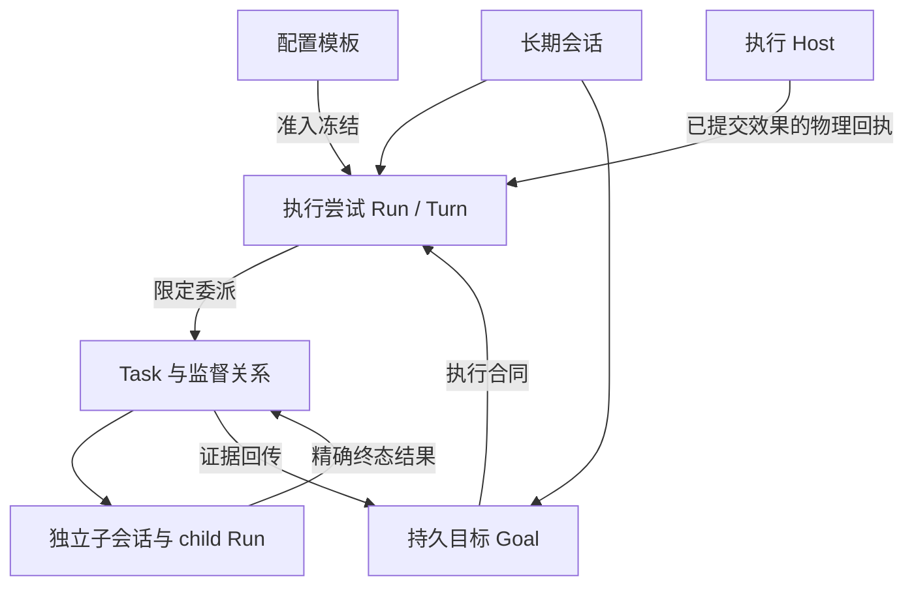

> **发布兼容约束：重新发布的 Nola 1.0.0 是首个受支持基线，Nola 自有协议、ABI 与数据库格式/epoch 从 1 开始；此前开发格式不保留兼容或转换代码。从本次发布起，后续版本须维护已发布接口与数据兼容，破坏性变更必须有明确版本协商、升级说明及回归测试；数据库迁移必须可验证、可回滚并保护原始数据。未知或不支持的格式明确拒绝，不得自动删除、重建或静默改写用户数据。外部服务标准协议沿用其自身版本。**

# 会话、Run、Goal 与子任务边界

状态：当前权威关系与本轮实施决定，2026-11-02。遵循[软件架构总纲](../../总体设计/SOFTWARE_DESIGN.md)、[模块契约](../../模块契约.md)。详细状态机仍由[Goal/Task 契约](GOALS_AND_TASKS.md)、[上下文契约](../09-上下文与压缩/CONTEXT_AND_ACCOUNTING.md)、Application 事务与委派 Host 契约约束；本页统一概念，不新增一套运行时。

## 实体、身份与所有者

| 对象 | 身份与关系 | 权威与存储 |
| --- | --- | --- |
| AgentProfile / Persistent Agent | 配置模板；不是任务、用户或历史容器 | 版本化产品配置；Run 准入时冻结模型、工具、权限和预算 |
| Conversation | 长期用户记录；可含多个顺序执行的 Run | canonical messages/parts、配置与 Core checkpoint；Application 唯一写入口 |
| Session | 当前执行适配器常用名；Core session 通过持久绑定关联 Conversation | 不是另一套可独立写的聊天记录；外部 executor session 另有精确身份 |
| Run / Turn | Run 是一次准入执行；Turn 是 Core 语义轮次，不能靠字符串相等推导关联 | Run、invocation digest、assistant message、Turn/effect/delivery 精确绑定；终态 seal 是执行事实 |
| Goal | 持久业务目标、范围、要求、执行合同与验收；可跨多个 Run | Core GoalProjection/checkpoint、命令回执、冻结 Goal execution binding |
| Plan | 版本化步骤与依赖；不是执行成功证明 | 对应 Goal/Conversation 的版本化记录；编辑使用 CAS |
| Task | 一项范围确定的委派/后台工作；有 owner、祖先、预算与结果 | durable_tasks、authority/admission、attempt/lease、child Run binding、终态 receipt |
| Subagent | 执行 Task 的独立执行者，不是新增领域实体 | 独立 child Conversation/Run；以 Task 与 parent admission 绑定，不借父前台可变执行状态 |
| Room participant | 某 Room 的成员实例；相同 Agent 在不同 Room 不共享私有 context | 每个 participant 独立 context Conversation + ContextOwner；公开 Room 时间线是另一个读取范围 |
| Host / executor | 执行已提交的模型、工具和取消效果；报告可核对的物理事实 | 不自行写业务终态、不把进程退出或口头完成当 seal；凭据留在 Host 私有配置 |



## 数据与上下文所有权

| 数据 | 权威来源、引用与读取规则 |
| --- | --- |
| 用户原文、原始 transcript | canonical Conversation messages/parts 与原文对象；保留原文，显示分页和模型工作集不修改它。分支复制可见的已完成边界并记录 lineage，不复制活跃执行 |
| 压缩摘要 | Core 选择范围、Host 返回候选、Core 校验 fingerprint/预算后提交；只替换工作上下文，不覆盖原始 transcript、不拥有 Goal/权限事实 |
| 工具结果 / artifact | 已提交 effect 回执及精确 owner/run/part、内容引用和 digest；预览可截断，原始结果可按授权引用读取，不能用预览冒充完整证据 |
| Memory | 独立长期记忆库及其授权；冻结 memory policy 在注入前过滤。会话摘要不是跨会话读取授权 |
| CodeMemory | 工作区代码的派生索引与来源版本；按当前工具目录、工作区和权限读取，索引不是原文件或执行成功证明 |
| 请求快照与 usage | 实际物理请求与度量记录；缓存前缀不赋权，估算不伪称实测，缺 usage 不填精确零 |

Context 是为本次执行选择的材料，不是权限。父子传递任务 brief、范围、约束、期望证据和可访问引用，不复制全部父历史。原生与 CLI 的 child executor 都不得继承父 Turn 的一次性授权。冷恢复当前最多选择 32 条消息、最多 32KB 内容并提示省略；这是初始窗口，不是原文访问上限，也不意味着已自动回忆全部父任务。需要更多信息时走现有 recall / 原文范围读取，仍校验来源与所有权。

## 入口协调与已有任务直达

Router 是入口协调职责，不新增 Router 数据实体。新工作由当前会话入口准入；明确关联已有 Task 的输入、子结果、权限/用户回答、取消和恢复，经准确 task/run/owner/revision 路由，不再次让模型判断“是否新任务”。相关性只提供上下文，不授予跨任务操作权。不得按用户文本关键词强制路由。

已有运行 Task 的补充通过现有 guidance / send_agent_message 及 FIFO 输入队列提交，保留 message_id、水位和消费回执；只能在模型边界采用，不改写已发出的请求。当前 guidance 绑定原 parent incarnation，父 Run 已封存则不再接受它；终态 Task 的后续工作使用现有 continuation 创建新 Task 并绑定原 child 会话，不重开旧 Run，也不把新范围偷偷塞进旧权限。通用跨来源订阅/自动任务识别属于以后，不在本轮新增。

### 工作区与交付范围

子会话本身隔离身份、上下文与运行归属，不创建独立文件系统。共享 Rust Host 对 Git 项目中的可写委派自动准备独立 worktree；非 Git 或只读任务仍沿既有工作根执行。进程资源隔离也不等于 worktree 隔离。父级 brief 必须区分实现路径、测试/临时路径和交付文件集合。沿用已有测试目录；源码专用交付目录不能默认作为测试目录，无现成布局时将临时测试放在交付树外。子结果列出改动路径、验证命令及实际覆盖文件，父级按完整交付集合验收。不得在子任务结束时自动删除共享文件或测试。

Host 在根 Run 准入前准备项目专属的独立临时工作区容器，将该容器的精确路径加入本轮冻结范围。位置由项目与 Store 身份派生，Unix 必须是当前用户所有且模式为 0700 的真实目录；已有 symlink、其他所有者或宽松权限明确拒绝，不改写既有目录权限。Core 从独立授权范围选择目标，不要求授权项目的整个父目录；例如 `/app` 不需要授权 `/`。子任务不扩张冻结范围，已有 worktree 绑定保持原执行根。容器位于源码之外，避免平台生成的嵌套 worktree 把 source 状态变脏；平台不自动删除、集成或验收目录。

共享 Rust Host 提供显式 `git_worktree_list` / `git_worktree_create`：先读取实际 HEAD、worktree 列表与共享 Git 目录，再以精确 HEAD 和共享目录为前置条件创建 detached worktree。Core 权限计划分别绑定源目录、共享 Git 元数据和目标目录；Host 再验证实际路径与身份。目标必须不存在、父目录已经存在并被授权；Host 在启动 Git 前原子创建空目标目录以占有该路径，同目标的并发调用在 Git 启动前拒绝，失败保留现场不自动删除或接管；仅在具有精确 `source_snapshot` 计划时捕获已跟踪脏源码，不复制未跟踪/忽略文件或新增凭据，不创建分支、不 push、不合并、不强制覆盖，也不自动清理。创建使用原 Git 写进程的取消/超时路径；中断或失败后先检查实际 Git 注册与目录，不盲目重发或伪造成功。

创建工具本身不切换会话，也不修改既有 Task。`spawn_agent.worktree` 显式选择已存在、已授权的 linked worktree；Host 在父 Run 准入时见证父项目 Git 共享目录及目录身份，再见证所选 worktree 的路径、baseline commit、共享 Git 目录和目录身份。Core 要求所选 worktree 属于冻结父项目的同一仓库（不只是落在某个授权文件夹内），并在原有 delegated invocation 中冻结绑定与所有权，不新增持久表。子进程启动、冷恢复及实际工具派发使用同一绑定根目录，默认工具工作根改为该子根目录；具体读取仍由原 Core 权限规则决定，不能把默认目录说成读取沙箱；有界文件写者另有下面描述的写入硬上限。目录丢失、被替换、baseline 不再为当前 HEAD 的祖先或授权撤销时阻止执行，不重建或回落到父目录。子任务自行提交和脏文件允许保留，不自动清理、合并或导出。

Task 的项目归属、查询及项目并发额度仍绑定原父项目。Core 仅对冻结 Nola profile 的全部工具均为可信只读工具或有界文件原语、且有独立 worktree 绑定时标记 `bounded_file_writes`。这些文件任务按实际执行根目录参与公平领取；不同根目录且不同 Git index 可并行，同根、父子目录、相同 index 仍互斥。普通命令、插件或外部执行器任务继续按仓库/原项目排他，不能靠改 profile 名称获得并发。Host 在权限解析前及实际执行前约束文件写入不得越出冻结根目录、不得改 `.git` 绑定，额外批准也不突破该任务上限；这不是抵御宿主外部进程或所有文件系统竞态的 OS 沙箱。

为避免嵌套子任务切换调度键绕过写者约束，已绑定 worktree 的任务当前只允许派发实际只读子任务并继承同一绑定；写入或命令型嵌套任务在 Core 准入前拒绝。创建结果返回带目录身份的 `task_worktree_selection`，后续准入仍重新见证，不凭工具的自由文本信任路径。原目录的干净 HEAD 与已跟踪脏源码快照明确区分，绑定同时记录源 HEAD、源码状态指纹、执行基线 commit 与 tree；不得用干净 HEAD 冒充脏源码。

#### 无感工作区：产品方向与当前边界

不提供 worktree 管理页、选择器或 `/worktree` 命令。用户编辑代码任务时应只面对任务、变更和最终验收；Git 工作区属于 Host 准备资源。当前已实现 Git 项目中可写委派的自动准备、冻结绑定、恢复校验、受限文件任务并发及审批后的交付集成。非 Git 项目没有 worktree 能力；本机移动 Host 不宣称桌面工作区隔离。只读委派不创建工作区，显式绑定和已有 Task continuation 沿用原绑定。

`AgentRuntime::prepare_delegation_workspaces` 在原 `spawn_agent` 被调度前冻结一个附属于该调用的 `workspace_preparation`。首先执行正常 `git_worktree_list`；检查 Host 见证的仓库身份、Git checkout 根及精确来源状态，再执行正常审批的 `git_worktree_create`；核验完成 receipt、checkout 后置条件和目录身份后，才将 `worktree` 注入原委派的有效参数并继续原 Task 准入。内部准备调用保留独立 call_id、权限、结果和 journal，不授予子任务额外工具或文件权限。模型委派、Code Mode 中已授权委派和 `/agent` 快捷入口共用此调度链，不靠提示词要求模型补调用。

目标是来源 checkout 之外、已授权父目录中的稳定任务目录，以来源 session/turn/call 身份生成目录名。现有授权范围不覆盖该父目录、Host 缺少 Git 准备能力、项目不是 checkout 顶层、脏源码无法安全捕获或仓库身份变化时，明确阻断；不自动增加允许根、不复制忽略/未跟踪文件或凭据、不替用户清理/提交。准备阶段随正常 checkpoint 持久化。效果未知或准备失败时原委派不落回来源目录；不重新创建/接管旧目录。成功创建但随后准入失败的 worktree 保留供检查，不自动删除。已跟踪脏源码使用私有 Git index 和无 filters 的原始字节快照：保留 staged/unstaged、删除、新增已跟踪文件及可执行位，不修改来源 HEAD、分支或真实 index。源状态在捕获前后核对；敏感路径、未跟踪文件、冲突、子模块、特殊文件或超出有界大小的改动明确阻断。checkout 后重新比对字节、模式和干净状态，不能保真时不准入，保留现场。快照 commit 由明确的 Nola 本地身份创建，不调用用户签名。

结果返回 `task_worktree_selection`，父级可沿现有工具审阅完整交付并验证。`git_worktree_integrate` 是独立审批的 Host 写操作，不是 child 成功就自动执行：仅接受已见证身份、指定的 child commit 及干净的 child；干净来源须仍处于原 baseline，脏来源须仍与冻结的源码状态指纹和快照内容精确相符。已审阅提交的有界 binary diff 经 `git apply --check` 后应用，再做反向检查；返回 `applied_unstaged`，保留来源 HEAD/index、child 与 worktree。交付未提交、child 脏数据、来源偏离冻结状态、基线/commit/目录变化、冲突或过大补丁均阻断，不执行 merge/reset/force/自动删除。应用或取消效果未知时保留现场，不盲目重发或伪造回滚。应用成功不是测试通过、Task 验收或 Goal 完成；父级仍须验证并通过既有合同验收。外部 Git 进程不受 Nola 调度锁控制，运行时不能宣称跨所有外部写者的文件系统事务或 OS 安全隔离。

原生 Nola 的 Git 主会话统一承担协调职责：`primary_native_workspace_root` 由冻结执行 backend、仓库身份及是否已有工作区绑定确定；普通模式与 SWE 模式共用，不要求用户先选择模式，也不从用户文字猜测。稳定系统指引要求通过同一 `spawn_agent` 准备链实现修改，父级审阅并集成交付。Core 对 Host 已解析的来源目录文件写入（含进程明确声明的文件写入资源）返回可恢复的委派要求。单个进程 cwd 既不证明源码写入，也不证明只读，不用于协调器的编辑判断；进程仍执行原有 Host 风险解析、权限审批、资源保护及已配置的沙箱。模型自报 operation_kind 不是只读证明，也不能绕过具体写入资源的委派要求。被拒调用的原副作用不执行；`git_worktree_integrate` 仍沿独立审批。此设计不迁移运行中的主 Run cwd，不创建另一套主任务引擎，也不自动验收子结果。外部 harness 主会话及不透明 MCP/插件副作用尚未纳入该协调约束；它不把进程 cwd 当作文件写入证明；不透明程序仍依赖正常进程审批、资源保护与实际启用的 OS 沙箱，协调策略不是 OS 安全边界。已通过 CLI 真实模型的工作区创建、显式本次提交身份、集成、最终位置执行及只读追问回归；这不代表所有编辑任务或外部 harness 长任务都已验收。

Codex、Claude Code、OpenCode 的委派 profile 与原生 worker 共用同一自动准备和持久绑定入口，工具目录为空表示由执行器管理，并不表示只读；创建前不跳过工作区准备。原 Task continuation 沿用冻结绑定，不重复创建。外部 Git 主会话现在由 `prepare_primary_workspace` 在首次执行器请求前复用同一 Inspect/Create 转移，使用正常工具准入与审批；准备期间不发送模型请求。会话持久化 `PrimaryWorktreeBinding`，明确来源根与执行根，冷恢复复用原绑定，不重新准备或自动迁移旧执行器上下文。`effect_dispatch` 将精确绑定写入 `DelegatedAgent`，Host 在准入和实际启动前分别验证仓库、目录及授权根，外部程序实际使用该执行根。来源目录后续独立修改不改变原快照；来源或执行目录被替换、权限收窄、准备失败均拒绝，不回退来源裸跑。工作区身份包含冻结策略摘要，不能把原目录 harness session 静默恢复到新目录。非 Git 会话不宣称 worktree 隔离；缺失独立工作区授权会明确失败。未新增管理界面，不自动集成、删除或验收产物；Git 集成仍是单独审阅授权。外部 harness 自有工具不是 Nola 文件级拦截或 OS 沙箱，当前必需 native-shell 策略不能用于该执行器，创建前拒绝。上述为代码及确定性契约验证，尚无修后真实 harness 长任务验收。

可选 `sandbox_requirement=codex_workspace_write` 只接受冻结 backend 为 Codex 且原生策略为 workspace-write；不可用时创建前拒绝，恢复和派发仍校验，不静默裸跑。它声明必须请求 Codex 原生策略，不是 Nola 对整个 Host 的 OS 隔离证明。Mac/CLI/Web 的共享 Rust Host 消费同一契约；iOS/Android 本机明确拒绝桌面 worktree/native sandbox 任务，不能把桌面绑定当移动路径执行。

参考 Pi 的可替换 Bash 后端和 OpenCode 的显式 worktree/session 移动边界，但不照搬仅 shell 隔离或初始化失败回落裸跑。Nola 尚无覆盖所有文件、网络、插件和凭据的统一 OS 沙箱。

**worktree 不等于执行沙箱。** Git worktree 独立工作文件与 index，但仍共享对象库、refs、配置和 hooks；checkout 还可能运行配置的 hooks/filters，`git_worktree_create` 明确保留这种 Git 语义，必须按实际调用审批，不能当无副作用文件复制。沙箱则必须由实际执行环境提供文件系统/网络/凭据边界。当前 Codex 通过原生协议请求冻结策略的 `workspace-write` 或显式 full-access；策略请求不是 OS 已执行的证明。Claude 的审批桥、OpenCode 的目录权限和 Nola 的工具路径约束都不构成已验证 OS 沙箱，外部执行上下文明确标为未由 Nola 证明，不能静默宣称已隔离。当前没有 Nola 自建的跨平台 OS/container 沙箱、也没有“沙箱失败后裸跑”的新回退。

#### 自动准备的宿主执行边界与 LayerFS 对照（2026-11-06）

Git 工作区准备在 agent 进程沙箱外，不能信任仓库转换程序。共享 Host Git helper 固定 `/usr/bin/git`（Windows 为标准安装路径 `C:\Program Files\Git\cmd\git.exe`），不从宿主 PATH 搜索，缺失不回退；清空继承环境，仅恢复用户 Git 配置位置、固定系统 PATH 和必要运行标志，不继承 Git/动态加载器覆盖项。非标准 Windows 安装需后续可信 Host 配置方案，本轮没有该端动态验证。当前观察命令显式关闭可执行 fsmonitor；创建 checkout 用命令级私有空 hooksPath，不修改用户仓库配置。读取当前及 index 属性后，活动 filter 和 gitlink/submodule 拒绝自动准备；checkout 另以命令级配置禁用已声明的转换程序，允许与本仓库无关的全局 LFS 声明。此限制不代表文件系统/配置不会被外部进程并发修改，更不是 OS 沙箱。显式来源提交等原有工具仍保留其审批及 hook 语义。清洁 inspect 后来源新增改动时，共享准备状态机依据 create 返回的 dirty 事实拒绝绑定，保留目录等待基线审阅；不静默丢弃新编辑。

参考 Ephemeral-AI-Lab/LayerFS **v1.1.0**（MIT），不混用其 main 的 2.0 开发分支：其 Workspace 固定 Branch 快照、文件操作与执行投影分层、Commit 以 expected head 条件推进、结束默认不丢弃未提交数据，适合借鉴为 Nola 的“冻结输入 → 独立工作区 → 可审阅交付”边界。它保存完整树（含忽略项及 `.git`），能缓解 worktree 缺依赖/构建产物，但照搬会引入秘密和用户文件的捕获风险。当前发布文档明确 Disposable/WAL/synchronous=OFF，无掉电持久保证；Store 要共享 Linux 内核/本地盘，macOS/Windows 通过 worker，而非原生透明跨机文件系统。它的 branch.publish 是发布操作，不是对用户工作目录的安全集成；不能替代 Nola 原证据验收或停止 ACK。Nola 本轮不引入 FUSE、Docker、额外 Store 或每步全树捕获，不新增依赖；保留未来执行后端评估，不将 LayerFS 等同安全沙箱。

源码依据：[Workspace 入口](https://github.com/Ephemeral-AI-Lab/layerfs/blob/v1.1.0/api/agent/sdk/src/workspace/mount.js)、[Commit/Unmount](https://github.com/Ephemeral-AI-Lab/layerfs/blob/v1.1.0/api/agent/sdk/src/workspace/unmount.js)、[History 权威契约](https://github.com/Ephemeral-AI-Lab/layerfs/blob/v1.1.0/core/crates/layerfs-history/src/contract/catalog.rs)、[运行平台与 worker](https://github.com/Ephemeral-AI-Lab/layerfs/blob/v1.1.0/api/how-to-use/runtime.md)、[持久性限制](https://github.com/Ephemeral-AI-Lab/layerfs/blob/v1.1.0/api/README.md)。仅代码/文档调研，未安装或运行 LayerFS。

#### Anthropic Sandbox Runtime 评估（2026-11-06）

本次核对官方 `@anthropic-ai/sandbox-runtime` 0.0.81（Apache-2.0、Node >=22.12.0）的源码与配置；它是独立 Node/TypeScript 包；macOS 使用 Seatbelt，Linux 使用 bubblewrap，网络过滤依赖代理。Windows 后端为 alpha，部分模式需要一次性系统配置或实验 SDK，不能视为当前已验证跨平台后端。Nola 当前未安装或启用该包；已有固定依赖声明及同一命令适配器，生产入口已条件接线但尚未动态启用。默认读取允许、写入白名单与独立网络控制不能自动等同 Nola 的最小授权；接入必须按任务收紧读取和网络，并明确凭据环境。它适合作为受可信 Host 管理的进程执行后端：配置、环境变量/凭据过滤、允许访问的目录/网络、初始化和清理由 Host 负责，必需后端不可用时停止执行，不回落裸跑。

仅包装 shell 及其子进程，不会自动保护 Nola 进程内文件工具、插件或 MCP 连接；这些仍必须通过原共享 Core 权限与 Host 路径检查。worktree 共享 Git 配置/hooks/对象库，也不能被当成沙箱。现有环境曾分别拒绝 `sandbox_apply` 和 Application Service socket bind；两项只证明各自 API 初始化失败，不能推定同一根因，也不能通过换 IPC 或关闭监控绕过。当前不声称已完成 SRT 动态验证。

当前 `nativeShellSandbox` 只从可信 NOLA_HOME 的 `.nola/config.json` 读取；项目配置不能设置或清除。声明显式限定 `native_shell` 范围，策略与安装身份进入冻结执行身份、子任务快照和持久任务元数据；恢复不从可变全局配置扩大权限。`tools/parts/background.rs::run_bash_execution` 与 `task_runtime_parts/execution.rs::run_shell_task`（包括 PTY）消费同一 `FrozenProcessSandbox::prepare_shell`。缺失安装、策略变化或初始化失败不回退原命令。持久入口在启动前以原 lease/attempt CAS 保存私有资源描述；正常监控、取消及停止证明保持原链路。资源描述只是追踪信息，不是 ACK、清理或发信号授权；物理停止未确认时保留私有资源，不能因 SRT 退出伪造停止。外层 Host 的监督 shell 使用绝对系统路径、清空继承环境并固定最小 PATH，包装脚本不查找宿主 PATH 中的 bash/mv；内层 shell 提供有界退出/管道证据，外层写状态证据；不开放整个 Host 状态目录。直接 formatter 子进程不能满足该监督契约，必需策略下拒绝并引导受监督 Bash，而不静默裸跑。

后端接入的最小完整边界应是可信 Host 的单个进程启动方案，而非模型可选的任意命令前缀：冻结后端版本、实际程序身份、原 argv/cwd、环境白名单、私有配置与 HOME/TMP、授权读写根及网络策略；短任务和持久任务调用同一方案，后者在已有任务元数据中保存同一身份并在恢复前验证。状态/exit-evidence 由可信父级负责，不能为了让子进程写证据开放整个 Host 状态目录。执行器账户凭据与 MCP 进程位于独立边界，需单独设计，不能把它们的可用性当成沙箱已覆盖。缺失依赖、配置解析/初始化失败均在用户命令启动前返回明确错误；运行后未知效果保持原 Unknown/ACK 语义。

2026-11-06 只读检查：本机 Node v26.7.0 满足上游声明的版本下限，PATH 未发现 `srt`；未安装包、未执行后端初始化，不能把依赖不全误称为已经接通的后端。Node 可用也不证明 Seatbelt、bubblewrap 或代理能启动。

`cli/sandbox-runtime/package.json` 精确固定 0.0.81；`cli/src/process_sandbox.rs` 检查安装版本/CLI 内容身份、可信 PATH 与环境白名单，生成显式私有 settings/HOME/TMP 并保持原 argv。安装须位于 agent 可写范围外；只允许已准入精确读写根，worker 写根收窄至原 worktree，并拒写共享 Git 元数据。目前网络默认拒绝，非空网络授权在尚未实现完整映射前明确拒绝；不传入账户凭据。未安装依赖、不探测 OS、不搜索环境 `srt`、不执行 Windows 安装；Windows 后端未接入。尚无传递依赖 lockfile，CLI 哈希不代表全部供应链证明。离线测试只执行本地 Git 或读取合成安装元数据，验证共享准备、冷恢复、配置冻结、两个启动入口缺依赖时不执行、退出证据及未知资源保留；没有执行 ASRT/Node 后端，不能声称 OS 隔离生效。原生文件工具、语言/Python/PDF等独立执行器、MCP/插件仍在范围外；保留但无调用方的 Web script helper 也不算已覆盖。

未触发包安装、系统设置或另一种沙箱探针。实际 SRT 的初始化、网络代理与取消清理仍需在允许相应 API 的环境验证后接入；已有拒绝不证明 SRT 自身必然失败，但不构成可绕开原拒绝的许可。

参考：[Sandbox Runtime 源码及许可证](https://github.com/anthropics/sandbox-runtime)、[Claude 的 shell 沙箱范围](https://code.claude.com/docs/en/sandboxing)、[Claude worktree 生命周期](https://code.claude.com/docs/en/worktrees)。借鉴自动准备与失败阻断，保留 Nola 不自动删除用户产物的约束。

设计依据：[Git worktree](https://git-scm.com/docs/git-worktree)、[Codex sandbox 与审批](https://developers.openai.com/codex/sandboxing)、[Claude sandbox 的范围](https://code.claude.com/docs/en/sandboxing)、[OpenCode 目录权限](https://opencode.ai/docs/permissions/)。不照搬外部项目的关闭审批或放宽目录配置。

冻结权限规则的原顺序必须保留：不把已经冻结的宽泛 Deny 再追加到精确 Allow 之后。当前父策略是冻结策略的追加扩展时，只并入新增 Ask/Deny，不导入新增 Allow；策略被替换或重排时继续保守收窄，不因此扩大旧任务授权。

`verification_review.paths` 是局部静态审阅，不是构建成功或全交付验收；输出同时列出审阅路径与范围外的变更。未指定路径时审阅当前 Git 变更（含未跟踪文件），忽略文件及非 Git 交付物仍需按真实交付边界检查。

无副作用的 `request_completion_review` 在普通执行阶段不因 validation/artifact 欠账改变 schema；Core 在实际调用时保留原准入限制。最终综合、拒绝授权及受限恢复阶段仍保持原工具边界。缓存 key、冻结配置与权限身份不为提高命中率放宽。

## 生命周期与控制语义

- 单次 Run 结束不等于 Task 交付成功，更不等于 Goal 完成。子结果必须来自绑定 child Run 的 seal；父级逐要求验收，失败子任务可由父补做，但必须有精确替代证据。
- Goal `continue` 才表示自动推进。`incomplete` 表示本次尝试结束且目标未完成，提交 `ConcludeIncomplete`（现有 `Paused` 状态与 `Incomplete` stop_reason，不新增状态），保留要求与证据，不自动下一轮/唤醒；显式 Resume 才继续。canonical Run 的 Incomplete 同样不能因缺少模型信号而无声启动下一轮。
- `blocked/needs_user` 等待用户，不写自动 wake；`failed` 是执行故障，现有调度可显式安排带退避的恢复。`waiting` 来自已提交的等待事实，不从自由文本猜测，也不等同完成。
- 暂停、停止、取消分别沿现有 Core 命令执行；停止父 Turn 取消其所属 Task 树，历史其他 Turn 的后台任务不因切会话被取消。Host 未确认停止或 delivery unknown 时保留真实未知状态，不伪造终态。
- 切会话只改变观察者和输入目的地，后台结果写回原 owner。父进程退出不移交权限；恢复须先核对原 Run/Task binding 与租约，已封存结果幂等回收，未知效果不自动重发。
- 终态 Run 不重开。Task continuation 与 Goal 后续合同创建新执行尝试，保留之前结果、失败与未知效果；客户端只能显示/调用 Core 给出的合法操作。

## 冻结、预算与并发

模型 route、profile revision、工具目录、权限与执行策略在准入时冻结；会话编辑只影响后续准入。子 profile 可进一步限制工具与策略，不能创建父合同之外的 Allow。

`AgentProfile.max_turns` 是省略任务参数时采用的默认值，缺省再继承 parent.max_iterations；不是不可提高的全局硬上限。显式 Task max_turns 沿现有 1–20 参数范围覆盖该默认值。任务准入后有效轮次预算冻结，恢复不能重新读取新 profile。wall/output/可选进程预算分别按现有 Task scheduling contract 执行，不把单 Task 预算宣称为整个 Goal 的总费用上限。工具 schema 应表达上述规则，不宣称固定 8 轮默认值，不改变已有用户策略。

同一主交互通道串行准入；独立会话和只读子任务可并发。当前项目级写/命令 Task 互斥、全局/项目并发及公平领取由 Store 原子裁决；权限等待和 reconciliation 不释放写者隔离。worker lease 只证明执行权，不证明工作已完成。

## 当前能力、本轮实施与以后

| 范围 | 当前与本轮实施 | 未实现边界 |
| --- | --- | --- |
| Goal 执行 | 共享 GoalRuntimePort；CLI 与 macOS 原生 Host 实现自动循环与调度；本轮统一 incomplete 控制 | macOS 使用既有 MacBackgroundGoalRunner；iOS/Android 新接共享逐轮准入与验收，仅在本机 App/Host 可执行期间推进，不承诺永久后台执行 |
| 子代理 | Rust Desktop Host 的 profile 可独立选择 Nola / Codex / Claude Code / OpenCode，冻结执行者与子会话；iOS 已接同连接、同生成策略的独立 HTTP 子模型客户端；Android 继承父模型 | 手机本机不启动桌面 CLI；原生私有模型 channel 子委派、跨凭据/不同生成策略、嵌套委派与完整 CLI 控制工具仍受限，不可静默换执行者/模型 |
| 委派重放 | 本轮按 parent Run/effect 精确查询原 Task，保留原配置与参数一致性校验 | 不全扫全部历史任务，不增加缓存或新调度器 |
| Room context | participant 私有 Conversation 与 ContextOwner 映射已实现 | 公开时间线不能当作私有历史授权；完整跨设备同步不属于本轮 |
| UI | 业务目标 / 工作项与执行尝试分层；显示来源、记录中可证明的执行 Host（未知不猜本机）、上下文范围与真实可用操作 | 不显示虚构的跨 Host 接管、自动 Goal 创建或通用订阅按钮 |

借鉴 DeepSeek 的是入口协调与已有工作输入分离、业务任务独立于 executor session、brief 加受控引用；不照搬其 Ticket/Mandate/Subscription 实体、免审批执行策略或后台时间常量。其设计文档不作为 Nola 能力证据：[Domain](https://github.com/deepseek-ai/dsh-superagent-prototype/blob/main/docs/001-domain.md)、[Execution](https://github.com/deepseek-ai/dsh-superagent-prototype/blob/main/docs/003-execution.md)。

## 本轮实现核对与验证边界

实现入口：`nola-runtime-driver/goal.rs` 统一未完成停留；Application 的 `delegation_preparation` 与 Store 的 `runtime_task_for_delegation` 按 owner/Run/effect 查询并保留冻结重放；`mobile_delegation` 与 `mobile_delegation_configuration` 在准备前校验原生模型能力（续接仍读原冻结 profile），并消费已冻结任务预算。活动详情由 Application 产出 context_scope 与可证明的 execution_host_id，Apple/Android/Web 只展示，未知 Host 不补推本机。没有新增持久表、迁移、任务引擎、外部服务或权限授予。

已执行：Goal 未完成/显式恢复定向回归；既有委派冷恢复与权限回归；活动来源/分页回归；iOS Test 通用模拟器构建（含两种架构最新 Core）、Android Kotlin 离线编译、Web 类型检查；扫描器及 iOS/Android/Web 本地化 quality 门禁全部通过。这些检查不等于实际 UI 验收。

原型源保留 v23 布局并更新活动详情、执行与上下文说明；浏览器已进入更新后的活动列表，显示“等事件”样例。继续点击详情及截图时浏览器接口返回 `browser.user is unavailable`，详情和目标控制未完成动态复查；未推断用户屏幕锁定。原生新画面未动态验收，未调用真实模型，未上传或发布外部原型。后续只需对这些改动页做直接复查，不重复全平台矩阵。

## 后续接线范围（2026-11-02）

- macOS 的 Goal 自动推进已经存在：MacWorkspaceModel → MacLocalAgentRuntime → native_host_entry → run_goal_cycle；后台唤醒由 MacBackgroundGoalRunner 复用同一冻结 Goal binding。上一轮仅搜索 Rust port 实现而笼统把 Apple 视为只读，是审查遗漏。本批固定原生 Goal 观察 generation，切会话不把旧工作事件借新观察身份显示。
- iOS 的独立子模型先支持已授权同一连接、相同 source/生成策略的不同 HTTP 模型。Core 在准备前核对原 profile revision、连接来源、有效生成参数；只替换已冻结 route 的 model，保留凭据摘要、权限、预算与能力边界。Host 复用现有精确模型恢复器创建独立客户端；不同凭据/协议/生成策略、订阅和本地模型仍明确拒绝，不静默回退。Android 不宣称此新增能力。
- 运行中追问通过原 Task guidance FIFO 提交，稳定 message_id 来自本次工具 call；重放复用原时间与回执，停止后拒绝新输入。native child pump 已有精确 Run/lease 的 guidance 消费，不新建订阅总线。终态任务通过 task_id 续接成新 Task，保留 child 会话；原 seal 不重开。
- iOS 后台不保证持续模型循环。本批不以 timer/后台保活重建 Goal 引擎；跨账户独立模型仍未实现；iOS/Android 本机已接 cooperative GoalRuntimePort，具体边界见下文。

### 终态后的派生续作不是原 Task 恢复

本轮原生 `spawn_agent.task_id` 复用现有协议，语义是从已结束工作**派生新的限定工作**：新 Task ID、新 Run，`TaskLineage.resumed_from_task_id` 指向原 Task，`parent_task_id` 仍是原来的真实父级，child Conversation 可复用。原 Task 的业务终态与 seal 不变；不能把它叫作同一业务 Task 的一次新 Run。原 Goal 若仍有要求，继续由 Goal 判断是否需要这项新工作并重新验收，不能自动视为替代满足。

运行中追问通过 guidance 保持原 Task；等待授权/输入时沿原 Task/Run 的既有恢复路径；只有用户明确要求终态后的新续作才使用派生入口，不把普通“继续”按关键词自动映射为新 Task。当前没有“重开终态业务 Task”命令。原生派生续作要求原冻结模型/生成事实仍由当前 Host 支持，否则准备前拒绝，不能静默改用当前模型。

### 唯一 Goal 推进契约（2026-11-02 整改）

所有 Host 使用 Application `step_goal`。它在事务内完成控制、冻结绑定、精确 Run 准入、封存结果读取、验收及续轮决策；原有 `run_goal_cycle` 仅作为该契约内部的共享决策实现。不得由 CLI 或原生再装配另一份 Goal Run。

返回指令为 `execute_run`、`wait`（可有精确唤醒时间）、`needs_user`、`terminal`。Host 只执行指令、提交 canonical Host response/terminal seal，或提供 timer/lifecycle 通知；Swift/Kotlin 不解释 running/paused 等 Goal 状态。同步 CLI/macOS/Web server adapter 也反复调用同一 step，不保留另一条同步准入链。Web 浏览器只发控制与观察，执行仍归服务 Host。

Start 可以携带由已有 Host admission 装配器提供的冻结配置；没有新配置时仅能复用已建立的会话配置。绑定与读取权限由 Core 检查，凭据仍归既有 Host 安全恢复路径。sealed Run 永不重开；执行报告已提交但验收未提交仍读取 immutable seal/journal。Pause/Cancel 先持久提交精确 Interrupt，返回 interrupted_run_id 供 Host 接续物理取消，未收到 ACK 不假称停止。

实现已替换旧 embedded/synchronous 分叉：删除 CLI HostGoalPort 与 execute-round 准入；旧 Host 同步函数只是 step/精确 Run 执行循环。既有控制 FIFO 仅运输 Goal envelope，消费时同样进入 step；Core 在这一处决定 Interrupt，队列不另做控制决策。封存读取也收为 step 内部，不再开放独立 load_sealed_goal_round 调度接口。App 不可执行时只报告不可执行，不承诺永久后台。


### 子代理暴露与退出观察（2026-11-03）

通用 profile 的完整工具集合是执行授权范围，不是初始模型投影。子代理复用 Host
的 Visible/Deferred 与 Core `tool_search` 激活流程；明确的窄 profile 保留直接工具面，
权限仍逐调用核验。冷恢复与新任务使用相同配置入口。

进程 reaper 记录精确 Attempt 的退出事实并立即唤醒等待者。Application 的
`CurrentWorkerExit` 只匹配当前 Attempt，旧 worker 退出不影响替代 Attempt。
`wait_task` 遇到该事实返回需要恢复，不等待整个超时，也不把进程退出伪造为
Task/Run 终态。Run 封存、未知效果恢复和重试仍走现有共享 Core 合法路径。


### Code Mode 的子代理能力范围与发现（2026-11-03）

子代理授权工具面由自身配置的统一 Host descriptor catalog 产生，包含已配置的
Core Code Mode 描述，不再仅枚举传统 ToolSpec。父显式工具范围、窄 profile 与
read_only 仍可收窄；Code Mode 包装器本身不被当作只读工具，因此 read_only
不自动获得它。每个 nested call 继续进入同一 Core 权限/资源准入，外层 JS 不授予文件、
网络或进程能力。关闭工具、排除 Code Mode 或缺少发现入口时，不显示发现提示。

父子 Host 只有在 Code Mode 和 tool_search 实际可发现时，使用同一 Core 文案
提示其用于循环、依赖和并行工具结果处理；普通工具或 bash 更简单时直接使用，
不要求每个任务启用 Code Mode，也不承诺提高任务交付算法的运行速度。

## 子任务执行者：本机 harness（2026-11-04）

Task 的执行者与父会话模型分开。`agent_type=codex/claude_code/opencode` 选择独立本机 harness；`explore/plan/verify/general` 仍使用 Nola。现有 CLI `/agent` 列表和 `spawn_agent` schema 公开这些名称，不要求先把整个父对话切换到外部执行者。自定义 profile 可通过既有 `agents` 配置选择 `executor`：

```json
{"agents":{"implementation":{"executor":{"backend":"codex","model":null,"model_provider":null},"prompt":"Complete the assigned implementation and return changed paths and evidence."}}}
```

`executor.model_provider` 仅 Codex 支持；Claude/OpenCode 的非空值在 Domain 校验拒绝，OpenCode 可使用自己的 qualified model ID，不静默丢弃 provider 选择。OpenCode 的模型通过 ACP `session/set_config_option` 在新建或恢复原会话后设置，收到成功回执才发送 prompt；`opencode acp` 不接收 `--model`，不支持的模型明确失败，不回退到默认服务。`executor.model` 是 harness 自己的模型标识；它与 Nola 的 HTTP `model` profile intent 互斥。Core 在 `capture_delegated_invocation` 冻结执行者和模型。Task metadata 只投影这份 snapshot；恢复不能从当前父会话、全局选择或可变 metadata 重新选执行者。新 child 不继承父 harness session；续作只恢复原 child 已提交的 session，沿原 Task/Run/lease/封存协议，不打开旧 Run。

外部 harness 使用本机安装程序及其既有登录；Nola 不复制 API key、OAuth token 或绕过登录。外部 child 的 snapshot 清除父 HTTP route/credential/fallback。这不是 OS 环境隔离承诺：外部命令仍继承 Host 正常环境，harness 自身环境凭据可能存在；Nola 不显式注入父 API key，也不全局 env_clear 破坏用户的正常 harness 配置。Host 在 Task 创建前检查安装与执行者可提供的认证状态。Codex/Claude 的登录状态不等于底层模型路由已验证；OpenCode 的供应商认证彼此独立，版本探测通过也不代表选定模型已可用，仍须等待模型选择及请求结果。不可用返回准确错误，不静默换 Nola 或另一服务。执行仍通过 `CliAgentHostDriver → DelegateAgent → external_executor` 的原有 adapter，沿既有进程组、资源预算、权限请求回执和停止 ACK。

Host 的物理取消证明是内部 Rust 回调，不来自子进程 JSON：只有自己持有的进程组终止、leader `wait` 成功且 OS 观察到该进程组不存在后，adapter 才置 `physical_stop_confirmed`，worker 才提交 `CancellationConfirmed`。终止失败保留原 delivery，沿既有 reconciliation 处理未知结果；不能因为 `cancel_requested=true` 就封装成已停止。取消使用本次 owned 进程的物理停止，不承诺 provider 原生会话已经处理某条 cancel RPC；下一次仍严格恢复原 session，恢复失败不能偷建新会话重发。

外部协议事件必须绑定当前执行者身份，而不是凭事件名决定完成或审批。Claude 的已报告 `session_id` 必须与冻结恢复会话/本次已宣布会话一致；OpenCode ACP 的 `session/update` 和 `session/request_permission` 必须匹配本次 `sessionId`，恢复响应若报告身份也必须一致。Codex 先固定 thread，再绑定 `turn/started` 或 `turn/start` 返回的 turn；文本、工具、审批与完成事件不能来自其他 thread 或旧 turn。身份冲突直接报错，不改绑 session、不创建替代会话、不把旧终态封为本次成功。协议观察仅由 Host 解析，Task/Run/权限准入、冻结与封存继续由共享 Core/Application 负责。

Unix 取消仅收到信号投递成功或 leader 退出还不够；组仍存在、观察被拒绝或观察期限届满均保持停止未确认。期限是停止等待的界限，不是成功证据。Windows 现有 tree helper 没有可验证返回结果，仍不能仅凭 leader 退出产生物理取消 ACK。外部进程组停止不证明远端副作用已撤销；本机 Nola 子代理旧记录缺少独立工具停止证据，也不能用外部 adapter 的修复替代。

三个 adapter 的业务 stdin 写入（包含 flush）复用同一个可取消写 helper；短命 I/O job 只负责写入，Host 原有循环持有取消/预算权威。输入部分写入后取消会终止并等待进程，不重发剩余或完整 JSON；停止失败不 join 仍可能堵塞的 writer。OpenCode 的 initialize/session response 也走既有 bounded receiver、相同 setup deadline 和预算检查，不再使用不可取消的同步 `read_line`。Codex app-server / OpenCode ACP 的真实审批请求及提交回执桥在 catalog 标为支持；Claude stream-json 已接 default + stdio 的精确请求审批桥，本地协议回归通过，真实工程闭环未验；不切换 acceptEdits/bypassPermissions。

外部执行者拥有自己的工具目录，不能假装受 Nola `tools` allowlist 或 `read_only` 工具目录约束；此类组合在准备阶段拒绝。`ask` 不是授权扩大：具体权限仍由冻结父策略和该 harness 的现有审批/沙箱契约执行；没有宣称 Claude stream-json 与 Codex/OpenCode 的权限桥接能力完全相同。手机本机只公开可执行的 Nola profiles；iOS/Android 不能本地启动桌面 CLI。macOS 的 HTTP 模型主会话通过 `MacLocalAgentRuntime` 启动 Rust Host，能够复用本链；原生私有模型 channel 子委派仍有既有 transport 限制，不能冒称已接通。

参考代码（只读学习，未运行第三方项目）：

- Raft [`runtimeProcessBindingFence`](https://github.com/botiverse/raft-source/blob/db5e399f017d584e49597e3a28757645d6807893/packages/daemon/src/runtimeProcessBindingFence.ts) 与 Codex driver：参考当前进程/session/turn 的事件归属，不复制源码。该主仓库采用 FSL-1.1-ALv2；channel 插件的 wake 写入、活动 hook 与实际消费/完成是不同证据，不替代执行监督。
- Magpie [`claude_subscription.go`](https://github.com/yetone/magpie/blob/main/internal/gateway/claude_subscription.go)：参考真实 Claude CLI、续会话与工具回调分层；Nola 本轮不引入订阅凭据代理、自动账户切换、持久进程池或第三方消息通道，也不绕过 harness 自身审批/沙箱。
- T3 Code `b7ab02e0f6077a72cadfa5c9a40db4db67bc325f` 的 [CodexAdapterV2](https://github.com/pingdotgg/t3code/blob/b7ab02e0f6077a72cadfa5c9a40db4db67bc325f/apps/server/src/orchestration-v2/Adapters/CodexAdapterV2.ts)：明确 thread/turn、运行权限和 interrupt/terminal；[ClaudeAdapterV2](https://github.com/pingdotgg/t3code/blob/b7ab02e0f6077a72cadfa5c9a40db4db67bc325f/apps/server/src/orchestration-v2/Adapters/ClaudeAdapterV2.ts) 使用 Claude SDK，与 Nola 当前 stream-json adapter 不同，不把 SDK 能力冒充已实现。
- Magpie `7785c4278780e5c4a52c2c6d14f5c7284b499d45` 的 [codex.go](https://github.com/yetone/magpie/blob/7785c4278780e5c4a52c2c6d14f5c7284b499d45/internal/agent/codex.go)：侧重既有 agent 配置与模型路由；不据此新造 Nola 子任务引擎或导入第三方登录 token。

### 本轮外部进程停止的验证边界

- 取消确认来自 Host adapter 内部的终止/等待结果，子进程 JSON 不能伪造。操作系统拒绝停止时保留未确认 delivery，由既有恢复决策处理，不以请求已发送代替物理 ACK。
- Mac 隔离进程替身验证中，已确认的 owned PGID 7484 的 SIGKILL 返回 EPERM。随后 PID 7484/7485 已不存在，但不能倒推当时已取得停止证明；不继续重试或换权限路线。最终 writer 版本的四个故障用例在清理断言失败，未标通过；错误返回前已补非阻塞回收已退出 leader，仍返回 Unconfirmed。
- Windows 现有进程树终止 helper 只尽力操作、不返回树终止结果。外部 adapter 仍执行既有停止与 leader wait，但不能凭 leader 退出确认整个树已停，返回未确认停止而不发 CancellationConfirmed。Windows 树退出证明尚未实现/动态验收，本轮不宣称该端取消闭环。
- snapshot 清除父 API route/key/fallback 与执行会话，不等于清空宿主进程环境；各 harness 仍使用执行 Host 自己的既有环境/登录。Claude stream-json 当前审批桥仅通过本地协议回归，Codex app-server 与 OpenCode ACP 的实际桥和权限回执另有真实测试证据，不能与 Codex 旧 exec 命令构造或 T3 SDK 能力混同。

### Goal 状态声明的执行所有权

`goal_complete` 是纯 Core 状态声明工具，不依赖某端 Host 的工具目录或平台 I/O。共享 Core 按活跃 Goal/Turn 范围投影 schema、校验声明并生成规范工具结果；CLI 的独立工具入口也复用同一声明契约。它不授予权限、不执行外部动作、不直接完成 Goal。唯一 StepGoal 从该 Run 的不可变终态 journal 读取声明，再由 Application 验收真实 evidence/requirement revision。`goal_update` 仅记录工作信息，不能替代完成声明。

Codex 活跃回合取消先发送绑定 thread/turn 的原生 `turn/interrupt`，再正常关闭输入并观察进程组退出；超时只能进入既有停止/未确认路径。外部 worker 的物理停止观察与业务结果提交 ACK 分开传递，已确认的同 owner/attempt 停止事实不能因结果提交失败而丢失。没有该实际观察的历史 Run 不得仅因进程不在或超时而补写取消。

OpenCode 使用 ACP `session/cancel` 取消对应会话回合，并在成功、失败与取消出口统一关闭输入，观察正常 EOF 后的进程及进程组退出；不以已收到答案替代收尾完成，也不重试被 OS 拒绝的信号。退出仍不可证实时保留未确认状态。显式请求的外部 session 必须匹配冻结会话状态，否则准确拒绝，不能静默重建会话并用历史重放冒充恢复。


原生父侧本机恢复复用既有恢复决策日志与回执：检查使用原 parent conversation / parent Run / Task，Core 选取精确 child Run；UI 只提供检查与用户确认的 KeepUnknownBlocked，不提供授权重试。Mac 的决策文件按原父 Task 身份寻址，因此 child 已封存而提交响应丢失时，冷重开仍能找回原决策；iOS/Android 使用 Application 现有 pending command journal，保存原 owner、input 和 request ID。恢复先查原回执，仅在确认不存在时重放同一个已确认命令。closed/blocked 不等于物理停止，确认文案明确外部执行可能仍在继续；其他待处理工作继续由 Core 阻止收尾。历史原库不自动应用恢复决策。

### 未确认停止、恢复与执行器计量

取消意图、物理停止、结束等待是三个不同事实。`InspectOwnedTaskRecovery` 与 `ResolveOwnedTaskRecovery` 校验原始 parent conversation、parent Run、Task admission 及精确 child Run binding；只允许用户明确保留未知，不允许借只读子会话授予风险重试。blocked seal 与 Task terminal reconciliation 位于同一 Application 事务，无法取得真实 seal 或完成 reconciliation 时回滚。它不产生 CancellationConfirmed，不改变原 delivery attempt 的物理结果。外部执行仍可能继续，不能把 blocked 写成“已停止”。

Core 因重复调用或输出主动停止执行器时，保留 failure 并先进入 Cancelling；收到精确物理停止回执后才封存 Failed。原有待处理 Cancel 也阻止提前封存，不仅检查本次新增控制。响应元数据重新绑定可以保留 Cancelling；执行重派仍拒绝该状态。ACP pending 空参数不是实际工具调用；收到具体参数后才记录一次 start，完成事件必须对应已接受的 start，并将真实 call/result 写入 transcript。

Accounting 与上下文占用分离，按提供方报告的快照替换而不累加重复事件。Codex 为 session cumulative（可能包含前次执行）；Claude result 为 invocation cumulative，缺少 result 时 assistant usage 仅为 last model response；OpenCode ACP 最终 usage 也是 last model response，不能充当整次任务总账。缺失计数、提供方、模型保持未知。完成事件不清空已记账数据；计量不是验收或停止证据。

Claude Code 使用原生 default 与 stdio 双向审批，先完成 initialize 再发送该轮输入，输入管道保留到本轮结果且没有已跟踪的原生子任务。can_use_tool 绑定已确认 session、tool_use_id、工具名和完整 input；原生控制请求与 assistant snapshot 不假设先后顺序，两者都已出现时必须一致；经现有 Core 的 PermissionRequested/精确 delivery 后只回写该次 allow/deny 与原 input，不写 updatedPermissions。缺失决定、重复请求或身份不符明确失败，不自动授权。`supports_permission_bridge=true` 表示该协议已接线，不代表原生权限或工程写入自动可用。当前只完成本地协议回归，真实 Claude 工程闭环仍受此前资源采样 EPERM 限制，未重试。原生远程来源恢复仍需在来源 Host 处理，本机入口不会写入远端镜像或扩大控制权限。

原生只读任务检查不依赖通知投递成功。`apply_pending_task_notice` 失败时保留原待处理通知，仍可通过共享 `load_conversation_task_projection_v1` 读取已提交事实；读取成功不等于通知已消费，更不等于任务已停止。不得因父 Host 暂不可执行而隐藏已有任务检查入口。

Core session ID 与 Conversation ID 是独立身份。iOS 子任务导航使用当前父会话的 Conversation ID 和原 journal 的 parent Run；Android 使用该会话已验证的 task projection 的 Core session ID 校验 Task owner，原 journal 仅提供 Conversation/Run，最终由 Core 详情/恢复命令校验精确 admission 与 child binding。不得要求两个命名空间的字符串碰巧相等，也不使用“当前最新 Run”替代原父 Run。

共享执行器 brief 将工作目录表述为分配范围，而非写入授权；新轮及续接均保留 Nola 冻结策略和执行器原生权限的权威。权限拒绝或没有审批入口时，执行者应如实报告，不得重复被拒操作或宣称产物已经生成。该说明本身不授予权限；Claude 双向审批的具体接线遵循上述精确调用与 Core 决定契约。


父侧恢复检查入口不以旧 checkpoint/journal 的 cancelRequested 标志决定是否显示。三端对有精确父侧所有权的 Task 提供只读检查；Core 先校验原父会话、父 Run 和 Task admission，再读取 durable Task。未请求取消时返回无待处理恢复；已请求取消则继续检查精确 child binding 和 Run，不以 Task 终态代替 Run 证据；无效 owner 或缺失 binding 仍拒绝。只有 Core 返回精确 child inspection 后才提供保留未知；ResolveOwnedTaskRecovery 仍要求已提交取消与同一 child binding、原 attempt fences 及 KeepUnknownBlocked。Mac 的入口使用原 task_control 能力标记，不把该展示标记当作恢复准入；iOS/Android 在 Core 验证的只读子任务详情中检查。已确认但未收到响应的原决策回执仍可独立恢复，不要求旧投影先更新。

Claude 双向控制帧以 Anthropic 官方 [Agent SDK query](https://github.com/anthropics/claude-agent-sdk-python/blob/main/src/claude_agent_sdk/_internal/query.py) 与 [subprocess transport](https://github.com/anthropics/claude-agent-sdk-python/blob/main/src/claude_agent_sdk/_internal/transport/subprocess_cli.py) 的协议为依据，只实现 Nola 所需的 initialize 和精确 can_use_tool 回执，不引入 SDK、额外登录、hook 或持久权限规则。

Android 的保留未知操作同样先展示确认/取消，取消不提交；确认文案明确关闭为 blocked、不重试且不代表停止。任务卡片与检查器按权威投影的 Core session 过滤，不把 Conversation ID 当成 Core session。

Android 冷加载将已验证的活跃 journal 消息同时恢复为 journalResponse；父 Host 无法续作时不以空草稿覆盖已发布正文、工具与 task control。此为呈现保留，不重开 Run 或补写执行终态。

参考实现：[Pi sandbox 扩展示例](https://github.com/badlogic/pi-mono/blob/main/packages/coding-agent/examples/extensions/sandbox/index.ts)、[OpenCode worktree](https://github.com/anomalyco/opencode/blob/dev/packages/core/src/worktree/strategies.ts)、[OpenCode 安全边界](https://github.com/anomalyco/opencode/blob/dev/SECURITY.md)。

当前工作树入口为共享 Host 工具发现后的 `git_worktree_list/create` 与模型 `spawn_agent.worktree`；CLI `--allow-dir` / 已有工作区授权必须事先覆盖来源、共享元数据和目标目录，工具不自动扩大权限。`/agent` 快捷委派尚不带 worktree 选择器，原生客户端尚无专用 worktree 管理 UI；不能把工具接线描述为完整工作区管理。不同 worktree 的顶层写任务仍共用原项目单写者键，因此并行创建目录不证明多个写 worker 已可并行。

资源观察的实际边界：原生 child 的时间/输出监控始终存在，CPU/内存/进程数的 `ps` 采样只在配置相应预算时执行；正常默认完成路径不能仅因历史采样 EPERM 而判断不可启动。外部执行器的资源采样及取消后的进程树处理是独立路径。沙箱初始化、进程观察与 Application Service 本地 IPC 的拒绝应分别保留原始证据，不推断同源，也不改用回退执行器或关闭监控。
