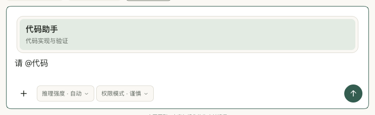
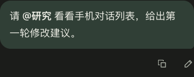

# 消息内的专家提及

用户可以在一句话里点名一个或多个专家，例如「请 @代码审查 看改动，@测试 帮我补回归用例」。输入框、已发消息和编辑重发都在这两个位置显示名字。读者能从句子本身看出用户想让谁做哪件事。

## 从输入到查看历史

在[专家提及原型](../prototype/index.html?demo=expert-mention)打开「让 Nola 更像 Nola」。手机可从[手机预览](../prototype/mobile.html)进入同名会话。首条消息里的「@研究」可以直接点开。下面三张图取自同一个交互原型。

**输入时**，用户键入「请 @代码」，候选同时给出名字和职责。选中「代码助手」后，正在编辑的句子变成「请 @代码助手」，用户可以继续写要求。

**发送后**，名字仍在原句中。复制按钮复制整句，点名字则查看这次提及的专家。

**点开名字**，先读专家职责，再决定是否查看本次关联的子会话。关掉资料即可继续读原消息。

## 写消息

| 操作 | 用户看到的行为 |
| --- | --- |
| 输入 `@` | 在光标附近打开当前 Host 的专家候选。支持句首、句中、换行和中文连续输入，例如「请@测试」。光标右边已有的文字保留。邮箱中的 `@`、粘贴的文字和正在组词的输入法文本按普通文本处理。 |
| 输入部分名字 | 按名称或职责筛选。空查询时先列本会话成员，再列其余可用专家。同名项显示职责或所属配置等可辨识信息。没有匹配时保留原文，用户可以继续输入或关闭候选。 |
| 选择候选 | 只替换光标处的查询片段，插入一个完整的 `@名字`。光标落在名字之后，原键盘和输入焦点保留。上下键移动候选，回车确认，Esc 收起并保留字面文本。中文输入法组词期间，回车先交给输入法。 |
| 改句子 | 左右键可以越过整个名字，名字末尾按退格一次移除整段，撤销可恢复。同一专家可在不同位置出现。复制、分享和粘贴纯文本得到可读的 `@名字`，需要重新选人才能恢复身份。 |
| 发送 | 仍按平常的发送键提交。仅点名字却没有正文或附件时，焦点留在草稿，并提示「写下想请专家做的事」。准入成功后清空本条草稿，下一条可以直接和 Nola 说话。失败保留文字、附件与提及。 |

打开、筛选和选择候选只编辑当前草稿。首次发送并获准时才加入成员。已有成员默认沿用本会话的配置；若要改用目录里的新版，单独确认重新引入。

桌面候选贴近插入点，随窗口边缘调整方向。手机在输入栏上方展开紧凑列表，键盘保持可见，整行可点。正文里的名字与周围文字共用字号、基线和行距，采用主题强调色和略重字重，保留可见的 `@`。名字随正文换行，深色、高对比度和大字号下仍能辨认。读屏按句子顺序读出「提及专家，测试」，并播报当前候选；输入栏外无需再占一行显示已选人。

### 各端入口

| 客户端 | 选人与查看 |
| --- | --- |
| macOS、Web、Windows Tauri | 在输入位置键入 `@`，用指针或上下键选人。发送后可用 Tab 聚焦名字，再按回车打开资料。Windows 桌面壳沿用 Web 编辑器。 |
| iOS、Android | 输入栏上方显示候选。点整行插入名字；发送后点气泡里的名字打开资料。返回聊天保留原草稿。 |
| 交互式 CLI | 输入 `@`，用上下键选择、回车插入，继续写要求后发送。已发消息保留可读名字，通过 `/edit` 编辑原消息。 |

## 发出以后

- 消息仍以用户为作者，名字留在原句。点名字查看该次提及的专家名与职责；已有对应子会话时，可从详情查看只读历史。专家改名、归档后，历史保留发送时的名字。查看资料不会启动任务。
- 用户向主 Agent 发送一条消息。主 Agent 能看到句子和明确点名的对象，按需分工并统一回复。只有真实派发后才展示相应任务进度。下一条即使没有点名，主 Agent 仍可在同一主会话内继续已有协作。
- 编辑重发恢复原文、原位置与原专家身份。用户可以删掉其中一个名字、换人或只改正文，再从原编辑点在同一主会话重发。已失效的提及标在原处，提供「重新选择」和「转为普通文字」。发送前先解决冲突，避免回溯后才发现无法提交。
- 当前专家历史里的「回到主会话继续」恢复父会话草稿，在插入点带入该成员的提及。草稿切换、撤销或移除名字只改变这份草稿，已建立的专家上下文仍可阅读。

## 编辑示例

假设第一轮已经请「研究」核对资料，第二轮请「代码助手」检查实现，第三轮是普通追问。在第二轮点「编辑重发」，删去「@代码助手」再提交。收到准入回执后，第一轮及其研究记录仍可读，第二轮从修改后的请求重新生成，第三轮及被替换轮次派出的专家记录退出当前时间线。输入栏里另写的草稿仍属于原主会话。

如果「代码助手」在第二轮发送后已重新引入，点击旧名字仍打开旧资料。编辑旧消息时，原位置继续显示原名字。提交遇到身份冲突可重新选人，或将提及转为普通文字再提交。在用户完成处理前，原消息和其后的回复仍可阅读。关闭编辑放弃本次修改。

| 入口 | 可执行的操作 |
| --- | --- |
| 已发消息中的名字 | 查看发送时的资料，进入该次绑定的子会话 |
| 当前子会话 | 阅读任务，回到主会话，在原草稿中带入该专家 |
| 旧配置子会话 | 阅读旧任务，关闭后回到上一级界面 |
| 仅可读的镜像会话 | 阅读、复制原文。编辑重发需要在持有该会话的 Host 上操作 |

## 跨端验收

以下为验收场景。用同一组重名专家，分别在 macOS、iOS、Android、Web、Windows Tauri 和交互式 CLI 完成下面的操作。图形端留存候选、已发消息和编辑态截图，CLI 留存终端记录。候选菜单测试需区分选中和发送两次操作，仅打开原型不计入原生客户端验证。

1. 在「请看这段」中间插入两个专家，包含中文输入法确认和名字前的 emoji。核对前后文字、光标、候选身份以及确认时的消息数。手机检查键盘遮挡，桌面检查键盘独立操作。
2. 两次点名同一专家，再删除、撤销其中一处。切换会话并返回，核对每个位置和当前草稿。复制到新草稿应得到纯文本；输入邮箱或手写同名文本应能正常发送。
3. 从发送、历史重开走到编辑重发，改掉第二个专家。检查主会话 ID、可见顺序、点开名字的对象和下一条草稿。浅色、深色、大字号与读屏各检查阅读顺序和辨识度。
4. 模拟目录改名、配置过期、Host 变更和确认回执丢失。核对恢复操作、原草稿和消息数。另用真实模型验证一次明确要求协作的请求，沿主会话、专家 Task、子会话和主回复核对实际归属。

执行与兼容设计见[主 Agent 与专家的统一执行契约](../../architecture/模块/10-Goal任务与子代理/EXPERT_SUBAGENT_EXECUTION.md)。
