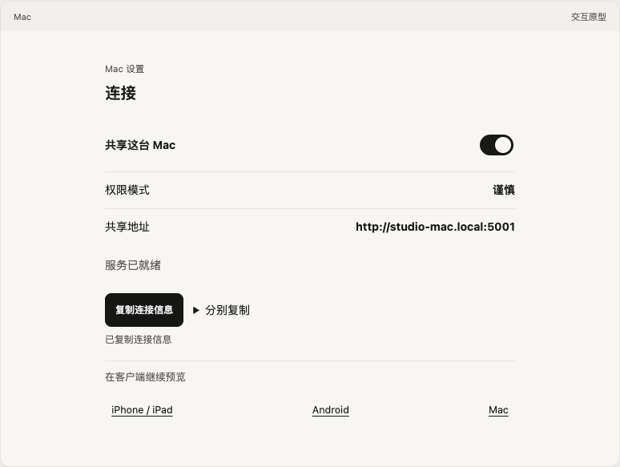
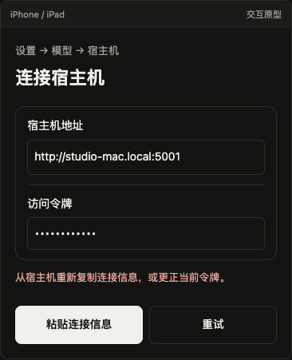
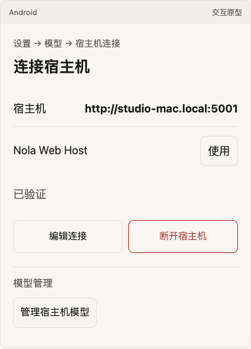

# 连接宿主机

从手机使用书房的 Mac，用户要完成三件事。在 Mac 上开启共享，将连接信息带到手机并验证，然后在需要的地方选择该宿主机或打开它的管理页。开启共享、保存配对、选择对话使用的模型和批准一次工具操作，各有独立的控件和结果。

## 从哪里进入

| 所在位置 | 入口和主操作 | 完成后去哪里 |
| --- | --- | --- |
| 提供服务的 Mac | Nola 设置 → 连接 → 共享这台 Mac。选择权限模式，开启共享，等到服务就绪，点「复制连接信息」。菜单也能分别复制地址或令牌。 | 当前页继续显示运行状态和共享地址。在这里关闭共享会停止由该开关启动的服务。 |
| 连接另一台宿主机的 Mac | 同一设置页的「连接到 Nola 服务器」。粘贴配置或手动填写，点验证。 | 设置显示实际响应的宿主机。若响应提供消息渠道管理入口，可以打开该宿主机的管理页。 |
| iPhone / iPad | 设置 → 模型 → 宿主机。也可从插件库要求访问宿主机的地方进入配对表单。 | 从设置进入会保存 Host 模型配置，从插件库进入会继续打开插件管理页，关闭后回到插件库。通过明确的模型选择流程进入时，选择回调可以选用该 Host。 |
| Android | 设置 → 模型 → 宿主机连接。打开连接编辑器，点「保存并验证」或键盘「完成」。 | 保存后回到宿主机标签。点「使用」才将它选作新会话默认；管理模型会打开宿主机的 Web 页面，系统返回键回到 Nola。 |
| Web 浏览器 | 打开提供服务的地址。从设置 → 连接可查看当前 Host 和登录状态；受保护页面引导用户输入令牌。 | 登录后回到发起请求的站内页面。退出只撤销当前浏览器会话。回环本机信任、已登录会话是两种不同状态。 |
| Windows 桌面 | Tauri 主窗口加载它启动的本机 Host，通过共享 Web 的设置 → 连接查看状态。 | 主窗口限于启动页与本次 Host 的 origin。用户访问另一台宿主机的 Web 服务时，使用浏览器打开其地址。 |
| CLI | 服务提供方可运行 `nola server --host 0.0.0.0 --port 5001`；将启动连接信息通过可信途径给客户端。 | 手机使用 Mac 的局域网地址或可解析的主机名。可选 Tailcat 连接有独立的 `nola web --connect-host --help`，需要预期 Host ID、受信助手与它的校验值，并从标准输入读取既有 Host 令牌。桥接建立后浏览器仍使用独立 Web 会话。关闭桥接仅断开该通道。 |

## 可操作原型与原型图

[Mac 共享](../prototype/scenarios.html?scene=share-host&platform=mac) · [Mac 连接另一台宿主机](../prototype/scenarios.html?scene=host-pair&platform=mac) · [iPhone / iPad 配对](../prototype/scenarios.html?scene=host-pair&platform=ios) · [Android 配对](../prototype/scenarios.html?scene=host-pair&platform=android) · [Web 登录](../prototype/scenarios.html?scene=web-login&platform=web)

从仓库根目录运行 `python3 -m http.server 8071 --bind 127.0.0.1 --directory docs/design/prototype`，打开 `http://127.0.0.1:8071/scenarios.html?scene=share-host&platform=mac`。开启共享、复制，再选手机继续预览。直接进入手机原型也可点「粘贴连接信息」，它会填入同一个「书房 Mac」样例。所有样例都留在页面内存，复制和粘贴不会接触系统剪贴板。

右侧「下次演示回执」可以指定下一次的启动失败、令牌拒绝、身份不符、离线或保存失败。选好回执后仍要在产品界面发起操作。直接点击状态目录则用于检查单一画面。「在客户端继续预览」和回执选择器属于评审导航。

| Mac 共享就绪 | 手机令牌被拒绝 | Android 已验证 |
| --- | --- | --- |
|  |  |  |

## 状态、操作和反馈

| 用户遇到的状态 | 界面与操作 | 必须满足的结果 |
| --- | --- | --- |
| 共享关闭或启动中 | Mac 开关旁显示服务状态。运行时展示生效的权限模式，服务就绪后才提供复制操作。 | 启动中可关闭，也可重新开启。旧进程的超时、退出或握手回调只处理旧启动。 |
| 首次连接 | 说明在 Mac 的哪个页面开启共享。粘贴只填草稿，也可手动输入。令牌遮盖显示。 | 点验证前不发起连接。iOS 使用系统粘贴控件，空剪贴板仍可手动填写，无效配置提示重新复制。 |
| 手动输入或修改地址 | 键盘「下一项」切换输入，点空白收起键盘并保留草稿。新地址需要自己的令牌。Android 只对 HTTPS 或已有指纹显示证书字段。 | 输入地址时不把原目的地的令牌、证书指纹或导入的身份带到新目的地。 |
| 验证中 | 按钮显示进度，防止重复提交。iOS「取消验证」保留草稿，再关闭有改动的表单才确认放弃。Android 取消编辑器会停止本次验证。Mac 可取消验证并保留草稿，编辑字段、切离连接分类或关闭设置窗口会使旧验证失效。 | 取消或离开验证表单后，迟到回执不得把已取消的连接标为成功。验证期间，移除已有绑定与提交验证不能同时执行。 |
| 令牌被拒绝或不可达 | 令牌错误时提示重新从对应宿主机复制；不可达时检查服务、地址和网络。反馈贴近验证按钮。 | 可以在原表单修改重试；保留本次输入和上次成功配对。 |
| 同地址返回另一身份 | 显示身份不符；用户先核实是否更换了电脑或重建了宿主机。 | 拒绝用新身份覆盖旧绑定。确认要重新信任时，由用户明确忘记原配对，再用新配置连接。 |
| 已验证或保存失败 | 保存完成后才显示已配对，收起首次引导。安全存储失败时显示失败，并给出重试或修复入口。 | 明确区分网络已通、身份已核对、凭据已保存。保存结果由本机存储操作确认。 |
| 打开管理页并返回 | 使用所选宿主机签发的管理入口。iOS 回到原插件库，Android 回到 Nola，Web 登录后回到发起页。 | 返回后配对仍在。打开目录只读取目录，执行、安装和模型生成分别走各自的操作。 |
| 解除配对或切换宿主机 | 明确点移除、忘记或断开，确认后才清除相应设备上的绑定。可以取消并继续使用原连接。 | 解除配对影响当前客户端。停止服务须在服务端操作，停止正在执行的任务须向原宿主机提交取消并等待回执。 |

## 地址、身份、凭据与权限边界

- **地址**　Mac 优先公布可用的私有局域网 IPv4，缺失时尝试 Bonjour 名称。通配监听地址只指定服务端如何监听。手机上的 `localhost` 指向手机自身。普通连接优先选 HTTPS；支持本地明文 HTTP 的客户端限制其范围，实际局域网连通性还取决于系统网络权限、防火墙和名称解析。
- **身份**　导入沿用 1.0.0 基线的 `nola.server.connection` 和 `server.started`，`protocol_version` 为 1。完整配置包含地址、Host ID 与访问令牌，因此整段连接信息需要按凭据传递。未知版本、内嵌账号密码、查询参数、片段和缺少必要字段的配置在导入阶段拒绝。客户端校验自身支持的版本、地址格式、认证返回的身份和权限协议。首次手工配对以成功的认证响应建立信任；导入配置还要对照其中的 Host ID。再次验证时，已保存绑定和导入声明都必须与实际身份一致。目的地址判断包含协议、主机、端口和有效路径。平台规范化大小写或默认端口时仍需保留路径边界。
- **凭据归属**　Mac 保存一个当前远端，替换失败保留原连接。iOS 按目的地保存配对身份和令牌，活动的 Host 模型另行选择。Android 保存一个当前 Host。重新验证同一台已选用的 Host 会更新活动连接；把 A 换成 B 后须重新点「使用」。从模型页或对话设置确认断开后，清除原配对、该 Host 的默认选择和设备授权，保留对话。浏览器会话、手机钥匙串／Keystore 和 Mac 钥匙串各由自己的客户端管理。
- **持久化**　Mac 更新钥匙串与配置时串行处理，配置保存失败会尝试恢复旧令牌。iOS 核对身份后保存令牌，首次令牌写入失败会尝试撤销本次新增的身份。Android 将地址、身份和证书设置作为一次 DataStore 编辑提交，失败路径恢复旧令牌。存储补偿可能失败，平台需要报告实际结果；独立凭据存储和数据库之间没有断电原子事务保证。
- **授权与执行**　Android 已有会话的执行绑定保存地址和可选 TLS 指纹，执行时使用当前可信身份。切换地址或指纹须重新建立连接，同址同证书的旧会话记录本身无法证明宿主机身份始终相同。配对建立的是到指定 Host 的认证关系。服务的权限模式、具体操作所需的批准，以及系统授予文件或设备的权限分别检查。修改新会话默认模型、退出管理页面、撤销浏览器登录都不会替用户批准操作或取消源 Host 的 Run。
- **Web 信任范围**　普通本机回环入口可具有本地信任。标为远端接入的 `--tailcat-ingress` 即使使用回环监听，也按远端身份登录。已登录的远端浏览器可管理 Host 明确开放的资源；仅限 Host 所在电脑的账户和桌面命令继续受本机权限限制。登录页仅在浏览器已有可用访问权时提供「取消」，返回校验过的站内地址。缺少访问权时，取消不能绕过认证。
- **跨浏览器旁观**　另一个已认证的浏览器打开正在运行的会话时显示只读提示。页面在前台读取同一宿主机、同一会话的消息，回复完成后自动显示。批准工具和停止任务仍需在发起任务的浏览器操作。离开页面或切到后台会取消读取。

[Apple 地址与导入规则](../../../shared/apple/Protocol/MobileHostTransportPolicy.swift) · [Mac 服务生命周期](../../../apps/macos/Services/MacManagedNolaServer.swift) · [iOS 配对与凭据](../../../apps/ios/Services/ModelSelectionManager.swift) · [Android 连接与默认模型](../../../apps/android/app/src/main/java/com/nola/ui/screen/models/ModelsViewModel.kt) · [Web 会话设置](../../../apps/web/frontend/src/pages/Settings.svelte) · [远程 Host 与同步架构](../../architecture/模块/14-远程Host与同步/README.md)

## 怎样对照验证

| 路径 | 核对结果 |
| --- | --- |
| 复制 → 配对 → 管理 → 返回 | 核对实际响应的 Host 身份，并在目录中读到该机的内容。从状态栏读到「已连接」只完成第一部分。 |
| 同址身份变更 / 新地址失败 | 先保存 A，再从相同地址返回不同身份；另用地址 B 验证失败。重新打开时 A 仍可用，B 没有取得 A 的凭据或授权。 |
| 验证中取消 | 用延迟返回的隔离服务开始验证，在手机取消或 Mac 切离设置后放行原响应，核对表单、存储和旧连接。 |
| 断开与撤销 | 分别验证 Android 的默认选择、iOS 单一目的地令牌、Mac 选中的保存地址，以及两个独立浏览器的退出结果。 |
| 窄屏、主题与点击 | 原型在明暗主题、窄屏和减少动效下走用户入口；原生应用检查系统键盘、焦点、返回和可取消的确认。 |

## 验证层次

- Mac：协议导入、源地址比较、局域网地址选择、凭据写入失败、配置写入回滚，以及独立数据库重开测试。
- Mac 实际宿主机：测试启动隔离的 Nola Server，使用生产客户端验证加密设置接口、错误令牌拒绝和宿主身份拒绝，不以 Python 模拟服务代替这一用例。
- Android：连接规则与 API 单元测试；模拟器上执行粘贴、显式连接、失败重试、取消后迟到回调、Keystore 配对保存及错误身份保留旧凭据。
- Android 实际宿主机：通过 adb reverse 连接独立 Nola Server，使用生产 API 客户端完成认证握手；只向指定的测试用户暂存连接信息，用后移除。
- 运行 `python3 scripts/test_real_ios_host_pairing.py` 可启动隔离的本机宿主机，复验 iOS 模拟器的五条输入与配对操作。测试从插件库进入配对页，完成认证，打开宿主机插件目录并返回客户端。连接表单还覆盖错误令牌、系统粘贴、重新验证和忘记配对。可用 `--binary` 指定已构建的 CLI。
- Android 模拟器的 `HostKeyboardProductTest` 检查系统输入法可见性、输入内容和实际目录。在已配对的宿主机上预置独有的模型名称，进入浏览器后查找该名称，再返回 Nola 并断开。
- 移动 Web 的 `mobile_host_touch.cjs` 在窄屏触摸模式下验证输入焦点、页面滚动和连接页返回，并从宿主机读取登录和退出后的会话状态。

实际双设备的 Wi-Fi、Bonjour、防火墙和网络切换仍需要单独的网络环境验收；本机回环连接或模拟器测试不证明这些条件都可用。配对测试也不能替代远端对话、长任务和工具审批的完整验收。

### 2026-11-20 实现复核

- Mac 的三个专项用例分别检查真实隔离 Host 的复制与认证、同址换身份与重开、验证中取消／切换分类／关闭窗口。iPhone 模拟器的两个 UI 用例和七个原生测试覆盖更改地址后的令牌隔离、取消与凭据保存失败的补偿。
- Android 在 API 35 模拟器上完成 13 项设备回归。测试用独立的 A、B 两台 Host 核对换机后的显式选择、管理页读取、慢请求取消、确认断开，并检查模型页与已打开的对话设置及时反映新绑定。
- Web 用两台隔离 Host 区分直连和远端入口，再用两个浏览器验证退出范围。CLI 用实际二进制区分 Host ID 不符、监听角色不符及缺少助手。Windows 桌面壳在 macOS 上做共享界面和桥接回归，原生 WebView2、系统托盘和跨设备 Tailcat 隧道仍需另行验收。
- 浏览器中的原型图来自合成状态。上面记录的端侧测试使用本机服务与隔离数据；本次不涉及付费模型、真实手机键盘或双设备物理网络。

### Tailcat 实际连接

连接页的「已配对」表示应用保存了通过验证的 Host 身份。要验收 Tailcat，还需观察客户端取得临时授权，并确认后续业务请求确实到达隧道另一端。macOS、iOS 模拟器和 Android 模拟器的专项测试将初始地址限制为身份检查与授权，再从真实宿主读回预置会话或刚创建的房间。普通构建是否包含原生 SDK 另行检查。

Web 通过 CLI 创建的临时地址登录。桌面端改名后，移动视口打开同一会话并读回新标题。Linux arm64 虚拟机另用原生助手连接 macOS 宿主并创建会话，断开后宿主仍能按 ID 读回。关闭通道后，只有助手成功退出才能确认「已关闭」；仍在退出和退出异常各有独立回执，三种结果都不会取消任务。Windows 原生壳、两部物理设备和网络切换仍待验收。[各平台配置与复验范围](../../../transport/tailcat/README.md#platform-checks-2026-11-20)

## 远端长任务验收

`scripts/test_real_remote_host_long_tasks.py --nodes 200` 从真实 Web 页面发起任务，使用当前选定的真实模型和独立 Host/Store。200 个随机命名节点逐个依赖前一个节点，另外核对缺失链接恢复、10 个检查点和最终报告；独立读取已提交的工具记录与文件结果，拒绝使用 Bash、Code Mode 或子任务绕过逐步读取。`--smoke` 只有 4 个节点，仅用于验证测试脚本，不计入长任务验收。

测试期间离开页面、关闭原标签页再打开，宿主机必须继续推进同一个 Run。另一个真实进程用例先确认未批准时没有执行，再只批准本次具体命令；客户端重新连接后停止任务，核对物理进程停止写入、只启动一次、没有完成产物，并验证取消后的下一轮对话。测试不拦截或伪造模型响应。

在上述验收通过后，`--resume-evidence <本次隔离证据目录>` 重启 Host 进程并打开全新浏览器，要求从保存的上下文恢复初始随机标记。追问不包含标记答案，项目文件也不保存答案；旧 Run 不得重放，报告和检查点保持正确。原验收回执与重启后的回执分别保留。

`scripts/test_real_android_remote_long_task.py --serial <模拟器> --user <隔离用户> --avd <指定 AVD> --steps 120` 从 Android 生产界面选择已配对宿主机，实际审阅并批准命令，运行两分钟物理作业。退出 Activity 后强制停止客户端进程，再冷启动恢复原对话；核对同一个 Run、一次命令启动、连续 120 次物理进度、随机结果及原助手消息中的最终回复。这是两分钟作业验收，不冒充 120 次模型工具调用。必须使用专用模拟器的可丢弃次要用户，不能使用主用户或真机生产数据。

Android 权限申请使用认证宿主机提供的 `safe_review_text` 展示具体命令；不以原始工具参数替代安全审阅文本。缺少审阅文本时禁用两种允许操作，仍可拒绝。紧凑卡片保留执行位置和决定按钮，完整文本、数据边界与有效范围放入可滚动详情，避免长命令将按钮挤出屏幕。设备本地权限继续沿用原流程，版本 1 协议不变。

## 历史验收（2026-11-10）

Mac 最终复检 19 项、iOS 模拟器 11 项、Android 单元测试 17 项，以及 Android 测试用户上的 4 项设备验收均通过，没有跳过。设备端验收包含真实 Nola Server 握手、粘贴后显式连接、失败重试、取消后迟到回包，以及 Keystore 凭据保持测试。Mac 的实际 Server 用例也验证错误令牌和错误身份被拒绝。

iOS 复核还发现系统粘贴控件在表单中可能显示为空行，已改为有明确标题的用户点击入口；渲染测试使用本机文字识别检查按钮文案确实出现在截图中。最终 11 项 iOS 测试通过，0 跳过。

补充远端长任务验收：Web 的真实模型任务持续约 30 分钟，200 次已提交节点读取、10 个检查点及报告均与独立预期一致，中途发生两次非空上下文压缩。浏览器断开／冷标签恢复未重复提交 Run；另一条命令被取消后，物理文件停止增长，后续对话仍可完成。上游出现两次真实传输错误并恢复，最终原任务为 `answered`。Host 重启后，新浏览器的一次真实追问成功恢复原随机标记，原输出未被重做。生成响应均来自所选真实模型；测试中继仅放行指定模型的 Responses 生成请求，其他路径被本地拒绝，不计为上游错误或生成成功。

Android 两分钟作业的完整回执通过：退出及强制停止客户端期间宿主机继续执行，冷启动后对应原 Run，实际作业启动一次，120 次连续进度、随机结果和原助手消息最终回复均正确。该轮模型生成请求 5 次，全部成功，没有伪造生成响应。权限事件、SSE 及切换会话单元回归共 16 项，缺失审阅文本的界面测试 1 项通过；独立长任务 oracle 回归 7 项通过。

随后以 90 秒真实作业复跑，增加对完整命令及隔离执行目录的审批校验，并要求最终回复出现后“停止”按钮恢复为“发送”；完整链路与终态界面校验均通过。

这组长任务结果覆盖 Web 客户端与 Android 模拟器链路；不代表 Mac／iOS 原生客户端已经完成同样的长任务验收，也不代表双设备真实 Wi-Fi 网络已验收。
